# Alignment Metrics

## Guide contents

- [Overview](#overview): module purpose, example applications, and system requirements.
- [Usage](docs/usage.md): main command entry points and links to the full command guides.
  - [Compute all metrics](docs/usage-all.md): running the full workflow, inputs, outputs, tips, and CLI options.
  - [Compute coverage metrics](docs/usage-coverage.md): running coverage-only analysis, inputs, outputs, tips, and CLI options.
  - [Compute accuracy metrics](docs/usage-accuracy.md): running accuracy-only analysis, inputs, outputs, tips, and CLI options.
  - [Compute read metrics](docs/usage-read.md): running read-metrics analysis, inputs, outputs, tips, and CLI options.
  - [Compute GC bias metrics](docs/usage-gcbias.md): running GC bias analysis, inputs, outputs, tips, and CLI options.
  - [Build labeled BED inputs](docs/usage-merge-and-label-bed.md): building labeled BED inputs for label-stratified runs.
- [File formats](docs/file-formats.md): custom format schemas used by Alignment Metrics.
- [Metrics](docs/metrics.md): metric file schemas, definitions, denominators, and constraints.
- [Troubleshooting](docs/troubleshooting.md): common issues and resolutions.
- [Appendix](docs/appendix.md): concepts, terminology, and glossary entries.
- [Release notes](CHANGELOG.md): notable changes by version.

## Overview

The Alignment Metrics tool computes read, coverage, base-accuracy, and GC bias metrics from an aligned BAM file.
Use the Alignment Metrics tool for routine QC, targeted-enrichment review, duplex-specific assessment, and homopolymer-focused analysis.

At a glance: **BAM + optional BED + required reference for coverage, accuracy, and GC bias** -> **read, coverage, accuracy, and GC bias metrics**.

The Alignment Metrics tool exposes five analysis commands and one helper executable.
The commands overlap by design.
`all` is the default entry point for the most common workflow.
The single-purpose commands exist for focused reruns and workflows that do not need every input.

- `all` runs coverage, accuracy, and read metrics together, and can also emit GC bias metrics when `--enable-gc-bias-metrics` is set.
- `coverage` computes depth, distribution, targeted-enrichment, and optional homopolymer coverage outputs.
- `accuracy` computes base-level error metrics, substitution breakdowns, cluster-size summaries, and optional homopolymer error metrics.
- `read` computes read-count, read-length, and targeted-enrichment read summaries without requiring a reference.
- `gcbias` computes GC bias metrics from the reference and aligned reads.
- `merge_and_label_bed` prepares the labeled BED input used by `--stratify-by-label`.

### Duplex base-type filtering

Coverage and accuracy metrics can apply base-level duplex filtering with `--min-base-type`.
For duplex data, `concordant` is the strictest and usually the most informative setting for post-filter metrics.
For simplex or consensus BAMs without YC tags, leave `--min-base-type` at `simplex`.
See [Definitions for duplex reads](docs/appendix.md#definitions-for-duplex-reads) for the duplex base-type terms.

### Homopolymer, targeted-enrichment, and label-stratified analysis

Add `--enable-homopolymer-metrics` to `coverage`, `accuracy`, or `all` to compute homopolymer metrics.
Add `--enable-target-enrichment-metrics` to `coverage`, `read`, or `all` to compute targeted-enrichment summaries from a BED file.
Add `--stratify-by-label` with a labeled BED file to split outputs by region label in one run.
See [Labeled BED for `--stratify-by-label`](docs/file-formats.md#labeled-bed-for---stratify-by-label) for the BED schema.

### Example applications

Expand an example below to see the typical use case, the matching command guide, and a representative command.

Routine QC for a duplex whole-genome or panel BAM

- **Data type:** Duplex BAM from demultiplexing or post-consensus processing.
- **Objective:** Produce the complete output set from the Alignment Metrics tool for read, coverage, and accuracy review.
- **Usage page:** [`all` example command](docs/usage-all.md#example-command).
- **Command:** `alignment_metrics all`

Coverage-only review for panel design or depth troubleshooting

- **Data type:** Any aligned BAM, with or without duplex base typing.
- **Objective:** Inspect depth histograms, coverage thresholds, and optional target-enrichment coverage uniformity.
- **Usage page:** [`coverage` example command](docs/usage-coverage.md#example-command).
- **Command:** `alignment_metrics coverage`

Error profiling for consensus or duplex datasets

- **Data type:** Duplex or intermolecular-consensus BAM.
- **Objective:** Quantify base-error rates, substitution patterns, and cluster-size effects.
- **Usage page:** [`accuracy` example command](docs/usage-accuracy.md#example-command).
- **Command:** `alignment_metrics accuracy`

### System requirements

| | Requirements |
|:--|:--------------|
| CPU | The Alignment Metrics tool scales well up to 8 cores on a modern fourth-generation Intel Xeon or fourth-generation AMD EPYC CPU. |
| Memory | At least 16 GiB with 8 threads. Memory usage scales with region size and coverage depth. |
