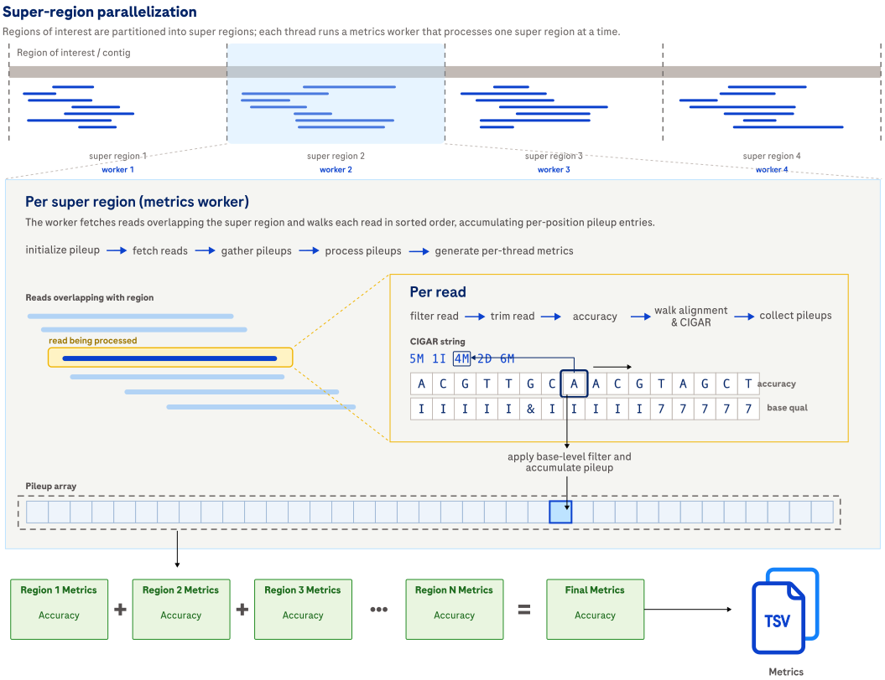

# Compute accuracy metrics

## How it works

`alignment_metrics accuracy` computes base-level error summaries from the BAM and reference.
It reports overall error rates,
substitution breakdowns,
optional read-type and cluster-size breakdowns,
and optional homopolymer-specific error outputs.

Use this command when the analysis question is error profiling.
If you also need coverage and read outputs,
use [`all`](usage-all.md).



Expand the details below for implementation details about how this command traverses reads and aggregates error outputs.

<details>
<summary>Design details.</summary>

The command traverses aligned reads against the reference,
builds per-position pileup information,
and aggregates substitutions,
insertions,
deletions,
and skipped positions into per-thread metrics containers.
For duplex BAMs,
base-type decoding lets the run distinguish concordant,
simplex,
and discordant bases.
For consensus BAMs,
the run can also stratify the error outputs by cluster size and cluster composition.

</details>

## Example command

```shell
alignment_metrics accuracy \
  --bam INPUT.bam \
  --reference REFERENCE.fa \
  --bed REGIONS.bed \
  --output-dir OUTPUT_DIR \
  --threads 8
```

For duplex data,
add `--min-base-type concordant` for duplex-filtered accuracy.
For homopolymer error outputs,
add `--enable-homopolymer-metrics`.

## Input

| Input | Required | Notes |
|:------|:---------|:------------|
| BAM file | Yes | Coordinate-sorted, indexed BAM file passed with `--bam`. |
| Reference FASTA | Yes | Indexed FASTA file passed with `--reference`. |
| BED file | No | Regions of interest passed with `--bed`. |
| Labeled BED file | No | BED file with a comma-separated label list in column 4 when `--stratify-by-label` is enabled. See [File formats](file-formats.md#labeled-bed-for---stratify-by-label). |

## Output

Accuracy outputs are written to `accuracy/` under the selected output directory,
or to `<label>/accuracy/` when label stratification is enabled.

| Output | Description |
|:-------|:------------|
| *base_level_accuracy_summary.tsv* | Summary counts, percentages, and Phred-scaled error scores for substitutions and indels. See [base_level_accuracy_summary.tsv](metrics.md#base_level_accuracy_summarytsv). |
| *errors_by_substitution_type.tsv* | Substitution counts by substitution class and, when available, by strand, read type, or cluster type. See [errors_by_substitution_type.tsv](metrics.md#errors_by_substitution_typetsv). |
| *errors_by_read_type.tsv* | Error counts by strand and read type when the dataset carries that metadata. See [errors_by_read_type.tsv](metrics.md#errors_by_read_typetsv). |
| *errors_by_cluster_size.tsv* | Error counts stratified by consensus-cluster size and cluster composition when the dataset carries that metadata. See [errors_by_cluster_size.tsv](metrics.md#errors_by_cluster_sizetsv). |
| *hp_errors.tsv* | Homopolymer error summary emitted when `--enable-homopolymer-metrics` is set. See [hp_errors.tsv](metrics.md#hp_errorstsv). |
| *qscore_stats.tsv* | Predicted-versus-empirical quality score summary. See [qscore_stats.tsv](metrics.md#qscore_statstsv). |

## Tips for analysis

Expand the details below for practical analysis recommendations and common pitfalls.

<details>
<summary>Show tips for analysis.</summary>

- Keep `--min-base-type simplex` for simplex or consensus BAMs that do not carry YC tags.
- Raise `--min-base-quality` or use `--min-base-type concordant` only when you intentionally want a stricter post-filter error surface.
- Use `--max-alt-allele-fraction` to suppress likely variant signal when you want a sequencing-error view instead of a variant-inclusive mismatch view.

</details>

## CLI options

This command also accepts the common `-h, --help`, `-v, --version`, and `-l, --log-level` options.
Required parameters are highlighted in **bold**.

### Input options

| Parameter | Description | Value(s) |
|:----------|:------------|:---------|
| **--bam** | Path to the coordinate-sorted, indexed BAM file whose accuracy metrics are calculated. | Path to a sorted and indexed BAM file. |
| **--reference** | Path to the indexed FASTA used to compare reads against the reference. | Path to an indexed FASTA file. |

### Output options

| Parameter | Description | Value(s) |
|:----------|:------------|:---------|
| --output-dir | Path to the output directory where accuracy outputs are written. | Path to a directory. Default: `.`. |
| --overwrite | Overwrite existing output files. Without this flag, the Alignment Metrics tool reports an error if any output file already exists. | Flag. Default: off. |
| --output-prefix | Prefix prepended to all output filenames with an underscore separator. For example, `--output-prefix SAMPLE` produces `SAMPLE_coverage_stats.tsv`. | Filename component. Default: none. |

### Region options

| Parameter | Description | Value(s) |
|:----------|:------------|:---------|
| --bed | Path to a BED file that restricts the run to regions of interest. | Path to a BED file. |
| --stratify-by-label | Interpret BED column 4 as a comma-separated label list and emit one output subtree per label. Requires `--bed`. | Flag. |

### Read filtering options

| Parameter | Description | Value(s) |
|:----------|:------------|:---------|
| --exclude-flags | Exclude alignments whose FLAG field overlaps the supplied decimal integer. | Integer. Default: `3332`. |
| --min-mapping-quality | Minimum mapping quality for accuracy metrics and post-filter read counts. | Integer from 0 to 255. Default: `4`. |
| --trim-start-length | Number of bases trimmed from the start of each read before metrics are calculated. | Integer from 0 to 50. Default: `0`. |
| --trim-end-length | Number of bases trimmed from the end of each read before metrics are calculated. | Integer from 0 to 50. Default: `0`. |

### Base filtering options

These filters evaluate individual bases at each alignment position.

| Parameter | Description | Value(s) |
|:----------|:------------|:---------|
| --min-base-quality | Minimum base-call quality for accuracy metrics. | Integer from 0 to 255. Default: `30`. |
| --min-base-type | Minimum duplex base type for accuracy metrics. | One of `discordant`, `simplex`, or `concordant`. Default: `simplex`. |
| --skip-base-type-decoding | Treat all bases as simplex bases and skip YC-tag decoding. | Flag. |
| --include-ambiguous-reference-bases | Include IUPAC ambiguous reference bases (R, Y, S, W, K, M, B, D, H, V) as valid positions. When enabled, only N/n reference positions are excluded; query bases matched against an ambiguous reference that is not N are not counted as errors when consistent with the ambiguity code. | Flag. |

### Accuracy metrics options

| Parameter | Description | Value(s) |
|:----------|:------------|:---------|
| --min-depth | Minimum depth threshold for positions that contribute to accuracy metrics. | Integer greater than or equal to 0. Default: `10`. |
| --max-alt-allele-fraction | Threshold used to classify high-alt-fraction observations as likely variant signal instead of sequencing error. | Float from 0 to 1. Default: `0.1`. |
| --max-cluster-size-bin | Maximum cluster-size bin for `errors_by_cluster_size.tsv`. | Integer greater than 0. Default: `50`. |

### Homopolymer metric options

| Parameter | Description | Value(s) |
|:----------|:------------|:---------|
| --enable-homopolymer-metrics | Enable homopolymer accuracy metrics. | Flag. |
| --min-homopolymer-length | Minimum homopolymer length considered for homopolymer metrics. | Integer from 2 to 30. Default: `2`. |
| --max-homopolymer-length | Maximum homopolymer length considered for homopolymer metrics. | Integer from `min-homopolymer-length` to 30. Default: `30`. |
| --homopolymer-allow-heterogeneous-insertions | Allow heterogeneous insertions when evaluating homopolymer errors. | Flag. |

### Discordant homopolymer masking options

| Parameter | Description | Value(s) |
|:----------|:------------|:---------|
| --skip-discordant-homopolymer-masking | Disable discordant homopolymer masking in duplex reads. | Flag. |
| --min-base-quality-for-hp-masking | Base-call quality threshold used for non-duplex masking logic or when base-type decoding is disabled. | Integer from 0 to 255. Default: `5`. |

### Performance options

| Parameter | Description | Value(s) |
|:----------|:------------|:---------|
| --region-size | Region size used for parallel work partitioning. | Integer greater than 0. Default: `10000`. |
| --reference-padding | Extra reference bases fetched on the 3' side of each region. | Integer greater than or equal to 0. Default: `1000`. |
| --threads | Number of worker threads. | Integer from 1 to the available thread count. Default: `1`. |
