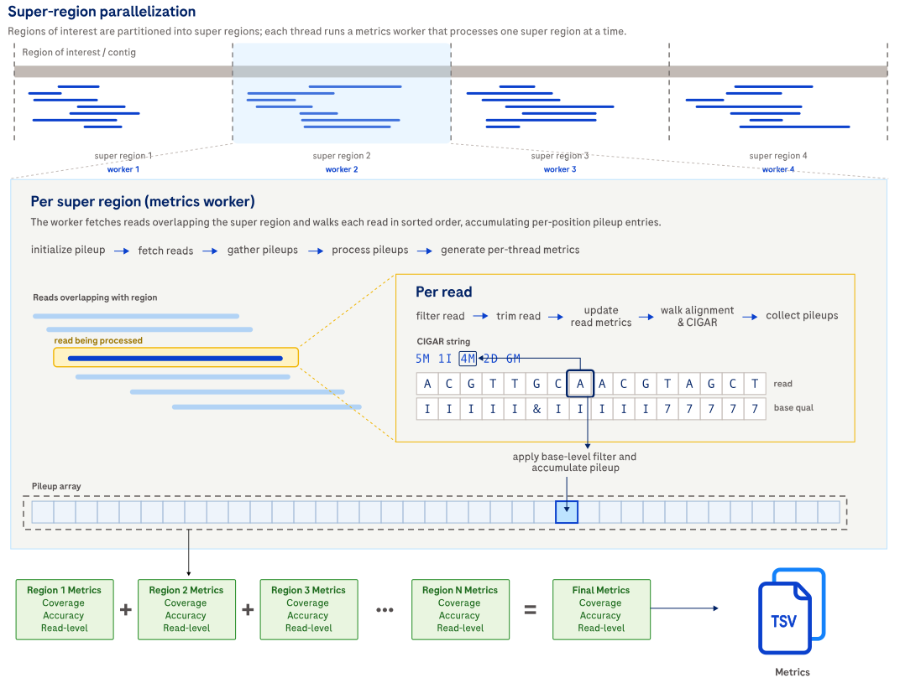

# Compute all metrics

## How it works

`alignment_metrics all` is the standard entry point for Alignment Metrics.
It runs the `coverage`, `accuracy`, and `read` workflows together with one shared set of inputs,
filters,
and output directories.
When `--enable-gc-bias-metrics` is set,
it also emits GC bias outputs.

Use this command when you want the complete Alignment Metrics deliverable.
Use the specific commands only when you need a narrower rerun,
a smaller output surface,
or a workflow that does not need every `all` input.



Expand the details below for implementation details about how this command partitions work and writes outputs.

<details>
<summary>Design details.</summary>

The command partitions the analysis regions,
assigns region work to per-thread metrics workers,
and merges the per-thread metrics at the end of the run.
Coverage metrics,
accuracy metrics,
and read metrics share the same BAM traversal and filtering settings where applicable.
If `--enable-gc-bias-metrics` is set,
the run also emits GC bias outputs from the shared traversal.
If `--enable-homopolymer-metrics` is set,
the run also identifies homopolymer regions from the reference and emits homopolymer-specific outputs.
If `--stratify-by-label` is set,
the run writes one output subtree per label instead of one shared output subtree.

</details>

## Example command

```shell
alignment_metrics all \
  --bam INPUT.bam \
  --reference REFERENCE.fa \
  --bed TARGETS.bed \
  --output-dir OUTPUT_DIR \
  --min-base-type concordant \
  --threads 8
```

Add `--enable-homopolymer-metrics` when you want homopolymer coverage and homopolymer accuracy outputs.
Add `--enable-target-enrichment-metrics` when the BED file is a targeted-enrichment panel and you want target-enrichment summaries.

## Input

| Input | Required | Notes |
|:------|:---------|:------------|
| BAM file | Yes | Coordinate-sorted, indexed BAM file passed with `--bam`. |
| Reference FASTA | Yes | Indexed FASTA file passed with `--reference`. `all` requires it because the command includes accuracy metrics. |
| BED file | No | Regions of interest passed with `--bed`. If omitted, all contigs in the BAM header contribute. |
| Labeled BED file | No | BED file with a comma-separated label list in column 4 when `--stratify-by-label` is enabled. See [File formats](file-formats.md#labeled-bed-for---stratify-by-label). |

## Output

Metrics are written under the selected output directory.
The command creates one directory per metrics family,
or one directory per region label when `--stratify-by-label` is enabled.

| Output | Description |
|:-------|:------------|
| *coverage/* | Coverage histograms, summary statistics, coverage-threshold summaries, and optional targeted-enrichment or homopolymer coverage outputs. See [Coverage metrics](metrics.md#coverage-metrics). |
| *accuracy/* | Base-level accuracy summaries, substitution breakdowns, cluster-size summaries, and optional homopolymer error outputs. See [Accuracy metrics](metrics.md#accuracy-metrics). |
| *read_metrics/* | Read-count, read-length, and optional targeted-enrichment read outputs. See [Read metrics](metrics.md#read-metrics). |
| *gc_bias/* | GC bias coverage metrics and summary emitted when `--enable-gc-bias-metrics` is set. See [GC bias metrics](metrics.md#gc-bias-metrics). |
| *<label>/coverage/*, *<label>/accuracy/*, *<label>/read_metrics/* | Label-specific output trees emitted when `--stratify-by-label` is enabled. |

## Tips for analysis

Expand the details below for practical analysis recommendations and common pitfalls.

<details>
<summary>Show tips for analysis.</summary>

- Start with `all` for routine Alignment Metrics work, then switch to a specific command only for targeted follow-up.
- For duplex BAMs, `--min-base-type concordant` usually gives the most meaningful post-filter coverage and accuracy outputs.
- For simplex or consensus BAMs without YC tags, keep `--min-base-type simplex` to avoid filtering every base out.
- Use `merge_and_label_bed` before a label-stratified run so the labeled BED is validated and non-overlapping.

</details>

## CLI options

This command also accepts the common `-h, --help`, `-v, --version`, and `-l, --log-level` options.
Required parameters are highlighted in **bold**.

### Input options

| Parameter | Description | Value(s) |
|:----------|:------------|:---------|
| **--bam** | Path to the BAM file whose metrics are calculated. The BAM file must be coordinate-sorted and indexed. | Path to a sorted and indexed BAM file. |
| **--reference** | Path to the reference FASTA used for accuracy metrics and homopolymer metrics. The FASTA must be indexed with a `.fai` file. | Path to an indexed FASTA file. |

### Output options

| Parameter | Description | Value(s) |
|:----------|:------------|:---------|
| --output-dir | Path to the output directory where metrics are written. | Path to a directory. Default: `.`. |
| --overwrite | Overwrite existing output files. Without this flag, the Alignment Metrics tool reports an error if any output file already exists. | Flag. Default: off. |
| --output-prefix | Prefix prepended to all output filenames with an underscore separator. For example, `--output-prefix SAMPLE` produces `SAMPLE_coverage_stats.tsv`. | Filename component. Default: none. |

### Region options

| Parameter | Description | Value(s) |
|:----------|:------------|:---------|
| --bed | Path to a BED file that restricts the metrics calculation to the listed regions of interest. If not specified, all contigs present in the BAM header contribute. | Path to a BED file. |
| --stratify-by-label | Interpret column 4 of the BED file as a comma-separated label list and emit one output subtree per label. Requires `--bed`. | Flag. |

### Read filtering options

| Parameter | Description | Value(s) |
|:----------|:------------|:---------|
| --exclude-flags | Exclude alignments from coverage metrics, accuracy metrics, and post-filter read metrics if any bits in their FLAG field match the supplied decimal integer. | Integer. Default: `3332`. |
| --min-mapping-quality | Minimum mapping quality for coverage metrics, accuracy metrics, and post-filter read metrics. | Integer from 0 to 255. Default: `4`. |
| --trim-start-length | Number of bases trimmed from the start of each read before metrics are calculated. | Integer from 0 to 50. Default: `0`. |
| --trim-end-length | Number of bases trimmed from the end of each read before metrics are calculated. | Integer from 0 to 50. Default: `0`. |

### Base filtering options

These filters evaluate individual bases at each alignment position.

| Parameter | Description | Value(s) |
|:----------|:------------|:---------|
| --min-base-quality | Minimum base-call quality for accuracy metrics and post-filter coverage metrics. | Integer from 0 to 255. Default: `30`. |
| --min-base-type | Minimum duplex base type for accuracy metrics and post-filter coverage metrics. Use `simplex` for simplex or consensus BAMs. | One of `discordant`, `simplex`, or `concordant`. Default: `simplex`. |
| --skip-base-type-decoding | Treat all bases as simplex bases and skip YC-tag decoding. | Flag. |
| --include-ambiguous-reference-bases | Include IUPAC ambiguous reference bases (R, Y, S, W, K, M, B, D, H, V) as valid positions. When enabled, only N/n reference positions are excluded; query bases matched against an ambiguous reference that is not N are not counted as errors when consistent with the ambiguity code. | Flag. |

### Coverage metrics options

| Parameter | Description | Value(s) |
|:----------|:------------|:---------|
| --coverage-distribution-cutoffs | Coverage thresholds included in the coverage distribution summary. | Comma-separated list of integers. Default: `10,20,30`. |
| --skip-uncovered-positions | Exclude uncovered positions from coverage statistics and histograms. | Flag. |
| --max-coverage-bin | Maximum histogram depth bin for coverage histograms. Deeper positions contribute to the `max-coverage+` bin. | Integer greater than 0. Default: `10000`. |
| --enable-gc-bias-metrics | Enable GC bias coverage metrics. Requires non-zero `--reference-padding`. | Flag. |
| --gc-window-size | Sliding window size for GC content computation. Must be smaller than `--region-size` and `--reference-padding`. | Integer from 1 to 1000. Default: `100`. |

### Target enrichment metrics options

| Parameter | Description | Value(s) |
|:----------|:------------|:---------|
| --enable-target-enrichment-metrics | Enable targeted-enrichment metrics for coverage and read outputs. Requires `--bed`. | Flag. |

### Accuracy metrics options

| Parameter | Description | Value(s) |
|:----------|:------------|:---------|
| --min-depth | Minimum depth threshold for positions that contribute to accuracy metrics. | Integer greater than or equal to 0. Default: `10`. |
| --max-alt-allele-fraction | Threshold used to classify high-alt-fraction observations as likely variant signal instead of sequencing error. | Float from 0 to 1. Default: `0.1`. |
| --max-cluster-size-bin | Maximum cluster-size bin for `errors_by_cluster_size.tsv`. | Integer greater than 0. Default: `50`. |

### Read metrics options

| Parameter | Description | Value(s) |
|:----------|:------------|:---------|
| --max-read-length-bin | Maximum histogram length bin for read-length histograms. Longer reads contribute to the `max-read-length+` bin. | Integer greater than 0. Default: `1000`. |

### Homopolymer metric options

| Parameter | Description | Value(s) |
|:----------|:------------|:---------|
| --enable-homopolymer-metrics | Enable homopolymer coverage and homopolymer accuracy metrics. | Flag. |
| --min-homopolymer-length | Minimum homopolymer length considered for homopolymer metrics. | Integer from 2 to 30. Default: `2`. |
| --max-homopolymer-length | Maximum homopolymer length considered for homopolymer metrics. | Integer from `min-homopolymer-length` to 30. Default: `30`. |
| --homopolymer-allow-heterogeneous-insertions | Allow heterogeneous insertions when evaluating homopolymer errors. | Flag. |

### Discordant homopolymer masking options

| Parameter | Description | Value(s) |
|:----------|:------------|:---------|
| --skip-discordant-homopolymer-masking | Disable discordant homopolymer masking in duplex reads. | Flag. |
| --min-base-quality-for-hp-masking | Base-call quality threshold used for non-duplex masking logic or when base-type decoding is disabled. | Integer from 0 to 255. Default: `5`. |

### General metrics options

| Parameter | Description | Value(s) |
|:----------|:------------|:---------|
| --summary-stats-percentiles | Percentiles computed for coverage and read-length summary statistics. | Comma-separated list of integers. Default: `10,25,50,75,90`. |

### Performance options

| Parameter | Description | Value(s) |
|:----------|:------------|:---------|
| --region-size | Region size used for parallel work partitioning. | Integer greater than 0. Default: `10000`. |
| --reference-padding | Extra reference bases fetched on the 3' side of each region. | Integer greater than or equal to 0. Default: `1000`. |
| --threads | Number of worker threads. | Integer from 1 to the available thread count. Default: `1`. |
