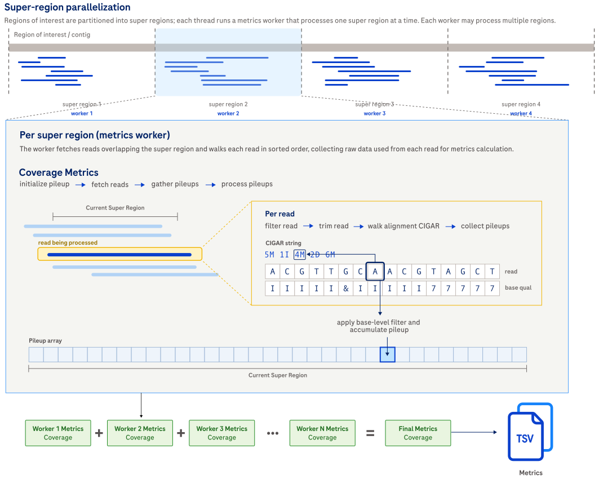

# Compute coverage metrics

## How it works

`alignment_metrics coverage` computes coverage histograms,
coverage summary statistics,
and coverage-threshold summaries.
It can also emit targeted-enrichment coverage summaries and homopolymer coverage outputs.

This is the right command when you only need coverage products.
If you also need read or accuracy outputs,
use [`all`](usage-all.md) instead.



Expand the details below for implementation details about how this command scans regions and accumulates coverage outputs.

<details>
<summary>Design details.</summary>

The command scans the BAM over the selected regions,
accumulates pileup-derived depth information,
and merges per-thread coverage metrics at the end of the run.
With `--min-base-type` and `--min-base-quality`,
it reports both overall coverage and post-filter coverage.
For duplex BAMs,
`concordant` filtering exposes the duplex-specific coverage surface.
When `--enable-homopolymer-metrics` is set,
the command first identifies homopolymers from the reference and then emits homopolymer-only coverage outputs.

</details>

## Example command

```shell
alignment_metrics coverage \
  --bam INPUT.bam \
  --bed TARGETS.bed \
  --reference REFERENCE.fa \
  --output-dir OUTPUT_DIR \
  --threads 8
```

For duplex data,
add `--min-base-type concordant` to review concordant duplex coverage.
For homopolymer coverage,
add `--enable-homopolymer-metrics`.

## Input

| Input | Required | Notes |
|:------|:---------|:------------|
| BAM file | Yes | Coordinate-sorted, indexed BAM file passed with `--bam`. |
| BED file | No | Regions of interest passed with `--bed`. |
| Reference FASTA | Yes | Indexed FASTA file passed with `--reference`. |
| Labeled BED file | No | BED file with a comma-separated label list in column 4 when `--stratify-by-label` is enabled. See [File formats](file-formats.md#labeled-bed-for---stratify-by-label). |

## Output

Coverage outputs are written to `coverage/` under the selected output directory,
or to `<label>/coverage/` when label stratification is enabled.

| Output | Description |
|:-------|:------------|
| *coverage_histograms.tsv* | Depth histogram for the selected regions. See [coverage_histograms.tsv](metrics.md#coverage_histogramstsv). |
| *coverage_stats.tsv* | Coverage summary statistics. See [coverage_stats.tsv](metrics.md#coverage_statstsv). |
| *coverage_distribution_summary.tsv* | Coverage-threshold counts and percentages. See [coverage_distribution_summary.tsv](metrics.md#coverage_distribution_summarytsv). |
| *coverage_histograms_hp.tsv* | Homopolymer-only coverage histogram emitted when `--enable-homopolymer-metrics` is set. See [Coverage metrics](metrics.md#coverage-metrics). |
| *coverage_stats_hp.tsv* | Homopolymer-only coverage summary emitted when `--enable-homopolymer-metrics` is set. See [Coverage metrics](metrics.md#coverage-metrics). |
| *coverage_distribution_summary_hp.tsv* | Homopolymer-only coverage-threshold summary emitted when `--enable-homopolymer-metrics` is set. See [Coverage metrics](metrics.md#coverage-metrics). |
| *mean_coverage_histogram.tsv* | Target-region mean-coverage histogram emitted when `--enable-target-enrichment-metrics` is set. See [mean_coverage_histogram.tsv](metrics.md#mean_coverage_histogramtsv). |
| *coverage_uniformity_summary.tsv* | Target-enrichment coverage uniformity summary emitted when `--enable-target-enrichment-metrics` is set. See [coverage_uniformity_summary.tsv](metrics.md#coverage_uniformity_summarytsv). |
| *gc_bias/gc_bias.tsv* | Per-GC-percentage-bin coverage metrics emitted when `--enable-gc-bias-metrics` is set. See [gc_bias.tsv](metrics.md#gc_biastsv). |
| *gc_bias/gc_bias_summary.tsv* | GC bias summary metrics emitted when `--enable-gc-bias-metrics` is set. See [gc_bias_summary.tsv](metrics.md#gc_bias_summarytsv). |

## Tips for analysis

Expand the details below for practical analysis recommendations and common pitfalls.

<details>
<summary>Show tips for analysis.</summary>

- Use `--min-base-type concordant` for duplex BAMs when the question is duplex-effective coverage, not raw depth.
- Use `--skip-uncovered-positions` only when you intentionally want to ignore uncovered loci in summary statistics.
- Use `--enable-target-enrichment-metrics` only with a true target-panel BED, because very large BED intervals can raise memory use.

</details>

## CLI options

This command also accepts the common `-h, --help`, `-v, --version`, and `-l, --log-level` options.
Required parameters are highlighted in **bold**.

### Input options

| Parameter | Description | Value(s) |
|:----------|:------------|:---------|
| **--bam** | Path to the coordinate-sorted, indexed BAM file whose coverage metrics are calculated. | Path to a sorted and indexed BAM file. |
| **--reference** | Path to the indexed FASTA used to compare reads against the reference. | Path to an indexed FASTA file. |

### Output options

| Parameter | Description | Value(s) |
|:----------|:------------|:---------|
| --output-dir | Path to the output directory where coverage outputs are written. | Path to a directory. Default: `.`. |
| --overwrite | Overwrite existing output files. Without this flag, the Alignment Metrics tool reports an error if any output file already exists. | Flag. Default: off. |
| --output-prefix | Prefix prepended to all output filenames with an underscore separator. For example, `--output-prefix SAMPLE` produces `SAMPLE_coverage_stats.tsv`. | Filename component. Default: none. |

### Region options

| Parameter | Description | Value(s) |
|:----------|:------------|:---------|
| --bed | Path to a BED file that restricts the run to regions of interest. | Path to a BED file. |
| --stratify-by-label | Interpret BED column 4 as a comma-separated label list and emit one output subtree per label. Requires `--bed`. | Flag. |

### Read filtering options

| Parameter | Description | Value(s) |
|:----------|:------------|:---------|
| --exclude-flags | Exclude alignments whose FLAG field overlaps the supplied decimal integer. | Integer. Default: `3332`. |
| --min-mapping-quality | Minimum mapping quality for coverage metrics and post-filter read counts. | Integer from 0 to 255. Default: `4`. |
| --trim-start-length | Number of bases trimmed from the start of each read before metrics are calculated. | Integer from 0 to 50. Default: `0`. |
| --trim-end-length | Number of bases trimmed from the end of each read before metrics are calculated. | Integer from 0 to 50. Default: `0`. |

### Base filtering options

These filters evaluate individual bases at each alignment position.

| Parameter | Description | Value(s) |
|:----------|:------------|:---------|
| --min-base-quality | Minimum base-call quality for post-filter coverage. | Integer from 0 to 255. Default: `30`. |
| --min-base-type | Minimum duplex base type for post-filter coverage. | One of `discordant`, `simplex`, or `concordant`. Default: `simplex`. |
| --skip-base-type-decoding | Treat all bases as simplex bases and skip YC-tag decoding. | Flag. |
| --include-ambiguous-reference-bases | Include IUPAC ambiguous reference bases (R, Y, S, W, K, M, B, D, H, V) as valid positions. When enabled, only N/n reference positions are excluded. | Flag. |

### Coverage metrics options

| Parameter | Description | Value(s) |
|:----------|:------------|:---------|
| --coverage-distribution-cutoffs | Coverage thresholds included in `coverage_distribution_summary.tsv`. | Comma-separated list of integers. Default: `10,20,30`. |
| --skip-uncovered-positions | Exclude uncovered positions from coverage statistics and histograms. | Flag. |
| --max-coverage-bin | Maximum coverage histogram bin. | Integer greater than 0. Default: `10000`. |
| --enable-gc-bias-metrics | Enable calculation of GC bias coverage metrics. Requires `--reference` and non-zero `--reference-padding`. | Flag. |
| --gc-window-size | The size of the sliding window used to compute GC content for GC bias metrics. Must be smaller than `--region-size` and `--reference-padding`. | Integer from 1 to 1000. Default: `100`. |

### Target enrichment metrics options

| Parameter | Description | Value(s) |
|:----------|:------------|:---------|
| --enable-target-enrichment-metrics | Enable targeted-enrichment coverage outputs. Requires `--bed`. | Flag. |

### Homopolymer metric options

| Parameter | Description | Value(s) |
|:----------|:------------|:---------|
| --enable-homopolymer-metrics | Enable homopolymer coverage metrics. | Flag. |
| --min-homopolymer-length | Minimum homopolymer length considered for homopolymer metrics. | Integer from 2 to 30. Default: `2`. |
| --max-homopolymer-length | Maximum homopolymer length considered for homopolymer metrics. | Integer from `min-homopolymer-length` to 30. Default: `30`. |
| --homopolymer-allow-heterogeneous-insertions | Allow heterogeneous insertions when evaluating homopolymer errors. | Flag. |

### Discordant homopolymer masking options

| Parameter | Description | Value(s) |
|:----------|:------------|:---------|
| --skip-discordant-homopolymer-masking | Disable discordant homopolymer masking in duplex reads. | Flag. |
| --min-base-quality-for-hp-masking | Base-call quality threshold used for non-duplex masking logic or when base-type decoding is disabled. | Integer from 0 to 255. Default: `5`. |

### General metrics options

| Parameter | Description | Value(s) |
|:----------|:------------|:---------|
| --summary-stats-percentiles | Percentiles computed for coverage summary statistics. | Comma-separated list of integers. Default: `10,25,50,75,90`. |

### Performance options

| Parameter | Description | Value(s) |
|:----------|:------------|:---------|
| --region-size | Region size used for parallel work partitioning. | Integer greater than 0. Default: `10000`. |
| --reference-padding | Extra reference bases fetched on the 3' side of each region. | Integer greater than or equal to 0. Default: `1000`. |
| --threads | Number of worker threads. | Integer from 1 to the available thread count. Default: `1`. |
