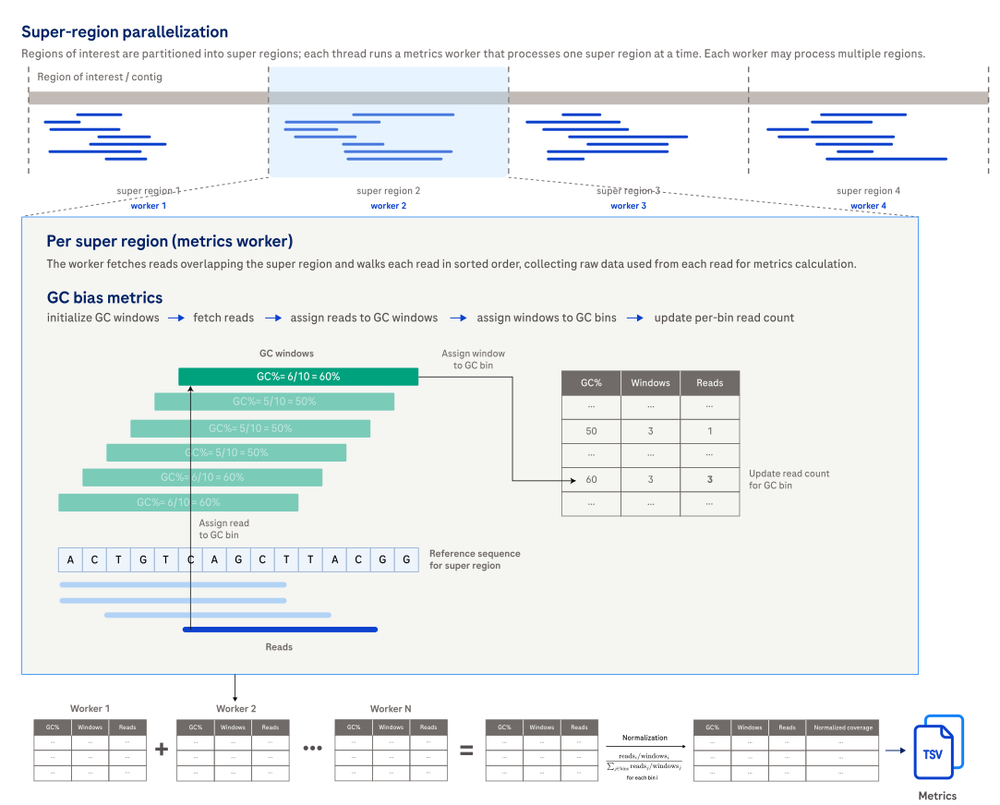

# Compute GC bias metrics

## How it works

`alignment_metrics gcbias` computes GC bias metrics by sliding a window across the reference sequence to determine GC content at each position,
then counting how many reads start at windows of each GC percentage.
The result is a normalized coverage profile across GC content bins that reveals systematic sequencing bias toward AT-rich or GC-rich regions.

Use this command when you only need GC bias products.
If you also need coverage,
accuracy,
or read outputs,
use [`all`](usage-all.md) or [`coverage`](usage-coverage.md) with `--enable-gc-bias-metrics` instead.



## Example command

```shell
alignment_metrics gcbias \
  --bam INPUT.bam \
  --reference REFERENCE.fa \
  --bed TARGETS.bed \
  --output-dir OUTPUT_DIR \
  --threads 8
```

## Input

| Input | Required | Notes |
|:------|:---------|:------------|
| BAM file | Yes | Coordinate-sorted, indexed BAM file passed with `--bam`. |
| Reference FASTA | Yes | Indexed FASTA file passed with `--reference`. Required for computing GC content windows. |
| BED file | No | Regions of interest passed with `--bed`. |
| Labeled BED file | No | BED file with a comma-separated label list in column 4 when `--stratify-by-label` is enabled. See [File formats](file-formats.md#labeled-bed-for---stratify-by-label). |

## Output

GC bias outputs are written to `gc_bias/` under the selected output directory,
or to `<label>/gc_bias/` when label stratification is enabled.

| Output | Description |
|:-------|:------------|
| *gc_bias.tsv* | Per-GC-percentage-bin metrics including window counts, read counts, normalized coverage, and error bars. See [gc_bias.tsv](metrics.md#gc_biastsv). |
| *gc_bias_summary.tsv* | Summary metrics including AT and GC dropout, quintile normalized coverage, and total counts. See [gc_bias_summary.tsv](metrics.md#gc_bias_summarytsv). |

## Tips for analysis

Expand the details below for practical analysis recommendations.

<details>
<summary>Show tips for analysis.</summary>

- Normalized coverage near 1.0 across all GC bins indicates minimal GC bias.
- AT dropout and GC dropout values near 0 indicate low bias at the AT-rich and GC-rich ends of the spectrum.
- Use `--gc-window-size` to adjust the resolution of GC content measurement.

</details>

## CLI options

This command also accepts the common `-h, --help`, `-v, --version`, and `-l, --log-level` options.
Required parameters are highlighted in **bold**.

### Input options

| Parameter | Description | Value(s) |
|:----------|:------------|:---------|
| **--bam** | Path to the coordinate-sorted, indexed BAM file whose GC bias metrics are calculated. | Path to a sorted and indexed BAM file. |
| **--reference** | Path to the indexed reference FASTA used to compute GC content windows. | Path to an indexed FASTA file. |

### Output options

| Parameter | Description | Value(s) |
|:----------|:------------|:---------|
| --output-dir | Path to the output directory where GC bias outputs are written. | Path to a directory. Default: `.`. |
| --overwrite | Overwrite existing output files. Without this flag, the Alignment Metrics tool reports an error if any output file already exists. | Flag. Default: off. |
| --output-prefix | Prefix prepended to all output filenames with an underscore separator. | Filename component. Default: none. |

### Region options

| Parameter | Description | Value(s) |
|:----------|:------------|:---------|
| --bed | Path to a BED file that restricts the run to regions of interest. | Path to a BED file. |
| --stratify-by-label | Interpret BED column 4 as a comma-separated label list and emit one output subtree per label. Requires `--bed`. | Flag. |

### Read filtering options

| Parameter | Description | Value(s) |
|:----------|:------------|:---------|
| --exclude-flags | Exclude alignments whose FLAG field overlaps the supplied decimal integer. Excluded reads do not contribute to post-filter read count and post-filter normalized coverage in the GC bias output. | Integer. Default: `3332`. |
| --min-mapping-quality | Minimum mapping quality threshold. Reads below this threshold contribute to `read_count` but not to `post_filter_read_count`. | Integer from 0 to 255. Default: `4`. |
| --trim-start-length | Number of bases trimmed from the start of each read before metrics are calculated. | Integer from 0 to 50. Default: `0`. |
| --trim-end-length | Number of bases trimmed from the end of each read before metrics are calculated. | Integer from 0 to 50. Default: `0`. |

### GC bias metrics options

| Parameter | Description | Value(s) |
|:----------|:------------|:---------|
| --gc-window-size | The size of the sliding window used to compute GC content. Must be smaller than `--region-size` and `--reference-padding`. | Integer from 1 to 1000. Default: `100`. |

### Performance options

| Parameter | Description | Value(s) |
|:----------|:------------|:---------|
| --region-size | Region size used for parallel work partitioning. | Integer greater than 0. Default: `10000`. |
| --reference-padding | Extra reference bases fetched on the 3' side of each region. | Integer greater than 0. Default: `1000`. |
| --threads | Number of worker threads. | Integer from 1 to the available thread count. Default: `1`. |
