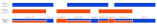

# Build labeled BED inputs

## How it works

`merge_and_label_bed` builds the labeled BED file consumed by `alignment_metrics <subcommand> --stratify-by-label`.
It pairs each `--bed` input with the corresponding `--label`,
splits overlaps at interval boundaries,
and writes one sorted BED with a comma-separated label list in column 4.

Use this helper whenever you want one Alignment Metrics run to emit separate output trees for overlapping region classes.



Expand the details below for implementation details about how this helper merges and labels overlapping BED intervals.

<details>
<summary>Design details.</summary>

The executable reads each input BED,
tags every interval with the supplied label,
merges intervals that share a label,
and splits cross-label overlaps into disjoint intervals.
The output BED therefore preserves the exact overlap structure needed for label-stratified Alignment Metrics runs.

</details>

## Example command

```shell
merge_and_label_bed \
  --bed autosomes.bed --label autosome \
  --bed high_confidence.bed --label high_confidence \
  --output labeled.bed
```

## Input

| Input | Required | Notes |
|:------|:---------|:------------|
| BED file(s) | Yes | One or more plain 3-column BED files passed with repeated `--bed`. |
| Label(s) | Yes | One label per BED file, passed with repeated `--label`. |

## Output

| Output | Description |
|:-------|:------------|
| Labeled BED file | A sorted BED whose first three columns are genomic intervals and whose fourth column is a comma-separated label list. See [Labeled BED for `--stratify-by-label`](file-formats.md#labeled-bed-for---stratify-by-label). |

## Tips for analysis

Expand the details below for practical analysis recommendations and common pitfalls.

<details>
<summary>Show tips for analysis.</summary>

- Repeat `--bed` and `--label` the same number of times. The executable pairs them by position.
- Reuse the same label across multiple input BED files when you want those regions merged under one logical class.
- Use the labeled output with `alignment_metrics ... --bed labeled.bed --stratify-by-label`.

</details>

## CLI options

This command also accepts the common `-h, --help`, `-v, --version`, and `-l, --log-level` options.
Required parameters are highlighted in **bold**.

### Input options

| Parameter | Description | Value(s) |
|:----------|:------------|:---------|
| **--bed** | Input BED file. Repeat once per label. Each `--bed` is paired with the matching `--label` by position. | Existing BED file. |
| **--label** | Label assigned to the regions from the corresponding `--bed` file. | String label. |

### Output options

| Parameter | Description | Value(s) |
|:----------|:------------|:---------|
| **--output** | Output labeled BED file path. | Path to a BED file. |
| --overwrite | Overwrite the output file if it already exists. | Flag. Default: `false`. |
