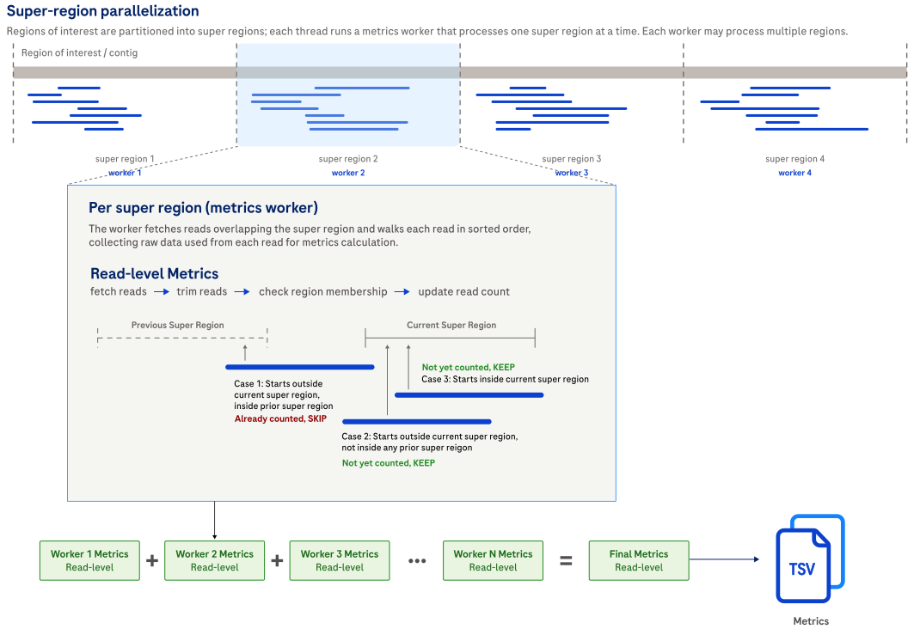

# Compute read metrics

## How it works

`alignment_metrics read` computes read-count and read-length summaries from the BAM.
It does not require a reference and is the lightest-weight Alignment Metrics command when you only need read-level outputs.

Use this command when the question is read composition,
read yield,
read-length distribution,
or targeted-enrichment read counts.
If you also need coverage or accuracy outputs,
use [`all`](usage-all.md).



Expand the details below for implementation details about how this command accumulates read-level summaries.

<details>
<summary>Design details.</summary>

The command walks the BAM,
applies read-level filters,
and accumulates per-thread read-count and read-length summaries.
When the BAM carries read-type metadata,
the outputs split counts and lengths into full and partial reads.
When the BAM carries consensus-cluster metadata,
the outputs also expose cluster-composition summaries.

</details>

## Example command

```shell
alignment_metrics read \
  --bam INPUT.bam \
  --bed TARGETS.bed \
  --output-dir OUTPUT_DIR \
  --threads 8
```

Add `--enable-target-enrichment-metrics` when the BED file is a targeted-enrichment panel and you want on-target read summaries.

## Input

| Input | Required | Notes |
|:------|:---------|:------------|
| BAM file | Yes | Coordinate-sorted, indexed BAM file passed with `--bam`. |
| BED file | No | Regions of interest passed with `--bed`. |
| Labeled BED file | No | BED file with a comma-separated label list in column 4 when `--stratify-by-label` is enabled. See [File formats](file-formats.md#labeled-bed-for---stratify-by-label). |

## Output

Read outputs are written to `read_metrics/` under the selected output directory,
or to `<label>/read_metrics/` when label stratification is enabled.

| Output | Description |
|:-------|:------------|
| *read_metrics_summary.tsv* | Read and alignment counts, plus base-count summaries. See [read_metrics_summary.tsv](metrics.md#read_metrics_summarytsv). |
| *read_metrics_te.tsv* | Targeted-enrichment read summary emitted when `--enable-target-enrichment-metrics` is set. See [read_metrics_te.tsv](metrics.md#read_metrics_tetsv). |
| *read_length_histograms.tsv* | Read-length histogram including soft-clipped bases. See [read_length_histograms.tsv](metrics.md#read_length_histogramstsv). |
| *read_length_excluding_soft_clips_histograms.tsv* | Read-length histogram excluding soft-clipped bases. See [read_length_excluding_soft_clips_histograms.tsv](metrics.md#read_length_excluding_soft_clips_histogramstsv). |
| *read_length_summary.tsv* | Summary statistics for read length including soft-clipped bases. See [read_length_summary.tsv](metrics.md#read_length_summarytsv). |
| *read_length_excluding_soft_clips_summary.tsv* | Summary statistics for read length excluding soft-clipped bases. See [read_length_excluding_soft_clips_summary.tsv](metrics.md#read_length_excluding_soft_clips_summarytsv). |
| *read_counts_by_cluster_size.tsv* | Cluster-size summary emitted when the dataset carries consensus-cluster metadata. See [read_counts_by_cluster_size.tsv](metrics.md#read_counts_by_cluster_sizetsv). |

## Tips for analysis

Expand the details below for practical analysis recommendations and common pitfalls.

<details>
<summary>Show tips for analysis.</summary>

- Use `read` for fast sanity checks before a heavier `coverage` or `accuracy` rerun.
- Remember that read-level metrics use read-level filters, not base-level filters.
- Targeted-enrichment read summaries compare on-target counts against the BAM-wide mapped-alignment total, so the percentages can differ from calculations based only on primary alignments.

</details>

## CLI options

This command also accepts the common `-h, --help`, `-v, --version`, and `-l, --log-level` options.
Required parameters are highlighted in **bold**.

### Input options

| Parameter | Description | Value(s) |
|:----------|:------------|:---------|
| **--bam** | Path to the coordinate-sorted, indexed BAM file whose read metrics are calculated. | Path to a sorted and indexed BAM file. |

### Output options

| Parameter | Description | Value(s) |
|:----------|:------------|:---------|
| --output-dir | Path to the output directory where read outputs are written. | Path to a directory. Default: `.`. |
| --overwrite | Overwrite existing output files. Without this flag, the Alignment Metrics tool reports an error if any output file already exists. | Flag. Default: off. |
| --output-prefix | Prefix prepended to all output filenames with an underscore separator. For example, `--output-prefix SAMPLE` produces `SAMPLE_coverage_stats.tsv`. | Filename component. Default: none. |

### Region options

| Parameter | Description | Value(s) |
|:----------|:------------|:---------|
| --bed | Path to a BED file that restricts the run to regions of interest. | Path to a BED file. |
| --stratify-by-label | Interpret BED column 4 as a comma-separated label list and emit one output subtree per label. Requires `--bed`. | Flag. |

### Read filtering options

| Parameter | Description | Value(s) |
|:----------|:------------|:---------|
| --exclude-flags | Exclude alignments whose FLAG field overlaps the supplied decimal integer. | Integer. Default: `3332`. |
| --min-mapping-quality | Minimum mapping quality for post-filter read metrics. | Integer from 0 to 255. Default: `4`. |
| --trim-start-length | Number of bases trimmed from the start of each read before metrics are calculated. | Integer from 0 to 50. Default: `0`. |
| --trim-end-length | Number of bases trimmed from the end of each read before metrics are calculated. | Integer from 0 to 50. Default: `0`. |

### Read metrics options

| Parameter | Description | Value(s) |
|:----------|:------------|:---------|
| --max-read-length-bin | Maximum histogram length bin for read-length histograms. Longer reads contribute to the `max-read-length+` bin. | Integer greater than 0. Default: `1000`. |

### Target enrichment metrics options

| Parameter | Description | Value(s) |
|:----------|:------------|:---------|
| --enable-target-enrichment-metrics | Enable targeted-enrichment read metrics. Requires `--bed`. | Flag. |

### General metrics options

| Parameter | Description | Value(s) |
|:----------|:------------|:---------|
| --summary-stats-percentiles | Percentiles computed for read-length summary statistics. | Comma-separated list of integers. Default: `10,25,50,75,90`. |

### Performance options

| Parameter | Description | Value(s) |
|:----------|:------------|:---------|
| --region-size | Region size used for parallel work partitioning. | Integer greater than 0. Default: `10000`. |
| --threads | Number of worker threads. | Integer from 1 to the available thread count. Default: `1`. |
