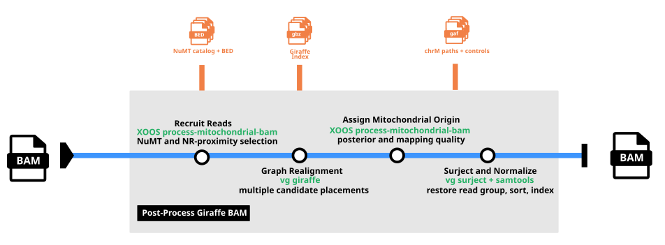

# BAM Post-Processing for Mitochondria Workflow

The full process to recover mitochondrial reads that have been misaligned to NuMT sequences is implemented as part of the [xoosnf pipeline](../docs/xoosnf/README.md), with the specific workflow within the pipeline documented [here](../docs/xoosnf/mitochondrial-bam-post-processing.md). See this documentation section for an overview of how the mitochondrial BAM post-processing steps fit into the variant-calling workflow. The rest of this guide outlines how the `process-mitochondrial-bam` module works and how it can be used to recover missed chrM alignments.

## Guide contents

- [Overview](#overview): what `process-mitochondrial-bam` does, when to use it, example applications, and system requirements.
- [Usage](docs/usage.md): the `process-mitochondrial-bam` entry points and links to command-specific pages.
  - [Running the end-to-end workflow](docs/usage-run.md): recovering mitochondrial reads and producing an indexed BAM file.
  - [Recruiting reads](docs/usage-recruit.md): selecting reads for graph realignment.
  - [Assigning mitochondrial reads](docs/usage-call.md): estimating mitochondrial origin probabilities and producing graph alignments.
- [File formats](docs/file-formats.md): `process-mitochondrial-bam` text formats.
- [Troubleshooting](docs/troubleshooting.md): common `process-mitochondrial-bam` issues and resolutions.
- [Appendix](docs/appendix.md): `process-mitochondrial-bam` concepts, algorithm details, and performance notes.
- [Release notes](CHANGELOG.md): notable changes by version.

## Overview

The `process-mitochondrial-bam` submodule recovers mitochondrial reads that initially align to nuclear mitochondrial DNA segments (NuMTs).
It realigns selected reads to a pangenome graph and estimates whether each read originated from mitochondrial or nuclear DNA.
The output is a mitochondria-specific BAM, which can be used as input to the mitochondrial small variant calling for improved accuracy.

At a glance: **NR-tagged, coordinate-sorted BAM and pangenome indexes** → **coordinate-sorted, indexed mitochondrial BAM**.


**Warning:** `process-mitochondrial-bam` is in alpha status and is for research use only.


### Pipeline

`process-mitochondrial-bam` implements two distinct operations that are intended to be executed in a pipeline along with specific `vg` operations:



The steps are:

1. Recruit reads that are aligned to NuMTs and the mitochondrial genome.
2. Realign the recruited reads to the pangenome graph with multimapping.
3. Estimate the probability of each read being aligned to the mitochondrial chromosome.
4. Project the graph alignments into the linear reference BAM format.

The full pipeline can be executed through the end-to-end `run-process-mitochondrial-bam.sh` script.
This is the recommended way to run the `process-mitochondrial-bam` pipeline.

#### Example command

The `run-process-mitochondrial-bam.sh` takes as input, minimally:

- An original genome-wide BAM from VG Giraffe, aligned using the `--off-ref-position` option
- Pangenome indexes for VG Giraffe

The output is a BAM containing all reads that have been assigned to the mitochondrial genome.

```shell
run-process-mitochondrial-bam.sh \
  --orig-bam sample.bam \
  --gbz graph.gbz \
  --min graph.min \
  --dist graph.dist \
  --zipcodes graph.zipcodes \
  --out-bam sample.chrM.bam \
  --threads 10
```

### Running in a container

The `bam_post_process` Docker image contains the `process-mitochondrial-bam` executable, the end-to-end `run-process-mitochondrial-bam.sh` script, `vg`, `samtools`, and GRCh38 resources.
The submodule exposes the [Recruiting reads](docs/usage-recruit.md) and [Assigning mitochondrial reads](docs/usage-call.md) stages for independent use.

### System requirements

| | Requirements |
|:--|:--------------|
| CPU | At least 1 CPU; `--threads` controls parallel work in the end-to-end workflow. |
| Memory | Sufficient memory to load the selected pangenome graph and the read-placement set. |

### Limitations

- `process-mitochondrial-bam` currently only accepts BAMs from Giraffe, which should be run with the `--off-ref-position` option to generate the NR tag.
- The pangenome indexes used in the `process-mitochondrial-bam` pipeline must be the same ones that were used for the original genome-wide mapping.
- The BAM generated by `process-mitochondrial-bam` is not merged or reconciled with the original BAM, and it only contains reads that were assigned to the mitochondrial genome. It is possible for a read in the output BAM to also remain at a different mapped location in the original BAM.

### Future releases

- `process-mitochondrial-bam` will be extended to work with alignments from BWA-MEM in addition to VG Giraffe in a future release.
