# Appendix

## Concepts and terminology

| Term | Definition |
|:---------|:-----------------------|
| Normal Sample  | The "baseline" or constitutional DNA sample (typically from blood or saliva). In somatic workflows, it is used to filter out inherited variants; in germline-only workflows, it is the primary sample analyzed for inherited copy number changes. |
| Tumor Sample  | The sample containing the cell population of interest (typically from a biopsy or surgical resection). It is compared against a Normal Sample to identify acquired (somatic) copy number alterations. |
| GC Bias  | The systematic variation in sequencing coverage caused by the G/C content of a genomic region. PCR and sequencing efficiency vary across different GC percentages, necessitating mathematical correction to ensure uniform coverage analysis. |
| Normalization  | The process of adjusting raw read counts to remove technical artifacts (such as GC bias, mappability issues, and total library depth) so that the remaining signal represents true biological copy number. |
| Segmentation  | The statistical process of grouping adjacent genomic intervals that share a similar copy number state into larger "segments." This simplifies the genome into a series of discrete blocks of constant copy number. |
| Undo Segments | A procedure where adjacent segments are merged if their mean log-ratios are within a distance defined as a factor of the standard-deviation of log-ratio values across the whole genome. |
| Log Ratios  | The log2-transformed ratio of observed coverage versus expected coverage. A Log Ratio of 0.0 represents the expected diploid state; positive values indicate gains (duplications), while negative values indicate losses (deletions). |
| Purity  | The estimated proportion of the sample that consists of the cells of interest (e.g., tumor cells). Lower purity "dilutes" the copy number signal with DNA from normal cells, requiring the caller to adjust its estimations. |
| Ploidy  | The average number of chromosome copies across the entire genome of the sample. While humans are naturally diploid (ploidy = 2), tumor genomes can be aneuploid, shifting the baseline for copy number calls. |
| BAF | B-Allele Fraction. The proportion of reads supporting the alternate allele relative to the total reads at a specific site. Used to detect allelic imbalances and distinguish between events like deletions and loss-of-heterozygosity (LOH). |
| Seed segments | An input file containing pre-defined genomic intervals. These segments provide the caller with "prior knowledge" to guide the segmentation process. They are primarily used to focus analysis on specific regions of interest or to improve the accuracy and speed of the segmentation algorithm by providing an initial genomic framework. Seed segments require the following columns: `Id`, `Contig`, `Start`, `End`, `IsInAllosome`, `IsInPseudoAutosomalRegion`. |
| Interval | A specific, fixed-length region of the genome (also known as a "bin" or "target") where read counts are measured. Intervals are the smallest units of analysis before being grouped into segments. |
| BigWig | A compressed, indexed binary format for the storage of dense, continuous data. In this pipeline, it is used to store Log Ratio and BAF values for high-performance visualization in genome browsers like IGV. More information on the BigWig format can be found [here](https://genome.ucsc.edu/goldenPath/help/bigWig.html). |

## Genome mappability

The Copy Number Caller is designed to operate in regions of the genome that are uniquely mappable.
It identifies suitable regions using a genome mappability BigWig file, which provides a quantitative measure of regional uniqueness within a given reference genome.
The Docker image includes two hg38 mappability BigWig resources:

- `/resources/hg38_500mer_mappability.bw` for SBX-S libraries.
- `/resources/hg38_mappability.bw` for SBX-D, SBX-FAST, and other library types.

The `germline-wgs`, `tumor-normal-wgs`, and `tumor-only-wgs` commands select the resource automatically when `--mappability-bigwig` is omitted.
Germline WGS detects the library type from `--bam`, tumor-normal WGS detects it from `--normal-bam`, and tumor-only WGS detects it from `--tumor-bam`.
You can provide `--mappability-bigwig` to override the automatic selection.

## Seed segments

Seed segments specify the genomic regions that the Copy Number Caller analyzes during segmentation.
The WGS workflows select the bundled hg38 resource automatically when `--seed-segments` is omitted.
Specify `--seed-segments` only to override that default.

Seed segment files are included in the Docker image as resources and are available for the following reference genomes:

- hg38: `/resources/hg38_seed.seg`

Seed segments require the following columns: `Id`, `Contig`, `Start`, `End`, `IsInAllosome`, `IsInPseudoAutosomalRegion`.

## Allosome handling

How Copy Number Caller performs copy number calling on allosomes depends on 3 major factors:

1. Whether the region is a [pseudoautosomal region (PAR)](https://en.wikipedia.org/wiki/Pseudoautosomal_region) or not:
    - PAR regions have 2 copies regardless of the sex of the sample
2. Sex of the sample:
    - Male: Modeled as XY (Haploid X and Y outside of PARs).
    - Female: Modeled as XX (Diploid X, Null Y).
3. Running in germline or somatic mode
    - In somatic mode, the caller relies on both the log ratios and BAF data and assumes access to heterozygous SNPs. This means in males there are no BAF values available in the non-PAR regions.

Taking all of this into account, the following table summarizes how copy number is predicted in the allosomes:


Copy Number Caller assumes that the chrY PAR region is masked in the reference genome that the data was aligned to.
If the chrY PAR region is NOT masked, Copy Number Caller will detect this and no copy number calling happens in PAR regions.



Masking of the chrY PAR region is important for Copy Number Caller since it assumes a baseline total copy number of 2 in the PAR region (irrespective of sex).
This means the coverage in PAR regions is expected to be double that of non-PAR regions in males.
When the chrY PAR region is masked, reads generated from the chrY PAR region will align to the chrX PAR region creating this double coverage.
Note that for females, the PAR and non-PAR regions have equivalent coverage.


|            |         | Somatic |        | Germline |        |
|:----------|:-------|:-------|:------|:--------|:------|
| Chromosome | Region  | Male    | Female | Male     | Female |
| chrX       | PAR     | Yes     | Yes    | Yes      | Yes    |
| chrX       | Non-PAR | No      | Yes    | Yes      | Yes    |
| chrY       | PAR     | No      | No     | No       | No     |
| chrY       | Non-PAR | No      | No     | Yes      | No     |

The following diagram visualizes this:


## Oversegmentation

Effective somatic CNV calling relies on accurate segmentation. In low-quality samples like FFPE, high noise levels often lead to oversegmentation (i.e. excessive, small segments).

Segment undoing merges adjacent segments when the difference in segment logR value is below the logR variance. The behavior is controlled by `--segment-undoing`, which accepts one of three strategies:

- `iterative` (default in `tumor-normal-wgs` mode): Repeatedly relax the stringency factor and re-merge until the target segment count is reached or no more segments can be merged.
- `non-iterative`: Perform a single merge pass at `--initial-segment-undoing-factor`. The factor is not escalated and no target segment count is applied, giving direct control over merge stringency.
- `disabled`: Skip segment undoing entirely; segments pass through untouched.

The `iterative` strategy is tuned via:

- `--initial-segment-undoing-factor`: Defines the stringency of the merging process.
- `--max-segments-for-undoing`: Target segment count for the undoing procedure.
- `--segment-undoing-increment`: Constant amount added to the factor on each round after the first.

In `iterative` mode, the tool always performs one merge pass at `--initial-segment-undoing-factor`. On each subsequent round it adds one `--segment-undoing-increment`, stopping when the segment count is at or below `--max-segments-for-undoing` or no further merges occur. The `--max-segments-for-undoing` and `--segment-undoing-increment` options are ignored by the `non-iterative` and `disabled` strategies.



To skip segment undoing entirely, set `--segment-undoing disabled`. To merge in a single pass without iteratively chasing a target segment count, set `--segment-undoing non-iterative`.

## Whole genome doubling

Estimating tumor purity and ploidy is one of the most challenging aspects of SCNV calling.
The difficulty arises from a model identifiability problem (also known as purity-ploidy degeneracy): multiple combinations of purity and ploidy can explain the observed log ratio and BAF data comparably well, so the best-fitting solution is not necessarily the correct one.
When the search is unconstrained, solutions with high ploidy are systematically favored for two reasons.
First, the expected log ratios of adjacent total copy number states are closer together at higher ploidy, allowing the model to fit noisy segment-level data more closely.
Second, higher ploidy introduces additional allelic states that the BAF model can use to explain the data (for example, a baseline total copy number of 4 admits the minor allele configurations AAAA, AAAB, and AABB).

To counteract this bias, the purity/ploidy search applies a diploid prior that favors a total copy number of 2 in the likelihood model, which in turn favors lower ploidy solutions.
The data must therefore provide sufficient evidence, such as a strong LOH signal, to overcome the prior.
A consequence of this design is that whole genome doubled (WGD) tumors, which have high ploidy, are harder to estimate correctly because they require substantial evidence to override the prior.

To help detect WGD, the caller applies two quality control (QC) checks to the initial solution obtained with the diploid prior.

- **BAF signal of clonal heterozygous deletions** (applied when the predicted purity is ≥ 0.35): Autosomal segments whose observed total copy number is approximately 1 are gathered as candidate clonal heterozygous deletions. Because only a single allele is retained in a true heterozygous deletion, the mirrored BAF (mBAF) values of these segments are expected to be similar to one another. If the candidate segments instead show disparate mBAF values (i.e. a multimodal distribution), this indicates an incorrect purity/ploidy parameterization and is evidence that the tumor is WGD, because the candidates are in fact a mixture of copy-neutral LOH and other states in a high ploidy genome. The initial solution is then rejected. This check is skipped when too few candidate segments are available.
- **High LOH fraction in a low purity scenario** (applied when 0.2 < predicted purity < 0.35): At low purity the mBAF signal is too weak to resolve distinct populations, so the caller instead measures the fraction of the autosomal genome in loss of heterozygosity (LOH). LOH is a hallmark of WGD tumors ([Lopez and Lim et al. 2020, Nature Genetics](https://www.nature.com/articles/s41588-020-0584-7)). A high LOH fraction (≥ 35% of the assessable autosomal genome) in a tumor with low predicted purity is therefore taken as evidence of WGD, and the initial solution is rejected. Below a purity of 0.2 the LOH signal is considered too unreliable to distinguish WGD from noise, so the initial solution is accepted without this check.

When the initial solution is rejected, the purity/ploidy search is repeated with a uniform prior, which does not favor any particular total copy number state. WGD tumors are consequently no longer penalized for high ploidy estimates.


Despite these QC checks, WGD detection remains a significant challenge in SCNV calling.
Always inspect the log ratio and BAF channels to confirm the purity/ploidy estimate.
If you suspect the estimate is incorrect, examine the purity/ploidy likelihood grid to identify an alternative solution, then use the [`predict-somatic-cnv`](usage-predict-somatic-cnv.md) subcommand to predict SCNV events under that purity/ploidy solution.


## Low SCNV signal tumors

Performance may be limited in tumors with low SCNV signal, such as those with low tumor purity and/or low SCNV burden. SCNV calling involves a circular dependency: the caller uses SCNV signal to estimate tumor purity and ploidy, while estimating the SCNV signal itself also depends on those purity and ploidy estimates. When the signal is weak, purity and ploidy estimates may be unreliable, which can in turn affect SCNV calls.

Low SCNV signal can make the purity estimate itself unreliable. Calls from tumors with predicted purity below 30% should generally be considered unreliable. Inspect the log-ratio and BAF channels regardless of predicted purity.

For `tumor-normal-wgs`, if you suspect the tumor has high purity but low SCNV burden, provide a [somatic-flagged VCF](usage-tumor-normal-wgs.md#input). In this scenario, tumor purity is estimated from somatic single-nucleotide variants and this estimated purity is used for SCNV calling. This fallback does not apply to `tumor-only-wgs`.

## Excluding problematic regions

Applies to: [`tumor-normal-wgs`](usage-tumor-normal-wgs.md) and [`tumor-only-wgs`](usage-tumor-only-wgs.md).

The human reference genome is often incomplete, frequently lacking representation of paralogous regions.
As a result, reads originating from these missing paralogous regions can incorrectly map to the single corresponding region present in the reference.
When substantial fixed differences exist between these paralogous regions, this ambiguous alignment can lead to an inflated number of observed variants in the mapped region.
This can result in regions with a high density of germline heterozygous variants and unreliable BAF values, which can adversely affect the accuracy of somatic CNV calling.

The WGS workflows automatically select a bundled BED file that excludes problematic regions; pass `--blocklist-bed` only to override the command-specific default.
For hg38, the `germline-wgs` default is `/resources/hg38_decoy_intervals.bed`.
For hg38, the `tumor-normal-wgs` default is `/resources/hg38_blocklist.bed`

This is based on the inverse of Heng Li's list of [easy genomic regions](https://academic.oup.com/gigascience/article/doi/10.1093/gigascience/giaf103/8247769) and was generated using the following command:

```bash
wget https://zenodo.org/records/15683328/files/hg38.pm151b-v2.easy.bed.gz

zcat hg38.pm151b-v2.easy.bed.gz \
    | bedtools complement -i - -g hg38.fa.fai \
    > hg38_blocklist.bed
```

In `tumor-only-wgs`, this default is `/resources/hg38_tumor_only_wgs_blocklist.bed`, which additionally masks common germline CNVs and the HLA/MHC region.

## Performance and cost notes

If the caller selects a purity/ploidy solution that contradicts your biological expectations (e.g., a "genome double" solution), you can use the [`predict-somatic-cnv`](usage-predict-somatic-cnv.md) subcommand to force a specific solution and regenerate the VCF and SEG files without re-running the entire `tumor-normal-wgs` or `tumor-only-wgs` pipeline.
This reuses the intermediate log ratios, BAFs, and segments already produced by the somatic commands, which avoids the cost of recomputing coverage and segmentation.
