# Call germline copy numbers

## How it works

The `germline-wgs` subcommand calls copy number variants from germline normal (i.e. non-tumor) WGS data.

This workflow involves calculating coverage of aligned reads across fixed-width intervals, correcting for GC-bias and noise, segmenting the genome into regions of similar coverage, and calling copy numbers using a likelihood model.

If the input BAM has a median coverage below 10x, the module exits with code 0 and writes structurally valid but data-empty output files (header-only SEG, VCF, BED; valid BigWig with chromosome headers). This avoids numerical errors during GC correction on very low or zero-coverage samples.


Germline CNVs called from a giraffe pangenome aligned BAM are known to miss common duplications.
This is caused by reads that align to the duplicated copy in the pangenome graph, but fail to project to the copy in the linear reference.
This results in missing reads associated with common duplications in the projected BAM.

A [rescue/tag method](../../read_collapser/docs/usage-rescue-secondary.md) has been developed that recovers these missing reads.
This method requires that giraffe is run with the `--max-multimaps` argument (recommended value of 3).
If using the XOOS pipeline and vg giraffe (i.e. CPU-based giraffe), it will be run with the `--max-multimaps` argument and the rescue/tag step is automatically run.
In this configuration, common duplications can be predicted.
If using XOOS pipeline with parabricks giraffe (i.e. GPU-based giraffe) or on-instrument alignment, the `--max-multimaps` is not yet supported.
This issue is expected to be resolved soon and the rescue/tag step will be incorporated into these workflows.

Note that BWA aligned BAM files will NOT have this missing common duplication issue.




Expand the details below for the step-by-step design of this command.

<details>
<summary>Design details.</summary>

1. **Gather input files**, which include the aligned reads from the germline normal sample in BAM format, as well as genome resource files (for example, a FASTA reference and a mappability file).
2. **Calculate coverage** of the aligned reads across fixed-width intervals over the whole genome.
3. **Correct and normalize coverage** to mitigate bias introduced by regions with high or low GC content, as well as to mitigate outliers and noise.
4. **Segment the genome** into stretches of adjacent intervals with similar coverage.
5. **Call copy number** of each segment using a likelihood model.
6. **Write** output summary files and metrics.

</details>

## Example command

```bash
copy_number_caller germline-wgs \
        --bam /path/to/bam \
        --reference /path/to/reference \
        --threads 16 \
        --output-dir /path/to/output
```

This command analyzes read alignments from a germline normal WGS sample provided in `/path/to/bam` to predict copy number variants.
It utilizes 16 processing threads and generates output files, including segment and VCF files, which are saved to `/path/to/output`.

For more details on available CLI options, see the [CLI options](#cli-options) section below.

## Input

| Input | Required | Notes |
|:---------|:-----------------------|:-----------------------|
| BAM | Yes | Position-sorted, indexed germline normal BAM (`--bam`). |
| Reference FASTA | Yes | Indexed reference genome (`--reference`). |
| Mappability file | No | [Genome mappability file](appendix.md#genome-mappability) (`--mappability-bigwig`). When omitted, the caller selects the bundled resource from the resolved library type. |
| Seed segments | No | [Seed segment file](appendix.md#seed-segments) (`--seed-segments`). When omitted, uses `/resources/hg38_seed.seg`; an explicit value overrides it. |
| Blocklist BED | No | 0-based regions to exclude before generating intervals (`--blocklist-bed`). When omitted, uses `/resources/hg38_decoy_intervals.bed`; an explicit value overrides it. |
| Germline SNP VCF | No | Bgzip-compressed, tabix-indexed, position-sorted VCF of germline SNPs for [BAF](file-formats.md#bafs) visualization only (`--vcf`, requires `--sample-name`). Records must be sorted by position within each contig and kept in contiguous contig blocks (contig block order can be arbitrary). The `.tbi` index must be next to the VCF. |

An optional position sorted VCF of germline SNPs (records sorted by position within each contig, in contiguous contig blocks) can be provided for downstream visualization purposes only.
**Importantly, the germline SNPs are NOT used for copy number calling**.

For variants in this optional germline SNP VCF (used with the Germline Normal workflow), the `FILTER` must be `PASS` and the `AD` (Allele Depth) tag must be present in the `FORMAT` field.
The `AD` tag describes a vector of two values, corresponding to the read depths over the reference and alternative alleles, respectively.
The BAF is derived from this information by dividing the number of alternate reads (alt reads) with the total number of reads (ref + alt reads).
**The Copy Number Caller does not do any preprocessing of the VCF to ensure it contains confident calls, this must be handled upstream.**

## Output

Files are written to the current working directory by default.
The output folder can be specified with `--output-dir`.
A custom prefix (for example a sample ID) can be prepended to every output filename with `--output-prefix`; the prefix and the default name are joined with an underscore, and the subfolder is preserved (for example, `--output-prefix SAMPLE` produces `SAMPLE_germline_copy_number_callset.vcf.gz` and `metrics/SAMPLE_metrics.tsv`). When `--output-prefix` is omitted, the default filenames below are used.
If any output file already exists, the command exits with an error unless `--overwrite` is specified.

Output files are organized into subfolders:

```text
<output-dir>/
├── germline_copy_number_callset.seg
├── germline_copy_number_callset.vcf.gz
├── germline_copy_number_callset.vcf.gz.tbi
├── metrics/       # QC and statistics
├── tracks/        # visualization (BigWig, IGV session)
└── supplemental/  # raw per-interval tracks and coverage
```

Principal output:

| Output | Description |
|:---------|:-----------------------|
| *germline_copy_number_callset.seg*  | Copy number estimations for each segment along with their likelihoods in [SEG](file-formats.md#segments) format.          |
| *germline_copy_number_callset.vcf.gz* | Copy number estimations for each segment in [VCF](file-formats.md#vcf) format. |
| *germline_copy_number_callset.vcf.gz.tbi* | Tabix index for the compressed VCF. |
| *tracks/igv_visualization.xml*  | Pre-configured IGV session file to visualize log ratios and optional BAF values.           |
| *metrics/metrics.tsv* | Summary metrics for copy number calls. |

Additional output:

| Output | Description |
|:---------|:-----------------------|
| *supplemental/augmented_intervals.bed*  | Output file for the whole genome intervals that were automatically generated in [intervals](file-formats.md#intervals) BED format. |
| *supplemental/corrected_coverage.bed*  | Output file for the GC-corrected coverage in [coverage](file-formats.md#coverage) BED format. |
| *supplemental/coverage.bed*  | Output file for the raw coverage in [coverage](file-formats.md#coverage) BED format. |
| *supplemental/log_ratios.bed*  | Output file for the log ratios in [log ratios](file-formats.md#log-ratios) BED format. |
| *tracks/log_ratios.bw*  | Output file for the log ratios in BigWig format. |
| *supplemental/mapping_quality.bed*  | Output file for the average mapping quality per interval in [observations](file-formats.md#observations) BED format. |
| *supplemental/bafs.bed*  | Output file for the BAF values in [BAFs](file-formats.md#bafs) BED format. Only output if `--vcf` is specified. |
| *tracks/bafs.bw*  |  Output file for the BAF values in BigWig format. Only output if `--vcf` is specified.   |

See [File formats](file-formats.md) for the schema of each output and [Metrics](metrics.md#germline-metrics) for the contents of *metrics/metrics.tsv*.

Notes:

- The predicted sex of the individual is printed to the header of the VCF file and to each line of the SEG file.
- `--sex auto-detect` predicts the sex from coverage and is the default.
  Use `male` or `female` to override prediction, or `skip-prediction` to leave the resolved output sex as `unknown`.
- When the sex is `unknown`, the caller excludes allosome segments (chromosomes X and Y) from copy-number calling because it cannot determine whether those segments are haploid or diploid. Autosomal segments remain eligible for calling.
- The sample ID in the output is "sample" by default, unless provided otherwise with `--sample-name`.
- Absent values in BED, SEG, and TSV outputs are written as `NA`.

## CLI options

Parameters in **bold** are required.
This command also accepts the common `-h, --help`, `-v, --version`, and `-l, --log-level` (`debug`, `info`, `warn`, `error`; default `info`) options.

### Input options

| Parameter | Description | Value(s) |
|:----|:----|:----|
| **--bam** | Path to the input BAM file. The BAM file must be coordinate-sorted and indexed. | File path |
| **--reference** | Path to the input reference FASTA file. The FASTA file must be indexed with a .fai file. | File path |
| --mappability-bigwig | Path to an input BigWig file describing mappability across the genome. When omitted, SBX-S uses `/resources/hg38_500mer_mappability.bw`; SBX-D, SBX-FAST, and unresolved library types use `/resources/hg38_mappability.bw`. | File path; [default: library dependent] |
| --seed-segments | Path to pre-generated segments file from which to start segmentation. The seed segments file must be in SEG format. When omitted, uses `/resources/hg38_seed.seg`; an explicit value overrides it. | File path |
| --library-type | Sequencing library type of the input BAM. Used to select the default `--interval-size` and `nonIntegerTcn` thresholds for germline WGS. When unset, it is auto-detected from the BAM header and read content. | Enum: {sbx-s, sbx-d, sbx-fast} |
| --blocklist-bed | Path to a BED file of 0-based regions to exclude from the analysis before generating intervals. When omitted, uses `/resources/hg38_decoy_intervals.bed`; an explicit value overrides it. | File path |
| --vcf | Path to a bgzip-compressed VCF file for germline SNPs (for BAF visualization). The VCF must have a co-located `.tbi` index. Requires --sample-name. | File path |

### Output options

| Parameter | Description | Value(s) |
|:----|:----|:----|
| --output-dir | Path to the output directory. | Directory path [default: .] |
| --output-prefix | Prefix prepended to all output filenames (for example a sample ID), joined with an underscore. If unset, default filenames are used. | Text [default: none] |
| --overwrite | Overwrite output files if they already exist. By default, the command exits with an error if an output file already exists. | Flag |
| --min-mapq-for-calls | Minimum average mapping quality (MAPQ) required for a call in the SEG output. Segments with an average MAPQ less than this value are merged. If merging is not possible, the call will be flagged in the SEG output. Use a negative value to disable this filter. If the BAM has rescued secondary alignments, the default value is set to 0 (user-provided value takes precedence). | Int; [default: 30] |

### Region options

| Parameter | Description | Value(s) |
|:----|:----|:----|
| --interval-size | The size (in base pairs) for each target region of the genome for which log ratios are calculated. When unset, the default depends on the library type: 1000 for SBX-S (simplex) input and 500 for SBX-D/SBX-FAST (duplex) input. The library type is taken from `--library-type` when set, otherwise auto-detected from the BAM. If the library type cannot be determined, the default falls back to 500. A value passed here always overrides the library-type default. | Uint; [default: 500 (SBX-D/SBX-FAST or unknown) or 1000 (SBX-S)] |
| --min-interval-mappability | Minimum allowable mappability score for an interval. Intervals with a score less than this value are excluded to ensure high-quality read alignment. Mappability scores come from `--mappability-bigwig`. This often excludes low complexity regions (i.e. segdups). | Float; [default: 0.8] |

### Sample metadata options

| Parameter | Description | Value(s) |
|:----|:----|:----|
| --sample-name | Name of sample in the input VCF header and used as a sample ID in the output. Does not require `--vcf`. | Text |
| --sex | How to obtain the sample sex. `auto-detect` predicts from coverage; `skip-prediction` records the resolved sex as `unknown`. | Enum: {auto-detect, male, female, skip-prediction}; [default: auto-detect] |

### Read filtering options

| Parameter | Description | Value(s) |
|:----|:----|:----|
| --exclude-flags | Exclude alignments if any bits in their FLAG field match the specified integer. Refer to <https://broadinstitute.github.io/picard/explain-flags.html> for flag generation. | Text; [default: 1796] |

### Segmentation options

| Parameter | Description | Value(s) |
|:----|:----|:----|
| --segment-undoing | Strategy for undoing log-ratio segments (re-merging segments with similar median log-ratio values). `iterative` relaxes `--initial-segment-undoing-factor` by adding `--segment-undoing-increment` on each subsequent round until `--max-segments-for-undoing` is reached or no more segments can be merged; `non-iterative` performs a single merge pass at `--initial-segment-undoing-factor`; `disabled` skips undoing. | {disabled, iterative, non-iterative}; [default: disabled] |
| --initial-segment-undoing-factor | The initial standard deviation multiplier for segment undoing. Adjacent segments with a difference less than or equal to the threshold determined by this multiplier are merged. | Float:positive; [default: 3] |
| --max-segments-for-undoing | Target segment count for the segment undoing procedure (`iterative` only). The process stops once the total number of segments is less than or equal to this value. | Integer:positive; [default: 500] |
| --hierarchical-pruning-height | Clustering parameter for hierarchical pruning. | Float; [default: 0.25] |

### Performance options

| Parameter | Description | Value(s) |
|:----|:----|:----|
| --threads | Number of threads. | Int; [default: 1] |
