# Call tumor-normal somatic copy numbers

## How it works

The `tumor-normal-wgs` subcommand characterizes somatic CNVs (aka. somatic copy number alterations) by comparing a tumor sample against a matched germline normal sample.
This workflow is specifically optimized for oncology research, where the goal is to distinguish acquired somatic mutations from inherited germline variations.

Analyzing tumor DNA presents unique challenges, such as tumor purity (the presence of infiltrating normal cells), aneuploidy (shifts in overall genomic ploidy), and tumor heterogeneity (where the somatic CNV is found only in a proportion of tumor cells).
To address these, the module simultaneously analyzes two independent signals: relative read depth (Log-Ratios) and allelic imbalance at heterozygous SNP sites (B-Allele Fractions).
By modeling these signals together, the caller can provide allele-specific calls (e.g., distinguishing between a simple deletion and copy-neutral loss of heterozygosity) and accurately estimate the tumor's purity and ploidy.

If either the tumor or normal BAM has a median coverage below 10x, or if the input VCF has insufficient data quality (too few germline SNPs or zero variants after filtering), the module exits with code 0 and writes structurally valid but data-empty output files. This avoids numerical errors during GC correction on very low or zero-coverage samples and prevents unreliable calls from poor-quality VCF input.



Expand the details below for the step-by-step design of this command.

<details>
<summary>Design details.</summary>

1. **Gather input files**, which include the aligned reads from both the tumor and the normal samples in BAM format, a list of germline heterozygous variant calls in VCF format, as well as genome resource files (for example, a FASTA reference and a mappability file).
2. **Calculate coverage** of the aligned reads for each sample across fixed-width intervals over the whole genome.
3. **Correct and normalize coverage** to mitigate bias introduced by regions with high or low GC content, as well as to mitigate outliers and noise. The caller normalizes data by taking the log2 ratio between the corrected coverages between the tumor and the normal samples.
4. **Segment the genome** into stretches of adjacent intervals with similar coverage. This workflow has two rounds of segmentation - the first round segments by the tumor-normal coverage log-ratios, and the second round further segments by the B-allele fractions of the germline heterozygous variant calls.
5. **Call copy number** of each segment using a likelihood model.
6. **Write** output summary files and metrics.

</details>

## Example command

```bash
copy_number_caller tumor-normal-wgs \
        --tumor-bam /path/to/tumor_bam \
        --normal-bam /path/to/normal_bam \
        --tumor-sample-name tumor_sample_name \
        --normal-sample-name normal_sample_name \
        --vcf /path/to/germline/variant/calls \
        --reference /path/to/reference \
        --threads 16 \
        --output-dir /path/to/output
```

For more details on available CLI options, see the [CLI options](#cli-options) section below.

## Input

| Input | Required | Notes |
|:---------|:-----------------------|:-----------------------|
| Tumor BAM | Yes | Position-sorted, indexed tumor BAM (`--tumor-bam`). |
| Normal BAM | Yes | Position-sorted, indexed matched normal BAM (`--normal-bam`). |
| Tumor-normal VCF | Yes | Bgzip-compressed, tabix-indexed, position-sorted VCF of variants for allele-specific copy number calling and [BAF](file-formats.md#bafs) visualization (`--vcf`). Records must be sorted by position within each contig and kept in contiguous contig blocks (contig block order can be arbitrary). The `.tbi` index must be next to the VCF. |
| Reference FASTA | Yes | Indexed reference genome (`--reference`). |
| Mappability file | No | [Genome mappability file](appendix.md#genome-mappability) (`--mappability-bigwig`). When omitted, the caller selects the bundled resource from the library type detected from the normal BAM. |
| Seed segments | No | [Seed segment file](appendix.md#seed-segments) (`--seed-segments`). When omitted, uses `/resources/hg38_seed.seg`; an explicit value overrides it. |
| Sample names | Yes | Tumor and normal sample names as they appear in the input VCF (`--tumor-sample-name`, `--normal-sample-name`). |
| Blocklist BED | No | 0-based regions to exclude before generating intervals (`--blocklist-bed`). When omitted, uses `/resources/hg38_blocklist.bed`; an explicit value overrides it. |

Germline heterozygous calls can be provided in the [VCF format](https://samtools.github.io/hts-specs/VCFv4.2.pdf).
The recommended way to generate this VCF is to use Mutect2 in tumor-normal mode (see [Tips for analysis](#tips-for-analysis) for more details).
For variants to be considered by the Copy Number Caller, the `AD` (Allele Depth) tag must be present in the `FORMAT` field.
The `AD` tag describes a vector of two values, corresponding to the read depths over the reference and alternative alleles, respectively.
The B-allele fraction (BAF) is derived from this information by dividing the number of alternate reads (alt B reads) with the total number of reads (ref + alt reads).
The caller will choose only the records in the VCF that have a BAF within a specified range (default: `0.367 < BAF < 0.633`).
The Copy Number Caller does not do any preprocessing of the VCF to ensure it contains confident calls, this must be handled upstream.

Two types of VCF input files are supported:

- Non-somatic flagged VCF: Unfiltered matched Tumor/Normal VCF containing germline SNPs.
  - The `FILTER` column is `.` for all records.
- Somatic flagged VCF: Unfiltered matched Tumor/Normal VCF containing germline SNPs and flagged somatic SNVs (`FILTER = PASS` indicates somatic, `FILTER != PASS` indicates germline or technical artifact)
  - The caller will distinguish germline from technical artifacts through internal filtering.
  - An example of this type of VCF would be output from the XOOS tumor-normal SVC

The latter VCF type can be helpful in cases of low somatic CNV signal, where the Copy Number Caller is unable to accurately estimate the tumor purity.
In these cases, the tumor purity can be estimated using only the somatic SNVs.
For a somatic-flagged VCF, the caller requires at least 50% of the evaluated variants to be heterozygous germline SNPs; otherwise it treats the VCF as likely invalid and exits gracefully with code 0, unless `--force-enable-somatic-variant-parsing` is set.
Regardless of VCF type, if no variants remain after depth and BAF filtering, the module exits gracefully with code 0 and writes data-empty output files. The force flag bypasses only the het-SNP fraction check, not the no-variants check.

## Output

Files are written to the current working directory by default.
The output folder can be specified with `--output-dir`.
A custom prefix (for example a sample ID) can be prepended to every output filename with `--output-prefix`; the prefix and the default name are joined with an underscore, and the subfolder is preserved (for example, `--output-prefix TN` produces `TN_somatic_copy_number_callset.vcf.gz` and `metrics/TN_metrics.tsv`). When `--output-prefix` is omitted, the default filenames below are used.
If any output file already exists, the command exits with an error unless `--overwrite` is specified.

Output files are organized into subfolders:

```text
<output-dir>/
├── somatic_copy_number_callset.seg
├── somatic_copy_number_callset.vcf.gz
├── somatic_copy_number_callset.vcf.gz.tbi
├── metrics/       # QC and statistics
├── tracks/        # visualization (BigWig, IGV session)
└── supplemental/  # purity/ploidy search solutions, raw tracks, coverage, intermediate segments
```

Principal output:

| Output | Description |
|:---------|:-----------------------|
| *somatic_copy_number_callset.seg*  | Copy number estimations for each segment along with their likelihoods in [SEG](file-formats.md#segments) format.          |
| *somatic_copy_number_callset.vcf.gz* | Copy number estimations for each segment in [VCF](file-formats.md#vcf) format. |
| *somatic_copy_number_callset.vcf.gz.tbi* | Tabix index for the compressed VCF. |
| *supplemental/purity_ploidy_grid.tsv* | Ranked purity ploidy solutions generated by the caller and their likelihoods in [purity ploidy grid](file-formats.md#purity-ploidy-grid) format. Not generated if `--tumor-purity` and `--tumor-ploidy` provided. |
| *tracks/log_ratios.bw*  | Output file for the log-ratios between the tumor and normal coverage across the genome in BigWig format. |
| *tracks/bafs.bw*  |  Output file for the tumor BAF values at putative germline heterozygous SNPs across the genome in BigWig format.   |
| *tracks/igv_visualization.xml*  | Pre-configured IGV session file to visualize log ratios and BAF values.           |
| *metrics/metrics.tsv* | Summary metrics for copy number calls. |

Additional output:

| Output | Description |
|:---------|:-----------------------|
| *supplemental/augmented_intervals.bed*  | Output file for the whole genome intervals that were automatically generated in [intervals](file-formats.md#intervals) BED format. |
| *supplemental/normal_corrected_coverage.bed*  | Output file for the GC-corrected normal sample coverage in [coverage](file-formats.md#coverage) BED format. |
| *supplemental/normal_coverage.bed*  | Output file for the raw normal sample coverage in [coverage](file-formats.md#coverage) BED format. |
| *supplemental/tumor_corrected_coverage.bed*  | Output file for the GC-corrected tumor sample coverage in [coverage](file-formats.md#coverage) BED format. |
| *supplemental/tumor_coverage.bed*  | Output file for the raw tumor sample coverage in [coverage](file-formats.md#coverage) BED format. |
| *supplemental/log_ratio_segments.seg*  | Output file for the log ratios in [SEG](file-formats.md#segments) format. |
| *supplemental/log_ratios.bed*  | Output file for the log ratios in [log ratios](file-formats.md#log-ratios) BED format. |
| *supplemental/mapping_quality.bed*  | Output file for the average mapping quality per interval in [observations](file-formats.md#observations) BED format. |
| *supplemental/bafs.bed*  | Output file for the BAF values in [BAFs](file-formats.md#bafs) BED format. |
| *supplemental/segment_likelihood.diploid_bias.tsv*  | Per-segment, per-grid-cell purity/ploidy likelihood analysis output for the [diploid-bias search pass](appendix.md#whole-genome-doubling). Only written when `--write-segment-likelihood` is set. See [Segment Likelihood](file-formats.md#segment-likelihood). |
| *supplemental/segment_likelihood.uniform.tsv*  | Per-segment, per-grid-cell purity/ploidy likelihood analysis output for the [uniform-prior search pass](appendix.md#whole-genome-doubling). Only written when `--write-segment-likelihood` is set and the [diploid-bias solution](appendix.md#whole-genome-doubling) is rejected by WGD QC. See [Segment Likelihood](file-formats.md#segment-likelihood). |

See [File formats](file-formats.md) for the schema of each output and [Metrics](metrics.md#somatic-metrics) for the contents of *metrics/metrics.tsv*.

Notes:

- The purity/ploidy solution the caller uses to call allele-specific variants is printed to each line of the SEG file.
- The predicted sex of the individual is printed to the header of the VCF file and to each line of the SEG file.
- `--sex auto-detect` predicts the sex from normal-sample coverage and is the default.
  Use `male` or `female` to override prediction, or `skip-prediction` to leave the resolved output sex as `unknown`.
- When the sex is `unknown`, the caller excludes allosome segments (chromosomes X and Y) from copy-number calling because it cannot determine whether those segments are haploid or diploid. Autosomal segments remain eligible for calling.
- The sample ID in the output is the concatenation of `--normal-sample-name` and `--tumor-sample-name`, delimited by `_`. For example, `NORMAL_TUMOR`.
- Absent values in BED, SEG, and TSV outputs are written as `NA`.

## Tips for analysis

- Generating variant calls — See the [Small Variant Caller — Tumor-normal whole-genome](../../small_variant_caller/docs/generating-candidate-calls.md#tumor-normal-whole-genome) section for the recommended Mutect2 command and parameters.
- [Excluding problematic regions](appendix.md#excluding-problematic-regions) — masking paralogous and other error-prone regions with `--blocklist-bed` to protect BAF-based calling.
- [Preventing oversegmentation](troubleshooting.md#preventing-oversegmentation) — tuning `--segment-undoing` for noisy samples such as FFPE.
- [Dealing with low SCNV signal tumors](troubleshooting.md#low-scnv-signal-tumors) - Use somatic flagged VCF to help with SCNV calling in low SCNV signal tumors (only applicable for `tumor-normal-wgs` mode).
- [Predicting SCNV in whole genome doubling tumors](appendix.md#whole-genome-doubling) — investigating alternative purity/ploidy solutions and using `predict-somatic-cnv` to regenerate calls.

See [Performance and cost notes](appendix.md#performance-and-cost-notes) in the appendix for guidance on reusing intermediate outputs to avoid re-running the full pipeline.

## CLI options

This command also accepts the common `-h, --help`, `-v, --version`, and `-l, --log-level` (`debug`, `info`, `warn`, `error`; default `info`) options.
Parameters in **bold** are required.

### Input options

| Parameter | Description | Value(s) |
|:----|:----|:----|
| **--tumor-bam** | Path to the input tumor BAM file. The BAM file must be coordinate-sorted and indexed. | File path |
| **--normal-bam** | Path to the input normal BAM file. The BAM file must be coordinate-sorted and indexed. | File path |
| **--vcf** | Path to a bgzip-compressed VCF file with germline variant sites. The VCF must have a co-located `.tbi` index. Heterozygous germline calls allow for estimation of allele-specific copy number. Requires `--normal-sample-name` and `--tumor-sample-name`. | File path |
| --seed-segments | Path to pre-generated segments file from which to start segmentation. The seed segments file must be in SEG format. When omitted, uses `/resources/hg38_seed.seg`; an explicit value overrides it. | File path |
| **--reference** | Path to the input reference FASTA file. The FASTA file must be indexed with a .fai file. | File path |
| --mappability-bigwig | Path to an input BigWig file describing mappability across the genome. When omitted, the library type is detected from `--normal-bam`: SBX-S uses `/resources/hg38_500mer_mappability.bw`; SBX-D, SBX-FAST, and unresolved library types use `/resources/hg38_mappability.bw`. | File path; [default: library dependent] |
| --blocklist-bed | Path to a BED file of 0-based regions to exclude from the analysis before generating intervals. When omitted, uses `/resources/hg38_blocklist.bed`; an explicit value overrides it. | File path |

### Output options

| Parameter | Description | Value(s) |
|:----|:----|:----|
| --output-dir | Path to output directory. | Directory path [default: .] |
| --output-prefix | Prefix prepended to all output filenames (for example a sample ID), joined with an underscore. If unset, default filenames are used. | Text [default: none] |
| --overwrite | Overwrite output files if they already exist. By default, the command exits with an error if an output file already exists. | Flag |
| --write-segment-likelihood | Write per-segment, per-grid-cell purity/ploidy likelihood analysis output, one file per search pass. See [Segment Likelihood](file-formats.md#segment-likelihood). Hidden analytical flag. | Flag |

### Region options

| Parameter | Description | Value(s) |
|:----|:----|:----|
| --interval-size | The size (in base pairs) for each target region of the genome for which log ratios are calculated. | Uint; [default: 1000] |
| --min-interval-mappability | Minimum allowable mappability score for an interval. Intervals with a score less than this value are excluded to ensure high-quality read alignment. Mappability scores come from `--mappability-bigwig`. This often excludes low complexity regions (i.e. segdups). | Float; [default: 0.6] |

### Sample metadata options

| Parameter | Description | Value(s) |
|:----|:----|:----|
| **--normal-sample-name** | Name of normal sample in the input VCF header and used as a sample ID prefix in the output. | Text |
| **--tumor-sample-name** | Name of tumor sample in the input VCF header and used as a sample ID suffix in the output. | Text |
| --sex | How to obtain the sample sex. `auto-detect` predicts from coverage; `skip-prediction` records the resolved sex as `unknown`. | Enum: {auto-detect, male, female, skip-prediction}; [default: auto-detect] |
| --tumor-purity | Tumor purity. Use if the tumor purity of the sample is known prior to the analysis. Requires: --tumor-ploidy. | Float; Range: [0.15 - 1] |
| --tumor-ploidy | Tumor ploidy. Use if the tumor ploidy of the sample is known prior to the analysis. Requires: --tumor-purity. | Float:positive |

### Read filtering options

| Parameter | Description | Value(s) |
|:----|:----|:----|
| --exclude-flags | Exclude alignments if any bits in their FLAG field match the specified integer. Refer to <https://broadinstitute.github.io/picard/explain-flags.html> for flag generation. | Text; [default: 1796] |
| --min-tumor-coverage | Minimum allowable coverage in the tumor sample for an interval to be kept. Intervals below this value are excluded. | Int; [default: 0] |
| --min-normal-coverage | Minimum allowable coverage in the normal sample for an interval to be kept. Intervals below this value are excluded. | Int; [default: 30] |

### Segmentation options

| Parameter | Description | Value(s) |
|:----|:----|:----|
| --segment-undoing | Strategy for undoing log-ratio segments (re-merging segments with similar median log-ratio values). `iterative` always performs an initial merge pass at `--initial-segment-undoing-factor`, then adds `--segment-undoing-increment` on each subsequent pass until the target segment count is reached or no more segments can be merged. `non-iterative` performs one pass and ignores the target count and increment; `disabled` skips undoing. | {disabled, iterative, non-iterative}; [default: iterative] |
| --initial-segment-undoing-factor | The initial standard deviation multiplier for segment undoing. Adjacent segments with a difference less than or equal to the threshold determined by this multiplier are merged. | Float:positive; [default: 3] |
| --max-segments-for-undoing | Target segment count for the segment undoing procedure (`iterative` only). Iteration stops once the total number of segments is less than or equal to this value or no more segments can be merged; the initial pass runs even if the count is already at or below the target. To skip segment undoing, set `--segment-undoing disabled` instead. | Integer:positive; [default: 500] |
| --hierarchical-pruning-height | Clustering parameter for hierarchical pruning. | Float; [default: 0.25] |
| --baf-distance-weight | Weight applied to the mirrored-BAF axis of the distance used for hierarchical pruning, applied only when both segments in a pair are copy-neutral. Values greater than 1 increase the separation of allelic-imbalance segments (for example, copy-neutral LOH) from balanced segments, making them less likely to be merged. | Float:positive; [default: 2] |

### Purity/ploidy search options

| Parameter | Description | Value(s) |
|:----|:----|:----|
| --baf-likelihood-weight-for-purity-ploidy-search-rerun | Weight applied to the BAF term of the joint likelihood during the [WGD uniform-prior re-run](appendix.md#whole-genome-doubling) only. The initial [diploid-bias search](appendix.md#whole-genome-doubling) is unaffected. Values greater than 1 give more weight to BAF than to log ratio. | Float:non-negative; [default: 1.0] |

### VCF parsing options

| Parameter | Description | Value(s) |
|:----|:----|:----|
| --force-enable-somatic-variant-parsing | Force enables parsing of somatic variants even if the fraction of germline variants is low. Only applicable for input VCF that contains flagged somatic variants. Requires: `--vcf`. | Flag |
| --min-vcf-normal-depth | Min normal depth for extracting variants from a matched tumor-normal or normal-only VCF. Variants with depth less than this value are excluded. | Int; [default: 15] |
| --min-normal-baf | Minimum BAF for a variant in the normal sample to be considered heterozygous. Variants below this value are excluded. | Float; [default: 0.367] |
| --max-normal-baf | Maximum BAF for a variant in the normal sample to be considered heterozygous. Variants above this value are excluded. | Float; [default: 0.633] |

### Performance options

| Parameter | Description | Value(s) |
|:----|:----|:----|
| --threads | Number of threads. | Int; [default: 1] |
