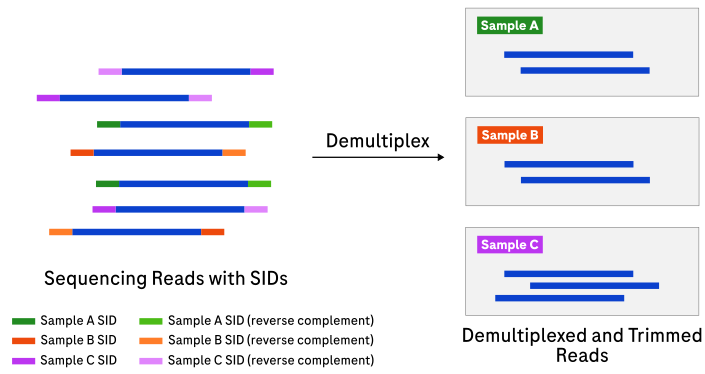

# Demux

## Guide contents

- [Overview](#overview): what Demux does, which commands it provides, and how
  simplex and duplex processing differ.
- [Usage](docs/usage.md): the main command entry points.
  - [Simplex demultiplexing](docs/usage-simplex.md): running `demux` on simplex
    data, inputs, outputs, tips, and full CLI options.
  - [Duplex demultiplexing](docs/usage-duplex.md): running `demux` on duplex
    data, inputs, outputs, tips, and full CLI options.
  - [Building the strand index](docs/usage-strand-index.md): running
    `demux_strand_index`, inputs, outputs, tips, and full CLI options.
- [File formats](docs/file-formats.md): sample sheet, adapter bundle
  configuration, output read-name annotations, and output directory layout.
- [Metrics](docs/metrics.md): simplex and duplex metric file schemas and
  definitions.
- [Troubleshooting](docs/troubleshooting.md): common issues and resolutions.
- [Appendix](docs/appendix.md): concepts and terminology, adapter designs, genome strand
  detection, and performance and cost notes.
- [Release notes](CHANGELOG.md): notable changes by version.

## Overview

Demux is a primary-analysis tool for raw reads generated by the AXELIOS 1
Platform, the Roche SBX sequencing platform.
The `demux` command demultiplexes reads into per-sample files, trims adapters,
and filters by length and quality; on duplex data it also computes pairwise
intramolecular [consensus](docs/appendix.md#consensus) and generates
[YC tags](docs/appendix.md#yc-tag).
A companion command, `demux_strand_index`, builds an optional strand index used
for genome strand detection of duplex reads.

At a glance: **raw FASTQ/RDB** → **per-sample demultiplexed FASTQ** (`demux`);
**reference FASTA** → **strand index** (`demux_strand_index`).

Demux turns raw sequencer output into clean, sample-labelled FASTQ files ready
for alignment and downstream analysis.
Multiple samples are pooled into one sequencing run, each labelled with a
[sample index (SID)](docs/appendix.md#sid).
Demux reads the SID on each raw read, assigns the read to a sample using the
[sample sheet](docs/file-formats.md#sample-sheet-format), trims adapter
sequences, filters short or low-quality reads, and writes per-sample output.

The processing pipeline depends on the library type, selected by the required
`--adapter-design-name` option:

- **Simplex** reads carry a single strand of a molecule.
  Demux locates the SID, assigns the read, trims adapters, and filters.
- **Duplex** reads carry both strands of a molecule (R1 and R2) joined by a
  [hairpin](docs/appendix.md#hairpin).
  Demux additionally aligns R1 and R2 into a higher-accuracy
  [consensus](docs/appendix.md#consensus) and emits a
  [YC tag](docs/appendix.md#yc-tag) so the original sequences can be
  reconstructed losslessly.

See [Adapter designs](docs/appendix.md#adapter-designs) for the full list of
supported designs and how each maps to a pipeline.

### Example applications

Expand an example below to see the typical use case, the matching command guide,
and a representative command.

Simplex WGS with UMIs

- **Data type:** SBX-S with UMIs
- **Objective:** Demultiplex pooled simplex libraries and retain per-molecule
  UMIs for downstream de-duplication.
- **Guide:** [Simplex demultiplexing](docs/usage-simplex.md#example-command)
- **Command:** `demux --adapter-design-name YSU`

Simplex WGS without UMIs

- **Data type:** SBX-S
- **Objective:** Demultiplex pooled simplex libraries where duplicates are
  handled downstream by position.
- **Guide:** [Simplex demultiplexing](docs/usage-simplex.md#example-command)
- **Command:** `demux --adapter-design-name YS`

Dual-index simplex

- **Data type:** SBX-S with distinct 5′ and 3′ SIDs
- **Objective:** Demultiplex pooled simplex libraries by the 5′/3′ SID pair for
  higher sample-index capacity.
- **Guide:** [Simplex demultiplexing](docs/usage-simplex.md#example-command)
- **Command:** `demux --adapter-design-name I2X-S-DX --sample-sheet samples.csv`
- **Per-end edit tolerance:** the 5′ and 3′ SIDs may set independent
  `max_edit_distance` values in the adapter design; the ends do not need to share
  the same edit tolerance.
- **Pair-aware full-read scoring:** Demux scores candidate SIDs against the
  independent 5′ and 3′ pools, then combines only pairs present in the sample
  sheet. A full read is assigned only when its best legal pair passes one joint
  score threshold. This supports different SID lengths and edit tolerances on the
  two ends without treating an arbitrary 5′/3′ combination as a sample.
- **Partial-read completion:** For a uniquely assigned one-SID read allowed by
  `--dual-sid-mode`, Demux also trims a verified complete fixed stem on the missing
  side. When that stem is itself truncated at the physical read end, it trims an
  insert-facing terminal stem fragment of at least 16 bases. The read remains
  partial because the opposite SID was not detected.

Duplex WGS

- **Data type:** SBX-D, SBX-FAST
- **Objective:** Demultiplex duplex libraries and produce high-accuracy
  consensus reads with YC tags for lossless reconstruction.
- **Guide:** [Duplex demultiplexing](docs/usage-duplex.md#example-command)
- **Command:** `demux --adapter-design-name SBX-D`

Duplex WGS with genome strand detection

- **Data type:** SBX-D
- **Objective:** As duplex WGS, with strand-aware indel left-alignment for
  downstream tools that expect a specific indel convention.
- **Guide:** [Duplex demultiplexing](docs/usage-duplex.md#example-command) and
  [Building the strand index](docs/usage-strand-index.md#example-command)
- **Command:** `demux --adapter-design-name SBX-D --strand-index strand.bloom`
  (build the index once with `demux_strand_index`)

10x single-cell libraries

- **Data type:** SBX 10x-linked
- **Objective:** Demultiplex 10x libraries where only the 5′ SID is trimmed;
  downstream tools consume the remaining structure.
- **Guide:** [Simplex demultiplexing](docs/usage-simplex.md#example-command)
- **Command:** `demux --adapter-design-name SIMPLEX-10X`

### System requirements

|          | Requirement |
|:---------|:------------|
| CPU      | At least 16 cores. `AVX2` or `AVX-512` support improves performance. |
| Memory   | `demux`: 8 GiB recommended. `demux_strand_index`: 64 GiB recommended (~32 GiB for the human genome). |
| Software | Docker or an equivalent containerization environment must be installed. |
