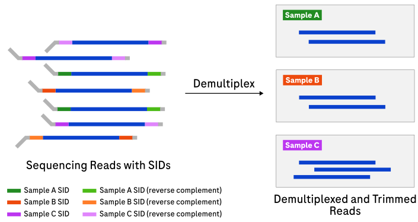
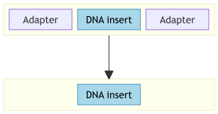
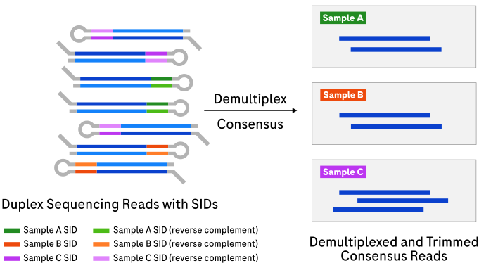

# Appendix

## Concepts and terminology

Key concepts used throughout this documentation.

| Term | Definition |
|:-----|:-----------|
| <a id="bloom-filter"></a>Bloom filter | Memory-efficient probabilistic data structure for set-membership tests. |
| <a id="consensus"></a>Consensus | Sequence generated by pairwise intramolecular consensus of R1 and R2. |
| <a id="duplex"></a>Duplex | A read with two constituent reads (R1, R2) paired intramolecularly. |
| <a id="assigned-read"></a>Assigned read | A read that has been successfully assigned to a sample using the SID of the read. |
| <a id="full-read"></a>Full read | Assigned simplex read with enough of both adapter regions before and after the insert to trim them off. The adapter design must have an adapter before and after the insert. |
| <a id="partial-read"></a>Partial read | Assigned simplex read that remains untrimmed on exactly one side. The adapter design must have at least one adapter before or after the insert. |
| <a id="full-duplex-read"></a>Full duplex read | Duplex read with identifiable insert on both R1 and R2. |
| <a id="partial-duplex-read"></a>Partial duplex read | Duplex read with a simplex region, where one or more features are missing on R1 or R2. |
| <a id="rc"></a>RC | Reverse complement. |
| <a id="runway"></a>Runway | Fixed adapter sequence at the 5′ start: `[runway][start adapter]`. |
| <a id="start-adapter"></a>Start adapter | Fixed sequence after the runway: `[runway][start adapter][R1 insert]`. |
| <a id="end-adapter"></a>End adapter | Fixed sequence at the 3′ end: `[R2 insert][end adapter]`. |
| <a id="endadapter"></a>Endadapter | Collective term for start/end adapters, which are reverse complements of each other. After consensus, the layout is `[endadapter][insert][hairpin]`. |
| <a id="loop"></a>Loop | Approximate 7 bp sequence between the two SIDs in the hairpin. |
| <a id="hairpin"></a>Hairpin | `[SID][loop][SID RC]` adapter sequence, also called midadapter. |
| <a id="linker"></a>Linker | Short, 1 to 4 bp spacer between functional regions, for example barcode and UMI. |
| <a id="linker-base"></a>Linker base | A base in the linker, usually A. |
| <a id="stem"></a>Stem | General term for a fixed adapter sequence between endadapter regions. Use more specific names when applicable. |
| <a id="hairpin-stem"></a>Hairpin stem | Stem between insert and hairpin: `[insert][stem][hairpin]`. In SBX-D this is just the linker base A. |
| <a id="r1"></a>R1 | First constituent read in a duplex read. Raw R1 is the untrimmed sequence before the loop. |
| <a id="r2"></a>R2 | Second constituent read in a duplex read. Raw R2 is the untrimmed sequence after the loop. |
| <a id="sid"></a>SID | Sample index, a sample-specific short nucleotide sequence attached to each DNA fragment before pooling. |
| <a id="valid-sid"></a>Valid SID | SID matching, within error tolerance, an entry in the sample sheet or bundle defaults. |
| <a id="umi"></a>UMI | Unique molecular index, a short sequence that tags individual molecules. |
| <a id="yc-tag"></a>YC tag | Lossless encoding of R1 and R2 in a duplex consensus read. |
| <a id="alignment-array"></a>Alignment array | Ordered pairwise alignment operations, indexed by consensus position, that describe how R1 and R2 align. |
| <a id="indel-smearing"></a>Indel smearing | Demux method for identifying consensus-preserving alternative placements of an indel in a duplex R1/R2 pairwise alignment. |
| <a id="strand-detection"></a>Strand detection | Determining the DNA strand, forward or reverse, relative to a reference genome. |
| <a id="sample-sheet"></a>Sample sheet | CSV file mapping SID sequences to sample names. See [Sample sheet format](file-formats.md#sample-sheet-format). |

### Primary analysis

A sequencer converts raw signals into nucleotide sequences (A, T, G, C) — a
process called **basecalling**. The resulting files contain millions of raw
**reads**: short sequences representing fragments of the original DNA. Primary
analysis transforms these raw reads into clean, sample-labelled sequence files
ready for downstream analysis.

### Demultiplexing

Sequencing workflows commonly pool DNA from **multiple samples** into a single
run. To distinguish samples, each is labelled with a
[sample index (SID)](#sid) — a sample-specific, short nucleotide
sequence attached to each DNA fragment before pooling. Demultiplexing reads the
SID on each raw read and sorts reads back into per-sample bins.



Without demultiplexing, reads from different samples would be mixed together.

### Sample index (SID)

A **SID** is a short, known nucleotide sequence — typically 12 bp — ligated to one
or both ends of every DNA fragment for a given sample. The SIDs in use for a run
are listed in the [sample sheet](file-formats.md#sample-sheet-format). Demux reads
the sample sheet, matches each SID in the raw reads, and assigns each read to a
sample.

### Adapter trimming

**Adapters** are short synthetic sequences added to DNA fragment ends during
library preparation. They are required for sequencing but are not part of the
biological DNA. Adapter trimming removes them so downstream tools see only the
insert sequence.



### Unique molecular index (UMI)

Some adapter designs include a **UMI** — a short random sequence attached to each
DNA molecule. Unlike SIDs (which identify the sample), UMIs identify the
**individual molecule**, distinguishing true biological duplicates from PCR
amplification artifacts.

### Simplex and duplex reads

| Term | Definition |
|:-----|:-----------|
| Simplex | A single read from one strand of a DNA molecule. |
| Duplex | A read that contains both strands of the same DNA molecule (R1 and R2) connected by a **hairpin** adapter. After sequencing, a consensus is computed from R1 and R2 to produce a higher-accuracy sequence. |



Expand the example below to see representative duplex and simplex raw read
structures.

<details>

<summary>Example raw read structures</summary>

**Duplex (SBX-D):**


Aligning R1 and R2 (reverse complement of R1) reveals concordant bases (matching,
higher confidence) and discordant bases (mismatching, lower confidence). The
`start` and `end` adapters are reverse complements of each other and flank the
inserts. The hairpin is `SID + loop + SID RC`, where `SID RC` is the reverse
complement of `SID`. This structure identifies duplex reads and assigns them to
samples.

**Simplex (YS/YSU):**


In YSU adapters, a UMI sits between the SID and the insert; YS adapters omit the
UMI. Each UMI includes a short 1–4 bp linker that spaces functional regions apart.
The paired UMI regions share a reverse complement relationship for the first 3
bases.

</details>

## Adapter designs

The [adapter design bundle](file-formats.md#adapter-bundle-structure)
(`--adapter-design-bundle`) ships several designs for simplex and duplex
libraries, with or without UMIs. Each design has a `type` that determines which
pipeline is used.

| Adapter design name | Type | Pipeline | UMI | Description |
|:--------------------|:-----|:---------|:----|:------------|
| SBX-D | `duplex` | Duplex | No | Default duplex adapter design for paired intramolecular reads that use SBX-D chemistry. |
| SBX-DM | `duplex` | Duplex | No | SBX-D adapter design for TAPS+ methylation libraries. |
| SBX-FAST | `duplex` | Duplex | No | Default duplex adapter design for paired intramolecular reads that use SBX-FAST chemistry. |
| YSU | `YSU` | Simplex | Yes | Simplex adapter for libraries that include UMIs. |
| YS | `YS` | Simplex | No | Simplex adapter for simplex libraries without UMIs. |
| I2X-S-DX | `simplex` | Simplex | No | Dual-index conversion simplex adapter. Uses distinct 5′ and 3′ SIDs and demultiplexes by the SID pair. Requires `--sample-sheet`. |
| SIMPLEX-10X | `simplex-10x` | Simplex | No | Simplex adapter for 10x-linked libraries. Only the runway and SID are trimmed (`<runway> + <sid>`); no trimming on the 3′ end is applied.\* |


The adapter design bundle can contain additional designs not listed here (e.g.,
`I2X_*` variants). These are internal or experimental and not intended for general
use.

\* Because SIMPLEX-10X only trims on the 5′ end, all assigned reads are classified
as [partial reads](#partial-read). Additional untrimmed adapter sequence before
and after the insert remains in the output for downstream tools.


## Genome strand detection

Strand detection is optional. It enables strand-aware indel left-alignment for
duplex reads without changing the [consensus](#consensus) sequence — only indel
positions (and thus quality score and [YC tag](#yc-tag) locations) are affected.
This is useful when duplex data is processed by downstream tools that expect
indels to follow a different alignment convention.

Detection uses k-mer membership queries against an interleaved Bloom filter
(forward + reverse strand), built by
[`demux_strand_index`](usage-strand-index.md). Lookups stop early once a binomial
test, controlled by `--strand-critical-phred`, classifies the read with high
confidence. Lower values classify faster at the cost of accuracy. Reads not
significantly classified use the strand with the higher k-mer count
(`strand_fw_reads` / `strand_rv_reads` metrics).

After classification, indels in the pairwise alignment are shifted as far left or
right as possible without altering the consensus, left-aligning them relative to
the reference genome. Unclassified reads (equal counts) are shifted arbitrarily
for consistency.
When enabled, genome strand detection controls the final left or right indel
anchoring used by [indel smearing](#indel-smearing), which affects the indel
locations recorded in the `YC` tag but not the consensus sequence or ambiguity
mask.

## Indel smearing

The terms **alignment array** and **indel smearing** describe Demux behavior;
they are not assumed to be standard bioinformatics terminology.

An alignment array is conceptually an expanded CIGAR-like representation of an
R1/R2 pairwise alignment in consensus orientation.
Each consensus position records whether the reads align as a match, mismatch,
insertion, or deletion.

Indel smearing is a post-alignment operation that explores alternative
placements of an unresolved indel block in that alignment array.
An indel can move only when the move preserves the consensus sequence and the
counts of matches, mismatches, insertions, and deletions.
It must not increase the number of gap openings, although grouping indels can
decrease that number.

The positions traversed by permitted moves form an **ambiguity mask**.
This defines fixed-consensus alignment ambiguity only.
Alternative alignments that would change the consensus sequence are outside
this definition and require a separate consensus-calling policy.

This ambiguity commonly occurs in homopolymers and tandem repeats, but indel
smearing is not a general low-complexity-sequence mask.
By default, Demux assigns the ambiguous duplex quality score (`9`, Q24) to
otherwise concordant bases in that mask.
Discordant and simplex-tail assignments take precedence and retain their
respective quality scores.

### Reference procedure

Demux uses an edit-distance pairwise alignment without gap-opening
penalties. Its alignment arrays can therefore contain separated indel blocks
that can be merged without changing the consensus. To account for this, first
sweep in one direction to group indels, then sweep in the opposite direction to
generate the ambiguity mask.
The final anchoring direction can differ by implementation, but it does not
change the ambiguity mask in consensus orientation.

The following pseudocode shows a leftward grouping pass followed by a
rightward marking pass.
`I` and `D` denote indel operations; the read-direction convention for those
operations is implementation-specific.

```text
is_indel(op) = op is I or D

group_left(consensus, alignment):
    indel_length = 0
    for position in [last index of consensus to 0]:
        if is_indel(alignment[position]):
            indel_length += 1
        else if indel_length > 0:
            indel_position = position + indel_length
            if consensus[position] == consensus[indel_position]:
                swap(alignment[position], alignment[indel_position])
            else:
                indel_length = 0

mark_right(consensus, alignment):
    mask = all false
    indel_length = 0
    for position in [0 to last index of consensus]:
        if is_indel(alignment[position]):
            indel_length += 1
        else if indel_length > 0:
            indel_position = position - indel_length
            if consensus[position] == consensus[indel_position]:
                mask[position] = true
                mask[indel_position] = true
                swap(alignment[position], alignment[indel_position])
            else:
                indel_length = 0
    return mask
```

The mirror-image procedure, grouping right then marking left, is equivalent
when the alignment-array orientation is reversed.

### Worked example: grouping indel blocks

This example shows why a grouping pass can be necessary when an alignment
algorithm emits separated but mergeable indel blocks.

```text
R1:                  CA-C---C
R2:                  CAACTACC
Consensus:           CAACTACC
Initial array:       ==I=III=
Index:               01234567
```

| Step | Alignment array after step | Mask after step |
|:---|:---|:---|
| Initial | `==I=III=` | `00000000` |
| Group left: 3↔6 | `==IIII==` | `00000000` |
| Group left: 1↔5 | `=IIII===` | `00000000` |
| Mark right: 1↔5 | `==IIII==` | `01000100` |

The grouping pass reduces two gap openings to one without changing the
consensus sequence or edit-operation counts.
The final mask produces this default quality assignment:

```text
Mask:                01000100
Quality:             H9&&&&HH
```

### Worked example: repeat and mismatch contexts

This example includes repeated sequence, mismatches, and indels.
It demonstrates that ambiguity masking is not limited to a homopolymer rule.

```text
R1:                  ATATACTT-G
R2:                  ATG--CTTTG
Consensus:           ATATACTTTG
Initial array:       ==XDD===I=
Index:               0123456789
```

The reference procedure completes the leftward grouping pass, then makes a
rightward marking pass.

| Step | Alignment array after step | Mask after step |
|:---|:---|:---|
| Group left (complete) | `DD==X=I===` | `0000000000` |
| Mark right: 0↔2 | `=DD=X=I===` | `1010000000` |
| Mark right: 1↔3 | `==DDX=I===` | `1111000000` |
| Mark right: 2↔4 | `==XDD=I===` | `1111100000` |
| Mark right: 6↔7 | `==XDD==I==` | `1111101100` |
| Mark right: 7↔8 | `==XDD===I=` | `1111101110` |

```text
Mask:                1111101110
Quality:             99&&&H99&H
```

## Performance and cost notes

### `demux` simplex mode

Runtime scales primarily with the number of input reads and the selected thread count.
Memory scales with `--threads` and `--batch-size`, and output remains fully
deterministic only when `--writers-per-sample 1` (the default) is used.
Increasing writing threads can improve throughput, but read order within a
sample can vary between runs.

### `demux` duplex mode

Runtime scales with input size, thread count, and whether duplex strand
detection is enabled. The default output is deterministic because
`--writers-per-sample` defaults to `1`; increasing it can improve
throughput, but read order within a sample can vary between runs. Strand
detection adds the cost of loading the Bloom filter into memory and performing
additional k-mer lookups for each classified read.

### `demux_strand_index`

Memory is at least 64 bits per unique k-mer (e.g., 1 Gbp ≈ 8 GiB). The
~10 GiB/Gbp heuristic accounts for hash-table overhead; power-of-2 sizing can
increase actual usage by up to 2× in the worst case. The human genome (~3 Gbp)
needs roughly 32 GiB to build.
