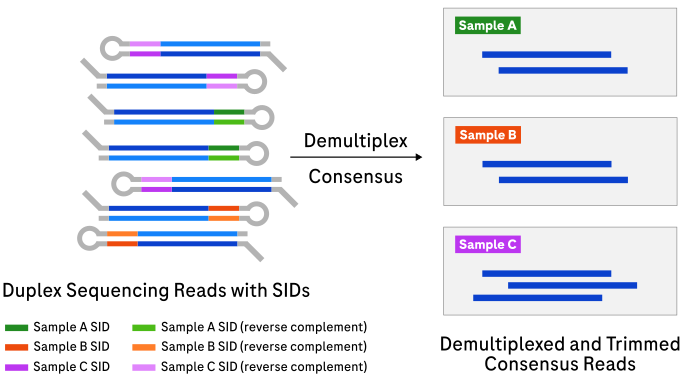

# Duplex demultiplexing

`demux` demultiplexes, trims, filters, and computes intramolecular consensus for
raw *duplex* sequencing reads. Duplex mode is selected when
`--adapter-design-name` names a duplex adapter design (SBX-D, SBX-DM, SBX-FAST).
Input: **raw FASTQ/RDB** → Output: **per-sample consensus FASTQ**.

## How it works

Each raw duplex read contains two passes of the same molecule (R1 and R2) joined
by a [hairpin](appendix.md#simplex-and-duplex-reads) adapter. `demux` locates the hairpin, reads
the [SID](appendix.md#sid) it carries, and assigns the read to a
sample. R1 and R2 are then aligned to each other to produce a higher-accuracy
[consensus](appendix.md#consensus), and a [YC tag](appendix.md#yc-tag) is
generated so the original R1/R2 sequences can be reconstructed losslessly.
Adapters are trimmed, reads are filtered, and passing consensus reads are written
per-sample.



Expand the details below for the duplex pipeline steps and an example raw read
structure.

<details>

<summary>Design details</summary>

Duplex processing adds a consensus step because each raw read contains **two**
passes of the same molecule.

Pipeline steps:

1. **Gather input files** in FASTQ or RDB format.
2. **Demultiplex** via the hairpin specified by the adapter design and sample
   sheet.
3. **Pairwise intramolecular consensus** for duplex reads, generating YC tags.
4. **Trim adapters** per the adapter design.
5. **Filter reads** by length, error rate, and other criteria.
6. **Write** processed reads to the output directory.
7. **Calculate metrics** and write summary files.

Filtering can be performed slightly out of order for performance reasons.




Aligning R1 and R2 (reverse complement of R1) reveals concordant bases
(matching, higher confidence) and discordant bases (mismatching, lower
confidence). The `start` and `end` adapters are reverse complements of each other
and flank the inserts. The hairpin is `SID + loop + SID RC`, where `SID RC` is
the reverse complement of `SID`. This structure identifies duplex reads and
assigns them to samples.

</details>

## Example command

```bash
demux \
  --adapter-design-bundle /resources/adapter-design-bundle.zip \
  --adapter-design-name SBX-D \
  --threads 16 \
  --sample-sheet /path/to/sample_sheet.csv \
  --reads /path/to/input_directory \
  --output-dir /path/to/output_directory
```

Demultiplexes reads from the input directory using the `SBX-D` adapter design.
Output is written per-sample into subdirectories under `--output-dir`. For the full
option reference, see [CLI options](#cli-options) below.

Optional [genome strand detection](appendix.md#strand-detection) is
enabled by passing a strand index (built by
[`demux_strand_index`](usage-strand-index.md)) via `--strand-index`:

```bash
demux \
  --adapter-design-bundle /resources/adapter-design-bundle.zip \
  --adapter-design-name SBX-D \
  --threads 16 \
  --reads /path/to/input_directory \
  --output-dir /path/to/output_directory \
  --strand-index strand.bloom
```

## Input

| Input | Required | Notes |
|:------|:---------|:------|
| Adapter design bundle | Yes | Passed with `--adapter-design-bundle`. ZIP or directory of adapter designs. See [Adapter bundle structure](file-formats.md#adapter-bundle-structure). Defaults to `/resources/adapter-design-bundle.zip`. |
| Raw reads | Yes | Passed with `--reads`. FASTQ, FASTQ.gz, or RDB files (or directories containing them). |
| Sample sheet | No | Passed with `--sample-sheet`. Restricts SID lookup to this [sheet](file-formats.md#sample-sheet-format). Falls back to the bundle's default sheet if omitted. The default sheet can include samples not associated with the run. |
| Strand index | No | Bloom filter from [`demux_strand_index`](usage-strand-index.md), passed via `--strand-index` to enable [genome strand detection](appendix.md#strand-detection). |

## Output

Output is written to `--output-dir` (default the current directory). See
[Output directory and filename structure](file-formats.md#output-directory-and-filename-structure)
for the full layout. Each passing consensus read carries a
[YC tag](appendix.md#yc-tag) encoding its R1 and R2 sequences.

| Output | Description |
|:-------|:------------|
| Per-sample FASTQ | Demultiplexed consensus reads in a subdirectory per sample, named `<sample_name>-<part_index>.fastq[.gz\|.zst]`. |
| *file_provenance.tsv* | Maps each output FASTQ file to the input file it was derived from (one per sample subdirectory). |
| Run metrics (*run_stats.tsv*) | Run-level summary statistics. See [Metrics](metrics.md#duplex-run-metrics). |
| Sample metrics (*sample_stats.tsv*) | Per-sample statistics. See [Metrics](metrics.md#duplex-sample-metrics). |
| Read and region size distributions | TSV files, one per distribution metric. See [Metrics](metrics.md#duplex-length-distribution-metrics). |

## Tips for analysis

Expand the note below for throughput and memory tuning guidance.

<details>

<summary>Throughput and memory</summary>

Increase `--batch-size` for better throughput at the cost of higher memory
usage. Memory scales with thread count and `--batch-size`; with defaults,
allocate roughly 1 GB per 10 threads. Strand detection adds the strand index file
size.

</details>

Performance and cost notes for simplex, duplex, and strand-index workflows are
described in the [Appendix](appendix.md#performance-and-cost-notes).

## CLI options

This command also accepts the common `-h, --help`, `-v, --version`, and
`-l, --log-level` options.

Parameters in **bold** are required. Options in the [Duplex options](#duplex-options)
group only take effect for duplex adapter designs. See
[Adapter designs](appendix.md#adapter-designs) for how the simplex/duplex adapter
type is determined.

### Input options

| Parameter | Description | Value(s) |
|:----------|:------------|:---------|
| **--reads** | Input FASTQ, FASTQ.gz, or RDB files or directories. May be specified multiple times or as a space-separated list. | A string file path |
| --reads-file-list | File listing input paths (alternative to `--reads`). | A string file path |
| --sample-sheet | Restrict SID lookup to this sheet; otherwise the bundle's default is used. See [Sample sheet format](file-formats.md#sample-sheet-format). | A string file path |
| --adapter-design-bundle | Path to ZIP or directory containing adapter architecture and search strategy. | A string file path [default `/resources/adapter-design-bundle.zip`] |
| --adapter-design-name | Required adapter design name to load from the bundle. Determines whether the simplex or duplex pipeline is used. | A string |

### Output options

| Parameter | Description | Value(s) |
|:----------|:------------|:---------|
| --output-dir | Output directory for demultiplexed reads and metrics. | A string directory path [default `.`] |
| --overwrite | Allow overwriting an existing output directory. | No value (flag) |
| --compression-type | Compression type for output FASTQs. `none` disables compression. | Either `zstd`, `gzip`, `none` [default `gzip`] |
| --compression-level | Compression level for output FASTQs (`zstd`: 1–19, `gzip`: 1–9). Higher values increase compression at the cost of speed. | An integer >= 1 and <= 19 [default `1`] |
| --write-failed-reads | Write unaltered failed reads to files prefixed `raw_failed`. | No value (flag) |

### Read filtering options

| Parameter | Description | Value(s) |
|:----------|:------------|:---------|
| --min-read-length | Filter raw reads shorter than this length. | An integer > 0 [default `50`] |
| --min-trimmed-read-length | Filter trimmed reads shorter than this length. | An integer > 0 [default `50`] |

### Metrics reporting options

| Parameter | Description | Value(s) |
|:----------|:------------|:---------|
| --max-read-length-bin | Maximum read length bucket in the length distribution report. | An integer > 0 [default `1000`] |

### Performance options

| Parameter | Description | Value(s) |
|:----------|:------------|:---------|
| --batch-size | Number of reads to process in each batch. | An integer > 0 [default `500`] |
| --threads | Number of threads used (0=available hardware threads). | An integer >= 0 [default `1`] |
| --writers-per-sample | Writer threads per sample (1–8). Output is deterministic at 1 (default); with >1, read order can vary between runs. | An integer > 0 and <= 8 [default `1`] |
| --workers-per-reads-file | Controls how many input files are processed concurrently: `concurrent inputs = threads / workers-per-reads-file` (minimum 1). Higher values reduce concurrency, which can lower memory pressure for large files. Clamped to `--threads` if larger. | An integer >= 1 [default `4`] |

### Duplex options

These options only take effect when the adapter design selects the duplex
pipeline (SBX-D, SBX-DM, SBX-FAST).

| Parameter | Description | Value(s) |
|:----------|:------------|:---------|
| --max-pairwise-error-rate | Maximum pairwise error rate for retaining a duplex consensus region. | A float >= 0 and <= 1 [default `0.1`] |
| --min-concordant-duplex-bases-for-early-stop | Minimum concordant duplex bases per sample for early stopping. | An integer |
| --strand-critical-phred | In duplex strand detection mode, this is the Phred scaled FPR critical value -10*log10(critical_value). Low values will classify faster at cost of accuracy. | A double > 0 [default `70`] |
| --ambiguous-topology-quality-mode | Mode to set a base-call quality score (default `9`) for duplex consensus bases at topologically ambiguous indel positions. `none`: disabled; ambiguous bases keep their normal duplex quality score. `smear`: smear the ambiguous score over concordant bases an indel could validly occupy (consensus-preserving; populates `ambiguous_duplex_bases`). `smear-override`: `smear` plus rewrite discordant bases to the ambiguous score where the smear marks them (overridden bases count as ambiguous; the YC tag is unchanged). | `none`, `smear`, or `smear-override` [default `smear`] |
| --quality-score-overrides | Output base-call quality scores (phred+33) for simplex, concordant, discordant, and ambiguous bases, in that order. The simplex score also applies to the simplex tail of duplex reads. | A 4-character phred+33 string (`!` to `~`) [default `7H&9`] |
| --strand-index | Enable [strand detection](appendix.md#strand-detection) using a Bloom filter built by [`demux_strand_index`](usage-strand-index.md). | A string file path |
