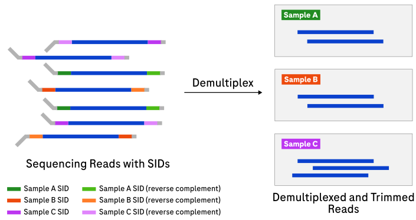

# Simplex demultiplexing

`demux` demultiplexes, trims, and filters raw *simplex* sequencing reads. Simplex
mode is selected when `--adapter-design-name` names a simplex adapter design (YS,
YSU, I2X-S-DX, SIMPLEX-10X). Input: **raw FASTQ/RDB** → Output: **per-sample
demultiplexed FASTQ**.

## How it works

Each read carries a [sample index (SID)](appendix.md#sid) at its 5′
and/or 3′ end. `demux` locates the SID, matches it against the
[sample sheet](file-formats.md#sample-sheet-format), and assigns the read to a
sample (or marks it unassigned when no match is found). Adapter sequences are
then trimmed away, short reads are filtered out, and passing reads are written to
per-sample subdirectories.

### Dual-index simplex

`I2X-S-DX` uses distinct 5′ and 3′ SIDs and requires a sample sheet that maps
each valid SID pair to a sample.
Demux scores each end independently, then accepts a full read only when a
sample-sheet-defined pair passes the joint score threshold.
For a read assigned by exactly one SID, Demux trims the verified fixed stem on
the unresolved side where it is present.
A terminal fragment of that stem is also trimmed when at least 16 insert-facing
bases reach the physical read end.
The read remains partial because the opposite SID was not detected.



Expand the details below for the simplex pipeline steps and an example raw read
structure.

<details>

<summary>Design details</summary>

Pipeline steps:

1. **Gather input files** in FASTQ or RDB format.
2. **Demultiplex input reads** into different samples using the provided sample
   sheet and adapter design.
3. **Trim adapters** from reads according to the specified adapter design.
4. **Filter reads** based on length, error rate, and other specified criteria.
5. **Write processed reads** to the output directory.
6. **Calculate metrics** and write summary output files.

Filtering can be performed slightly out of order for performance reasons.




In YSU adapters, a [UMI](appendix.md#umi) sits between the SID and the insert; YS
adapters omit the UMI. Each UMI includes a short 1–4 bp linker that spaces
functional regions apart. The paired UMI regions share a reverse complement
relationship for the first 3 bases.

</details>

## Example command

```bash
demux \
  --adapter-design-bundle /resources/adapter-design-bundle.zip \
  --adapter-design-name YSU \
  --threads 16 \
  --sample-sheet /path/to/sample_sheet.csv \
  --reads /path/to/input_directory \
  --output-dir /path/to/output_directory
```

Demultiplexes reads from the input directory using the `YSU` adapter design.
Output is written per-sample into subdirectories under `--output-dir`. For the full
option reference, see [CLI options](#cli-options) below.

## Input

| Input | Required | Notes |
|:------|:---------|:------|
| Adapter design bundle | Yes | Passed with `--adapter-design-bundle`. ZIP or directory of adapter designs. See [Adapter bundle structure](file-formats.md#adapter-bundle-structure). Defaults to `/resources/adapter-design-bundle.zip`. |
| Raw reads | Yes | Passed with `--reads`. FASTQ, FASTQ.gz, or RDB files (or directories containing them). |
| Sample sheet | No | Passed with `--sample-sheet`. Restricts SID lookup to this [sheet](file-formats.md#sample-sheet-format). Falls back to the bundle's default sheet if omitted. The default sheet can include samples not associated with the run. |

## Output

Output is written to `--output-dir` (default the current directory). See
[Output directory and filename structure](file-formats.md#output-directory-and-filename-structure)
for the full layout.

| Output | Description |
|:-------|:------------|
| Per-sample FASTQ | Demultiplexed reads in a subdirectory per sample, named `<sample_name>-<part_index>.fastq[.gz\|.zst]`. |
| *file_provenance.tsv* | Maps each output FASTQ file to the input file it was derived from (one per sample subdirectory). |
| Run metrics (*run_stats.tsv*) | Run-level summary statistics. See [Metrics](metrics.md#simplex-run-metrics). |
| Sample metrics (*sample_stats.tsv*) | Per-sample statistics. See [Metrics](metrics.md#simplex-sample-metrics). |
| Sample assignment metrics (*sample_assignment_metrics.tsv*) | SID collision statistics. See [Metrics](metrics.md#sample-assignment-metrics). |
| Read length distributions | Run-level TSV histograms in `metrics/read_length_distr/` and per-sample TSV histograms in `metrics/read_length_distr/<sample-name>_read_length_distr/`; passing-read TSVs combine total, full, and partial counts. See [Metrics](metrics.md#simplex-read-length-distribution-metrics). |


When `--adapter-design-name SIMPLEX-10X` is used for 10x scRNA libraries, only
the 5′ SID is detected and trimmed. All assigned reads are therefore reported as
[partial reads](appendix.md#partial-read), and metrics that depend on 3′ SID
detection report a value of zero.


## Tips for analysis

Expand the note below for throughput and memory tuning guidance.

<details>

<summary>Throughput and memory</summary>

Increase `--batch-size` for better throughput at the cost of higher memory
usage. Memory scales with thread count and `--batch-size`; with defaults,
allocate roughly 1 GB per 10 threads.

</details>

Performance and cost notes for simplex, duplex, and strand-index workflows are
described in the [Appendix](appendix.md#performance-and-cost-notes).

## CLI options

This command also accepts the common `-h, --help`, `-v, --version`, and
`-l, --log-level` options.

Parameters in **bold** are required. Options in the [Simplex options](#simplex-options)
group only take effect for simplex adapter designs. See
[Adapter designs](appendix.md#adapter-designs) for how the simplex/duplex adapter
type is determined.

### Input options

| Parameter | Description | Value(s) |
|:----------|:------------|:---------|
| **--reads** | Input FASTQ, FASTQ.gz, or RDB files or directories. May be specified multiple times or as a space-separated list. | A string file path |
| --reads-file-list | File listing input paths (alternative to `--reads`). | A string file path |
| --sample-sheet | Restrict SID lookup to this sheet; otherwise the bundle's default is used. See [Sample sheet format](file-formats.md#sample-sheet-format). | A string file path |
| --adapter-design-bundle | Path to ZIP or directory containing adapter architecture and search strategy. | A string file path [default `/resources/adapter-design-bundle.zip`] |
| --adapter-design-name | Required adapter design name to load from the bundle. Determines whether the simplex or duplex pipeline is used. | A string |

### Output options

| Parameter | Description | Value(s) |
|:----------|:------------|:---------|
| --output-dir | Output directory for demultiplexed reads and metrics. | A string directory path [default `.`] |
| --overwrite | Allow overwriting an existing output directory. | No value (flag) |
| --compression-type | Compression type for output FASTQs. `none` disables compression. | Either `zstd`, `gzip`, `none` [default `gzip`] |
| --compression-level | Compression level for output FASTQs (`zstd`: 1–19, `gzip`: 1–9). Higher values increase compression at the cost of speed. | An integer >= 1 and <= 19 [default `1`] |
| --write-failed-reads | Write unaltered failed reads to files prefixed `raw_failed`. | No value (flag) |

### Read filtering options

| Parameter | Description | Value(s) |
|:----------|:------------|:---------|
| --min-read-length | Filter raw reads shorter than this length. | An integer > 0 [default `50`] |
| --min-trimmed-read-length | Filter trimmed reads shorter than this length. | An integer > 0 [default `50`] |

### Metrics reporting options

| Parameter | Description | Value(s) |
|:----------|:------------|:---------|
| --max-read-length-bin | Maximum read length bucket in the length distribution report. | An integer > 0 [default `1000`] |

### Performance options

| Parameter | Description | Value(s) |
|:----------|:------------|:---------|
| --batch-size | Number of reads to process in each batch. | An integer > 0 [default `500`] |
| --threads | Number of threads used (0=available hardware threads). | An integer >= 0 [default `1`] |
| --writers-per-sample | Writer threads per sample (1–8). Output is deterministic at 1 (default); with >1, read order can vary between runs. | An integer > 0 and <= 8 [default `1`] |
| --workers-per-reads-file | Controls how many input files are processed concurrently: `concurrent inputs = threads / workers-per-reads-file` (minimum 1). Higher values reduce concurrency, which can lower memory pressure for large files. Clamped to `--threads` if larger. | An integer >= 1 [default `4`] |

### Simplex options

These options only take effect when the adapter design selects the simplex
pipeline (YS, YSU, I2X-S-DX, SIMPLEX-10X).

| Parameter | Description | Value(s) |
|:----------|:------------|:---------|
| --read-length-mode | Simplex read output mode. `full-only`: emit only full-length reads. `all`: emit full and partial reads together. `all-split`: emit full and partial reads into separate subdirectories (`<sample>/full/`, `<sample>/partial/`). | `full-only`, `all`, or `all-split` [default `all`] |
| --discordant-sid-mode | Determines how to handle reads where 5′ and 3′ SIDs disagree. `discard-tied`: discard only when both sides are equally likely. `discard-all`: discard all discordant reads. `keep`: keep all discordant reads, assign to winning side. | `discard-tied`, `discard-all`, or `keep` [default `discard-all`] |
| --dual-sid-mode | Controls single-ended assignment for dual-SID simplex designs (I2X-S-DX). `none`: allow a 5′-only or 3′-only assignment only when that side's SID sequence is unique in the sample sheet. `need-5p`: disable 3′-only assignment. `need-3p`: disable 5′-only assignment. `need-both`: disable single-ended assignment. | `none`, `need-5p`, `need-3p`, or `need-both` [default `none`] |
| --override-simplex-quality | Override base-call quality scores for simplex adapter reads (YS, YSU, I2X-S-DX, SIMPLEX-10X) with a fixed simplex value. By default, the original base-call quality scores are preserved. | No value (flag) |
| --min-score | Minimum log-odds score for a valid adapter match (experimental, subset of adapters only). | An integer >= 0 [default `30`] |
