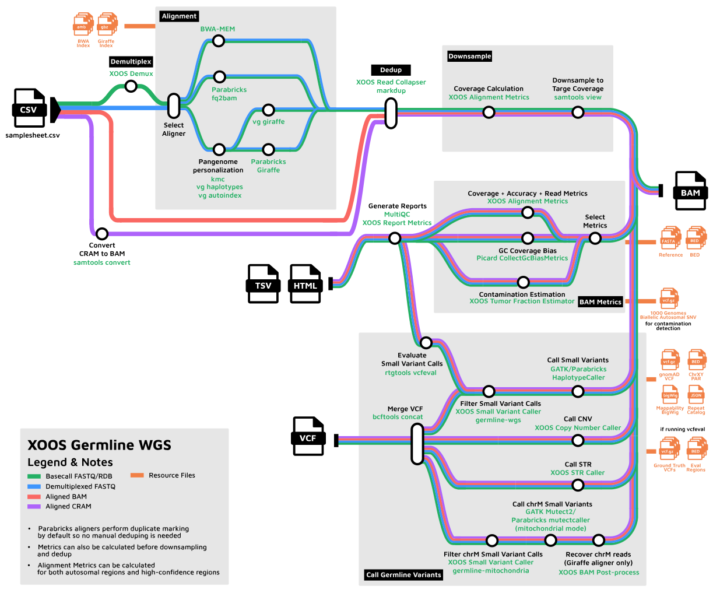
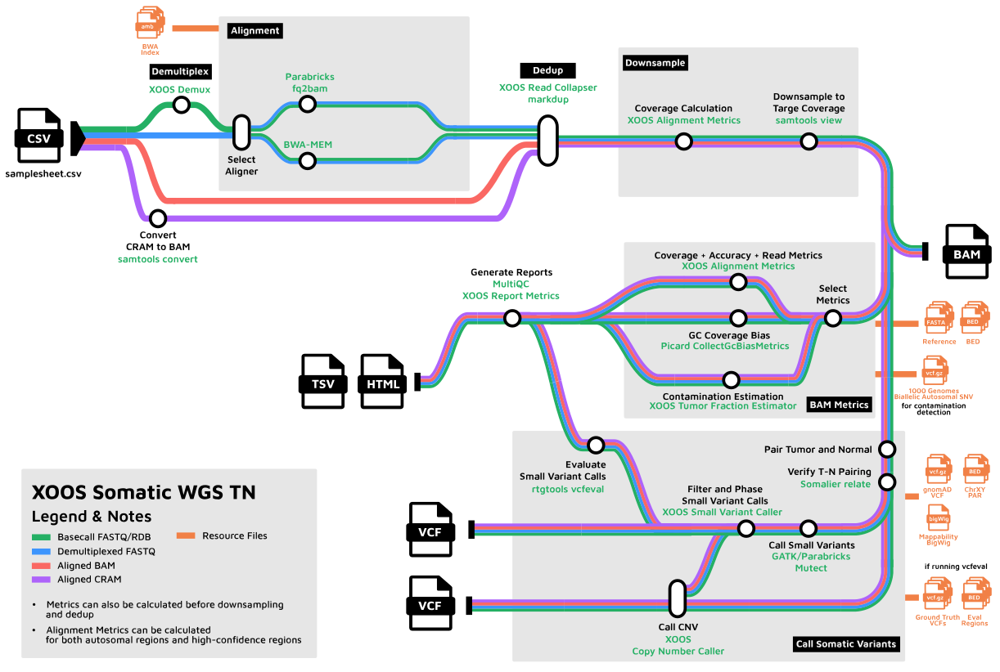
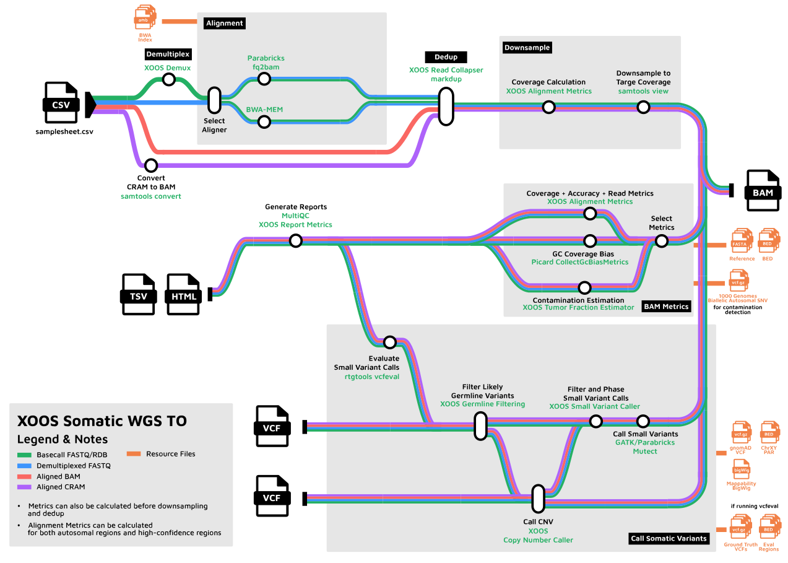
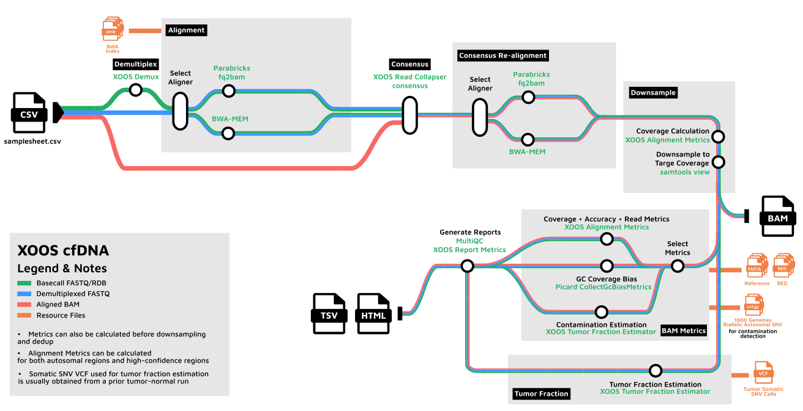

# Applications
<!-- markdownlint-disable MD024 -->

The XOOS pipeline supports five end-to-end applications for SBX Duplex (SBX-D) and SBX Simplex (SBX-S) data.
Each application is selected by a Nextflow **analysis profile** (passed via `-profile`) together with an appropriately structured samplesheet.
Chemistry support depends on the selected profile; the somatic and cfDNA profiles listed here use SBX-D.
This page describes each application and how to configure and run it.

| Application | Analysis profile | Variant calling mode |
|:------------|:-----------------|:---------------------|
| [SBX-D Germline WGS](#sbx-d-germline-wgs) | `germline_wgs_duplex` | `germline` |
| [SBX-S Germline WGS](#sbx-s-germline-wgs) | `germline_wgs_simplex` | `germline` |
| [SBX-D Somatic Tumor/Normal WGS](#sbx-d-somatic-tumornormal-wgs) | `somatic_wgs_tn_duplex` | `somatic_tn` |
| [SBX-D Somatic Tumor-Only WGS](#sbx-d-somatic-tumor-only-wgs) | `somatic_wgs_to_duplex` | `somatic_to` |
| [SBX-D cfDNA WGS](#sbx-d-cfdna-wgs) | `cfdna_wgs_duplex` | `none` (reporter against an external VCF) |


The cfDNA application depends on the output of the Somatic Tumor/Normal application. Run a
matched Tumor/Normal analysis first, then feed its output VCF into the cfDNA analysis. See
[SBX-D cfDNA WGS](#sbx-d-cfdna-wgs) below.


For the full profile parameter matrix, see
[Analysis profiles (xoosnf)](README.md#analysis-profiles-xoosnf). For the complete samplesheet
column reference, see [Input samplesheet](README.md#input-run-sheet-format).

---

## SBX-D Germline WGS

Germline whole-genome small variant and copy number analysis for a single sample (no matched
normal). Uses pangenome-personalized alignment and germline variant calling.



The optional mitochondrial branch uses [Mitochondrial BAM Post-Process](../../bam_post_process/README.md) to recover misaligned mitochondrial reads from Giraffe alignments before calling chrM variants with GATK Mutect2 in mitochondrial mode or Parabricks MutectCaller. For BWA alignments the mitochondrial read alignments are passed directly to GATK Mutect2 in mitochondrial mode or Parabricks MutectCaller.
The Small Variant Caller (SVC) applies its germline-mitochondria threshold filter to produce a chrM VCF, which is merged with the nuclear calls in the final VCF.
Enable this branch with [`--enable_mitochondrial_variant_caller`](README.md#variant-calling-options).
See [Variant calling options](README.md#variant-calling-options) for caller selection and Giraffe post-processing settings.

### Configure

Use a samplesheet with one row per sample and no `group` or `TN` columns.

```csv
sample_name,sample_sid,target_coverage
SAMPLE_A,ACGTACGT,30
SAMPLE_B,TTGGCCAA,30
```

Set the run-sheet `run_type` to `SBX-D`.

```csv
run_name,run_type,file_type,run_dir,samplesheet
run_001,SBX-D,basecall_rdb,/data/axelios/run_001,/data/axelios/run_001_samplesheet.csv
```

### Run

```bash
xoos run \
    --env ENV_NAME \
    --pipeline-script PATH_OR_URI_TO_PIPELINE_SCRIPT \
    --resources-base PATH_OR_URI_TO_RESOURCES_BASE \
    --analysis-dir PATH_OR_URI_TO_ANALYSIS_DIR \
    -- \
    --input run_sheet.csv \
    --outdir results/ \
    -profile docker,germline_wgs_duplex
```

Use `germline_wgs_duplex_benchmark` to additionally run bam subsampling, SVC model retraining and VCF evaluation.

### Datasets

The following public GIAB datasets were generated using XOOS 0.80:

**[GIAB BAMs — BWA, 30× downsampled](https://web.sbxdata.kamino.platform.navify.com/files/081326-AXELIOS-1-SBXD-GIAB-XOOS-BAMs-BWA-30x-Duplex/)**
BAMs generated using XOOS 0.80.
Downsampled to 30× using Concordant Duplex Coverage — only concordant duplex bases count toward coverage depth.
Aligned with BWA.

**[GIAB BAMs — BWA, non-downsampled](https://web.sbxdata.kamino.platform.navify.com/files/081326-AXELIOS-1-SBXD-GIAB-XOOS-BAMs-BWA-Non-Downsampled/)**
BAMs generated using XOOS 0.80.
Full coverage, not downsampled.
Aligned with BWA.

**[GIAB BAMs — Giraffe, 30× downsampled](https://web.sbxdata.kamino.platform.navify.com/files/081326-AXELIOS-1-SBXD-GIAB-XOOS-BAMs-Giraffe-30x-Duplex/)**
BAMs generated using XOOS 0.80.
Downsampled to 30× using Concordant Duplex Coverage — only concordant duplex bases count toward coverage depth.
Aligned with Giraffe.

**[GIAB BAMs — Giraffe, non-downsampled](https://web.sbxdata.kamino.platform.navify.com/files/081326-AXELIOS-1-SBXD-GIAB-XOOS-BAMs-Giraffe-Non-Downsampled/)**
BAMs generated using XOOS 0.80.
Full coverage, not downsampled.
Aligned with Giraffe.

**[GIAB XOOS VCFs — Giraffe, 30× downsampled](https://web.sbxdata.kamino.platform.navify.com/files/081326-AXELIOS-1-SBXD-GIAB-XOOS-VCFs-Giraffe-30x-Duplex/)**
VCFs generated using XOOS 0.80.
Downsampled to 30× using Concordant Duplex Coverage — only concordant duplex bases count toward coverage depth.
Aligned with Giraffe with pangenome personalization enabled.

**[GIAB XOOS VCFs — Giraffe, non-downsampled](https://web.sbxdata.kamino.platform.navify.com/files/081326-AXELIOS-1-SBXD-GIAB-XOOS-VCFs-Giraffe-Non-Downsampled/)**
VCFs generated using XOOS 0.80.
Full coverage, not downsampled.
Aligned with Giraffe with pangenome personalization enabled.

**[GIAB demultiplexed FASTQ](https://web.sbxdata.kamino.platform.navify.com/files/081326-AXELIOS-1-SBXD-GIAB-XOOS-Demultiplexed-FASTQ/)**
Demultiplexed FASTQ files for GIAB samples.

---

## SBX-S Germline WGS

Germline whole-genome small-variant and copy-number calling for SBX-S sequencing data.
This application uses pangenome-personalized Parabricks `pb_giraffe` alignment and XOOS read-collapser MARKDUP.
It retains partial reads during demultiplexing.
It estimates cross-sample contamination.
It requires the unfiltered Giraffe index and linearized-reference resources.
The Parabricks Giraffe alignment task requests 96 CPUs and 256 GB host memory.
On retry, it requests 192 CPUs and 512 GB host memory.

### Configure

Use a samplesheet with one row per sample and no `group` or `TN` columns.

```csv
sample_name,sample_sid,target_coverage
SAMPLE_A,ACGTACGT,30
SAMPLE_B,TTGGCCAA,30
```

For SBX-S data, set the run-sheet `run_type` to `YS`, `YSU`, or `YS-NEW`.
The pipeline maps these run types to the SVC simplex library type internally.

```csv
run_name,run_type,file_type,run_dir,samplesheet
run_001,YS,basecall_rdb,/data/axelios/run_001,/data/axelios/run_001_samplesheet.csv
```

### Run

```bash
xoos run \
    --env ENV_NAME \
    --pipeline-script PATH_OR_URI_TO_PIPELINE_SCRIPT \
    --resources-base PATH_OR_URI_TO_RESOURCES_BASE \
    --analysis-dir PATH_OR_URI_TO_ANALYSIS_DIR \
    -- \
    --input run_sheet.csv \
    --outdir results/ \
    -profile docker,germline_wgs_simplex
```

Use `germline_wgs_simplex_benchmark` to additionally run bam subsampling, SVC model retraining and VCF evaluation.

---

## SBX-D Somatic Tumor/Normal WGS

Somatic small variant and copy number analysis using a matched tumor and normal sample. Tumor and normal are
paired by the `group` column; the `TN` column designates each sample's role.



### Configure

Use a samplesheet with one row per sample with additional `group` and `TN` column to specify tumor-normal pairs.
Each tumor-normal pair shares a unique `group` value. `TN` must be `T` for the tumor and `N`
for the normal.

```csv
sample_name,sample_sid,group,TN,target_coverage
SAMPLE01_TUMOR,ACGTACGT,SAMPLE01,T,60
SAMPLE01_NORMAL,TTGGCCAA,SAMPLE01,N,30
```


`TN` and `group` must be provided together, and `group` must be unique per tumor-normal pair
across all runs. Tumor and normal samples may live in different runs (see the multi-run
samplesheet example in the [README](README.md#input-run-sheet-format)).


Optionally set `sample_type` to `auto-detect`, `ffpe`, or `cell-line` to select the somatic tumor-normal model and thresholds.
When you omit `sample_type`, the pipeline uses `auto-detect`.
Set `ffpe` or `cell-line` explicitly to override automatic detection.

Set the run-sheet `run_type` to `SBX-D`.

```csv
run_name,run_type,file_type,run_dir,samplesheet
run_001,SBX-D,basecall_rdb,/data/axelios/run_001,/data/axelios/run_001_samplesheet.csv
```

### Run

```bash
xoos run \
    --env ENV_NAME \
    --pipeline-script PATH_OR_URI_TO_PIPELINE_SCRIPT \
    --resources-base PATH_OR_URI_TO_RESOURCES_BASE \
    --analysis-dir PATH_OR_URI_TO_ANALYSIS_DIR \
    -- \
    --input run_sheet.csv \
    --outdir results/ \
    --svc_panel_of_normals_vcf /path/to/pon.vcf.gz \
    --svc_panel_of_normals_tbi /path/to/pon.vcf.gz.tbi \
    -profile docker,somatic_wgs_tn_duplex
```

Remove both PON parameter lines when running without a PON.

The somatic small variant VCF produced here can be used as the input to the cfDNA application below.


**Somatic variant phasing**: The pipeline supports SVC variant phasing for both somatic tumor-normal (`somatic_tn`) and somatic tumor-only (`somatic_to`) workflows.
After SVC filtering, somatic variants are phased using the Mutect output BAM and the SVC-filtered VCF.
The final somatic VCF contains the phasing annotations and its tabix index.


### Datasets

The following SBX-D webinar datasets are available from the [SBX Data portal](https://web.sbxdata.kamino.platform.navify.com/files/):

**[FFPE BWA BAMs](https://web.sbxdata.kamino.platform.navify.com/files/093026-Webinar-SBXD-FFPE-BWA-BAMs/)**
BWA-aligned BAMs for FFPE samples.

**[Buffy Coat BWA BAMs](https://web.sbxdata.kamino.platform.navify.com/files/093026-Webinar-SBXD-BuffyCoat-BWA-BAMs/)**
BWA-aligned BAMs for Buffy Coat normal samples.

**[FFPE VCFs](https://web.sbxdata.kamino.platform.navify.com/files/093026-Webinar-SBXD-FFPE-VCFs/)**
VCF files for FFPE samples.

---

## SBX-D Somatic Tumor-Only WGS



Somatic small variant and copy number analysis for tumor samples without a matched normal.
Each tumor sample is analyzed independently with tumor-only Mutect2 calling.

### Configure

Use one row per tumor sample.
Do not include the `group` or `TN` columns, which are only used for matched tumor-normal pairs:

```csv
sample_name,sample_sid,target_coverage
SAMPLE01_TUMOR,ACGTACGT,60
```

The profile enables somatic small-variant filtering, copy-number calling, germline filtering,
and merging of the small-variant and copy-number VCFs by default.
To provide a panel of normals for small-variant filtering, set
`--svc_panel_of_normals_vcf` and `--svc_panel_of_normals_tbi` together.

Set the run-sheet `run_type` to `SBX-D`.

```csv
run_name,run_type,file_type,run_dir,samplesheet
run_001,SBX-D,basecall_rdb,/data/axelios/run_001,/data/axelios/run_001_samplesheet.csv
```

### Run

```bash
xoos run \
    --env ENV_NAME \
    --pipeline-script PATH_OR_URI_TO_PIPELINE_SCRIPT \
    --resources-base PATH_OR_URI_TO_RESOURCES_BASE \
    --analysis-dir PATH_OR_URI_TO_ANALYSIS_DIR \
    -- \
    --input run_sheet.csv \
    --outdir results/ \
    --svc_panel_of_normals_vcf /path/to/pon.vcf.gz \
    --svc_panel_of_normals_tbi /path/to/pon.vcf.gz.tbi \
    -profile docker,somatic_wgs_to_duplex
```

Remove both panel-of-normals parameter lines when running without a panel of normals.
The filtered small-variant VCF is phased with the corresponding Mutect output BAM before
germline filtering.

### Datasets

The following webinar dataset can also be used as input for tumor-only analysis:

**[FFPE BWA BAMs](https://web.sbxdata.kamino.platform.navify.com/files/093026-Webinar-SBXD-FFPE-BWA-BAMs/)**
BWA-aligned BAMs for FFPE tumor samples.


**Somatic variant phasing**: The pipeline supports SVC variant phasing for both somatic tumor-normal (`somatic_tn`) and somatic tumor-only (`somatic_to`) workflows.
After SVC filtering, somatic variants are phased using the Mutect output BAM and the SVC-filtered VCF.
In the tumor-only workflow, phasing runs before germline filtering.
The final somatic VCF contains the phasing annotations and its tabix index.


---

## SBX-D cfDNA WGS

Cell-free DNA analysis. The cfDNA profile does not call variants de novo; instead it reports
on a set of variants supplied per sample via `reporter_vcf`. This is typically used for
tumor-informed cfDNA monitoring, where the variants come from a prior tumor/normal analysis of
the same individual.



### Workflow dependency


**Run Somatic Tumor/Normal first.** The recommended workflow is:

1. Run [SBX-D Somatic Tumor/Normal WGS](#sbx-d-somatic-tumornormal-wgs) on the individual's matched
   tumor and normal samples.
2. Take the somatic small variant VCF produced by that run.
3. Supply that VCF as the `reporter_vcf` for the individual's cfDNA sample(s) in the cfDNA
   samplesheet.

This produces a tumor-informed cfDNA report keyed to the somatic variants identified for that
individual.


### Configure

Add a `reporter_vcf` column pointing at the somatic VCF from step 1 (the file must exist):

```csv
sample_name,sample_sid,target_coverage,reporter_vcf
SAMPLE01_CFDNA,ACGTACGT,60,/data/results/SAMPLE01_somatic/SAMPLE01.somatic.vcf.gz
```

### Run

```bash
xoos run \
    --env ENV_NAME \
    --pipeline-script PATH_OR_URI_TO_PIPELINE_SCRIPT \
    --resources-base PATH_OR_URI_TO_RESOURCES_BASE \
    --analysis-dir PATH_OR_URI_TO_ANALYSIS_DIR \
    -- \
    --input run_sheet.csv \
    --outdir results/ \
    -profile docker,cfdna_wgs_duplex
```

The cfDNA profile uses consensus deduplication (`dedup_strategy = consensus`) and the
`wgs-duplex-cfdna` read-collapser preset, which differ from the germline and somatic profiles.

### Datasets

The following SBX-D webinar datasets are available from the [SBX Data portal](https://web.sbxdata.kamino.platform.navify.com/files/):

**[cfDNA BWA BAMs](https://web.sbxdata.kamino.platform.navify.com/files/093026-Webinar-SBXD-cfDNA-BWA-BAMs/)**
BWA-aligned BAMs for cfDNA samples.

**[cfDNA tumor fraction](https://web.sbxdata.kamino.platform.navify.com/files/093026-Webinar-SBXD-cfDNA-TF/)**
cfDNA data for tumor-fraction analysis.
