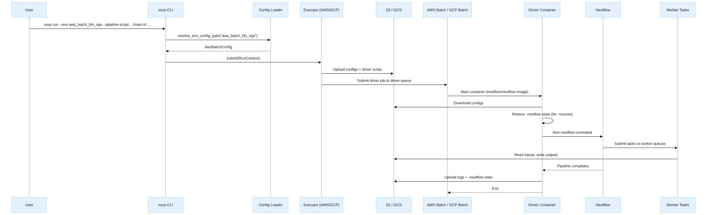

# XOOS Pipeline System Architecture

## Overview

The XOOS pipeline system consists of two repositories that work together to run bioinformatics analysis pipelines on cloud infrastructure:

| Repository | Role |
|---|---|
| **xoosnf** | An nf-core style Nextflow pipeline for end-to-end processing of SBX sequencing data (demux, alignment, variant calling, QC). |
| **xoos** (pipeline_launcher) | A Python CLI (`xoos`) that abstracts Nextflow pipeline submission across local, Slurm, AWS Batch, and GCP Batch environments. |

The user interacts only with pipeline_launcher. It reads an environment config, uploads pipeline configs to cloud storage, and submits a batch job that runs Nextflow, which in turn executes the xoosnf pipeline.



---

## pipeline_launcher and xoosnf

### Relationship

pipeline_launcher does not contain pipeline logic. It is a submission tool that wraps Nextflow invocation of any Nextflow pipeline, including xoosnf. The launcher:

1. Loads an **environment config** (YAML) that selects the executor type and cloud-specific settings.
2. Loads **Nextflow config files** that define process resources, queue routing, and retry strategies for that environment.
3. Renders a **driver script** (Jinja template) that handles Nextflow lifecycle inside a container.
4. Uploads configs + driver script to cloud storage.
5. Submits a batch job that runs the driver, which in turn runs Nextflow against the pipeline.

### Environment Configs

Environment configs are YAML files in `pipeline_launcher/src/pipeline_launcher/env/`. Each file describes one execution target:

```text
env/
├── aws_batch_<environment>.yaml    # AWS Batch
├── gcp_batch_<environment>.yaml    # GCP Batch
├── slurm_<cluster>.yaml            # Slurm HPC
├── local_<profile>.yaml            # Local execution
└── ...
```

The `executor` field determines which executor class handles the submission:

| `executor` value | Python class | Backend |
|---|---|---|
| `local` | `LocalExecutor` | Runs Nextflow directly on the current machine |
| `slurm` | `SlurmExecutor` | Submits an sbatch driver script |
| `aws_batch` | `AwsBatchExecutor` | Submits a containerized driver to AWS Batch |
| `gcp_batch` | `GcpBatchExecutor` | Submits a containerized driver to GCP Batch |

### Nextflow Config Files

Each environment config references one or more Nextflow config files via the `config_files` array. These are stored in `pipeline_launcher/src/pipeline_launcher/nextflow_config/env/` and define:

- **Process resource labels** (`process_single`, `process_low`, `process_medium`, `process_high`, `process_gpu`, etc.) — CPU, memory, time, and disk allocations.
- **Queue routing** — a closure that maps CPU/memory requirements to specific batch queue names.
- **Retry and error strategies** — exponential backoff for spot interruptions, retry on OOM/signal exits.
- **Executor-specific settings** — AWS Batch CLI path, IAM roles, GCP project/region, spot configuration.

The `profiles` array in the env JSON activates these configs as Nextflow profiles (e.g., `-profile <environment_profile>`).

### Execution Flow



---

## pipeline_launcher and AWS Batch

### How the AWS Batch Executor Works

The `AwsBatchExecutor` (`executor/aws_batch.py`) performs these steps:

1. **Build the Nextflow command** — assembles `nextflow run <pipeline> -profile <profiles> -c <configs> --outdir <s3_path> ...` with all environment and user-supplied parameters.
2. **Stage local files** — if the user passes local file paths (e.g., samplesheets), they are uploaded to S3 and the command is rewritten to use S3 URIs.
3. **Upload configs** — all Nextflow config files referenced in `config_files` are uploaded to `s3://<bucket>/<analysis_name>/conf/`.
4. **Render and upload the driver script** — the `aws_batch_driver.jinja` template is rendered with the Nextflow command, S3 paths for logs and state, and uploaded to S3.
5. **Create a Batch job definition** — a one-time job definition with the driver container image, vCPUs, memory, and the driver IAM role.
6. **Submit the job** — submits to the `driver_queue` with the driver script as the container command.

### Driver Script Lifecycle

The driver script (`templates/aws_batch_driver.jinja`) runs inside the `nextflow/nextflow` container on the driver queue:

1. **Stage configs** — downloads all config files from S3 to `/pipeline/conf/`.
2. **Download pipeline source** — if `pipeline_source_dir` is set, downloads the pipeline from S3 (decouples pipeline source from the container image).
3. **Restore resume state** — syncs `.nextflow/` from S3 to enable `-resume` across runs.
4. **Run Nextflow** — executes the assembled command, tees output to `nextflow-run.log`.
5. **Signal handling** — traps SIGTERM/SIGINT and forwards INT to Nextflow for graceful shutdown.
6. **Cleanup (EXIT trap)** — syncs `.nextflow/` state back to S3, uploads `.nextflow.log` and `nextflow-run.log`.

### Key Config Fields (AwsBatchAttributes)

| Field | Description |
|---|---|
| `region` | AWS region (e.g., `us-west-2`) |
| `s3_bucket` | S3 bucket for configs, logs, state, and pipeline outputs |
| `driver_queue` | Batch job queue for the Nextflow driver job |
| `driver_image` | Container image for the driver (e.g., `nextflow/nextflow:26.04.0`) |
| `cli_path` | Path to AWS CLI inside worker containers (mounted from EBS) |
| `job_role_arn` | IAM role ARN assumed by the driver container |
| `driver_vcpus` | vCPUs for the driver job (default: 2) |
| `driver_memory_mib` | Memory for the driver job in MiB (default: 3072) |
| `expected_bucket_owner` | AWS account ID for S3 bucket ownership verification |

### Queue Routing

The Nextflow config defines a `queue` closure that routes each process task to the appropriate Batch queue based on CPU and memory requirements:

```groovy
queue = {
    def memGB = task.memory.toGiga()
    if (task.cpus <= 2  && memGB <= 4)  return 'prod-standard-analysis-c7a-large'
    if (task.cpus <= 32 && memGB <= 64) return 'prod-standard-analysis-c7a-8xlarge'
    return 'prod-standard-analysis-c7a-16xlarge'
}
```

GPU tasks are routed to dedicated GPU queues via `withLabel:process_gpu`:

```groovy
withLabel:process_gpu {
    queue = 'prod-standard-analysis-g6-16xlarge'
    accelerator = 1
    cpus = 64
    memory = 240.GB
}
```

The queue names follow the pattern `<name_prefix>-<compute_resource_key>` where `name_prefix` comes from the terraform module and `compute_resource_key` is the map key in the `compute_resources` variable.

---

## pipeline_launcher and GCP Batch

### How the GCP Batch Executor Works

The `GcpBatchExecutor` (`executor/gcp_batch.py`) follows the same pattern as AWS but uses GCP APIs:

1. **Build the Nextflow command** — same as AWS.
2. **Stage local files** — uploads to GCS instead of S3.
3. **Upload configs** — uploads to `gs://<bucket>/<analysis_name>/conf/`.
4. **Render and upload the driver script** — uses `gcp_batch_driver.jinja`, uploads to GCS.
5. **Submit a GCP Batch job** — creates a `batch_v1.Job` with a single task group containing one runnable (the driver script), specifying machine type, boot disk, service account, and networking.

### Key Differences from AWS

| Aspect | AWS Batch | GCP Batch |
|---|---|---|
| **Compute provisioning** | Pre-provisioned compute environments with fixed instance types | Serverless — VMs created on demand per job |
| **Queue model** | One job queue per compute environment, routing via Nextflow config | No pre-created queues; Nextflow's `google-batch` executor creates VMs directly |
| **Storage** | EBS volumes attached to EC2 instances | Local SSD / persistent disk per VM |
| **Spot handling** | Compute environment `type = SPOT`, Nextflow retries on `exitStatus == Integer.MAX_VALUE` | `spot = true` in Nextflow config, `autoRetryExitCodes` for Batch-level retries |
| **GPU** | Dedicated GPU instance types in separate queues | `accelerator` directive with GPU type, `installGpuDrivers = true` |
| **CLI for storage** | AWS CLI mounted from EBS snapshot | gcloud CLI bundled in the Nextflow image |
| **Infrastructure-as-code** | Terraform module provisions everything | Manual setup (enable APIs, create bucket, create service account) |

### Key Config Fields (GcpBatchAttributes)

| Field | Description |
|---|---|
| `region` | GCP region (e.g., `us-central1`) |
| `project_id` | GCP project ID |
| `gcs_bucket` | GCS bucket for configs, logs, state, and outputs |
| `driver_image` | Container image for the driver (e.g., `nextflow/nextflow:26.04.0`) |
| `execution_service_account` | Service account email for the Batch job |
| `cli_path` | Path to gcloud CLI inside the container |
| `driver_machine_type` | Machine type for the driver VM (e.g., `n2-standard-2`) |

---

## AWS Batch infrastructure

Running the pipeline on AWS Batch requires provisioning a set of AWS resources before the first `xoos run`.
You can create these resources manually through the AWS console or CLI, or automate them with a Terraform module.
Either way, the resources described below are required.



### Required resources

#### Networking

- A VPC (a dedicated `/16` CIDR is recommended to avoid conflicts).
- One public subnet per availability zone with auto-assigned public IPs.
- An internet gateway and route table for outbound access (container image pulls, S3 access).
- A security group allowing all egress and no ingress.

#### Compute

For each workload tier (e.g., small CPU, large CPU, GPU), create a paired compute environment and job queue:

- A **launch template** configured with:
  - A root EBS volume (gp3, sized to your workload, KMS-encrypted).
  - The AWS CLI available inside containers at a known path (e.g., `/mnt/aws-cli/miniconda/bin/aws`) — either baked into the AMI, provided via a secondary EBS volume mounted at boot, or installed in the container image.
  - IMDSv2 enabled (metadata tokens required).
- A **Batch compute environment** — use `SPOT` with `SPOT_CAPACITY_OPTIMIZED` allocation for cost savings, or `EC2` with `BEST_FIT_PROGRESSIVE` for on-demand capacity.
- A **Batch job queue** mapped 1:1 to the compute environment.

A recommended set of tiers for CPU pipelines:

| Queue name | Instance type | Use |
|---|---|---|
| `<prefix>-small` | c7a.large | ≤ 2 vCPUs, ≤ 4 GB tasks |
| `<prefix>-medium` | c7a.8xlarge | ≤ 32 vCPUs, ≤ 64 GB tasks |
| `<prefix>-large` | c7a.16xlarge | > 32 vCPUs or > 64 GB tasks |
| `<prefix>-gpu` | g6.16xlarge | Parabricks alignment and variant calling |
| `<prefix>-driver` | c7a.large (on-demand) | Nextflow driver job |

The queue names you choose here must match the `queue` closure in your Nextflow config profile.

#### IAM roles

Create the following IAM roles:

- **Batch worker role** — assumed by EC2 instances.
  Needs ECS container service permissions and read access to SSM for Docker registry credentials.
- **Driver role** — assumed by the Nextflow driver container.
  Needs full Batch access, S3 and KMS access to the data bucket, `iam:PassRole` for the worker and data roles, and CloudWatch Logs read.
- **Data all-access role** — assumed by worker task containers.
  Needs full S3 and KMS access to the data bucket.
- **Spot fleet role** — one per SPOT compute environment, for EC2 spot fleet tagging.

#### Storage

Create an S3 bucket for pipeline work directories, staged configs, and outputs.
Recommended settings:

- Versioning enabled.
- Server-side encryption with a KMS key.
- Public access blocked.
- Lifecycle rules to manage costs: abort incomplete multipart uploads after 30 days, expire noncurrent versions after 30 days.

#### Notifications (optional)

Create an SQS queue that receives Batch job state change events via CloudWatch Event Rules (one rule per job queue).
This enables external monitoring of job completion and failure.

### Terraform approach

If you use Terraform to automate the above, a recommended pattern is a reusable module that accepts a map of compute tier definitions.
Each entry in the map creates a paired compute environment and job queue:

```hcl
# Example variable shape for a multi-queue Batch module
compute_resources = {
  small = {
    type                = "SPOT"
    allocation_strategy = "SPOT_CAPACITY_OPTIMIZED"
    bid_percentage      = 100
    max_vcpus           = 8192
    instance_type       = ["c7a.large"]
    volume_size_gb      = 500
  }
  gpu = {
    type                = "SPOT"
    allocation_strategy = "SPOT_CAPACITY_OPTIMIZED"
    bid_percentage      = 100
    max_vcpus           = 8192
    instance_type       = ["g6.16xlarge"]
    volume_size_gb      = 2000
  }
}
```

Use a consistent naming convention — e.g., `<name_prefix>-<key>` — so that queue names are predictable and can be referenced in your Nextflow config without manual coordination.

### Launch template userdata

Whether you provision resources manually or via Terraform, each EC2 instance needs a userdata script that runs at boot to prepare the ECS environment.
A typical userdata script should:

1. Retrieve Docker registry credentials from SSM Parameter Store and write them to `/etc/ecs/ecs.config` as `ECS_ENGINE_AUTH_DATA`.
2. Set `ECS_CONTAINER_STOP_TIMEOUT=5m` to allow graceful container shutdown.
3. Make the AWS CLI available inside containers at the path referenced by `cli_path` in your environment config.
4. Grow the root XFS filesystem to fill the EBS volume after launch.
