# Apply a model to a sample

The `predict` subcommand applies trained models to a single sample and produces a filtered, germline/somatic-tagged variant set for downstream somatic analysis.
It takes the sample's VCF and SEG files directly (no JSON config).
SNVs are scored by the SNV model and indels by the indel model.



## How it works

1. Parse the sample VCF and SEG; drop records below `--min-tumor-depth` and featurize the rest into a
   31-feature vector. The model uses 23 features for prediction; the remaining 8 are retained for output and
   bookkeeping.
2. Route each variant to the model matching its type and score it, producing a germline probability.
3. Apply a fixed candidate-tier cutoff shared by SNVs and indels, and a fixed `0.05` cutoff for the population-known tier.
4. Apply the two deterministic overrides (AF, then POPAF) to reclassify model-somatic calls as germline where their cutoffs are met (disabled by default).
5. Write the prediction CSV and the tagged VCF, plus per-sample QC metrics.

For the exact override cutoffs, see [Classification overrides](appendix.md#classification-overrides).

## Example command

`--snv-model` and `--indel-model` are optional: when omitted, `predict` uses the models shipped with the tool, so the minimal invocation is:

```bash
germline_filtering predict \
  --vcf sample.vcf \
  --seg sample.seg \
  --output-prefix analysis_run
```

To use your own models instead, pass their paths explicitly:

```bash
germline_filtering predict \
  --vcf sample.vcf \
  --seg sample.seg \
  --snv-model my_experiment_snv_model.txt \
  --indel-model my_experiment_indel_model.txt \
  --output-prefix analysis_run \
  --min-tumor-depth 20
```

A model file may be plain text or gzip-compressed (*.gz*).

## Input

The `predict` subcommand takes `--vcf` and `--seg` directly.

| Input | Required | Notes |
|:------|:---------|:------|
| VCF file | Yes | The sample VCF passed with `--vcf`. See [VCF file](file-formats.md#vcf-file). |
| SEG file | Yes | The sample copy-number SEG passed with `--seg`. See [SEG file](file-formats.md#seg-file). |

Labels are optional for prediction; unlabeled tumor-only (TO) inputs work as-is when records carry `FILTER=PASS`.
`--performance-metrics` requires a **labeled validation VCF** containing both `FILTER=PASS`
(truth-negative) and `FILTER=germline` or `FILTER=germline;normal_artifact` (truth-positive) records --
germline is the **positive** class and somatic (`FILTER=PASS`) is the **negative** class. A raw
Tumor-Only VCF, where every real variant carries `FILTER=PASS` because TO input does not distinguish
germline from somatic, cannot be used: predict only scores `PASS` candidates, so germline variants that
predict correctly flags would be counted as false positives against a truth label that is wrong for
them, producing meaningless rates. Such an input logs an error and skips only the performance metrics
file; the rest of predict's outputs (the tagged VCF, prediction CSV, and QC metrics TSV) are still
written and the run still exits successfully. See
[Prediction performance TSV](metrics.md#prediction-performance-tsv).

## Output

Outputs are written using `--output-prefix`; the sample name is the final path component of that prefix.

| Output | Description |
|:-------|:------------|
| *\<output-prefix>_prediction.csv* | Variant classifications with probabilities. See [Prediction CSV](file-formats.md#prediction-csv). |
| *\<output-prefix>.vcf.gz* (with a *.tbi* index) | The germline/somatic-tagged VCF. See [Tagged VCF](file-formats.md#tagged-vcf). |
| *\<output-prefix-parent>/metric/\<sample>.tsv* | Per-sample QC metrics (enabled by default; pass `--no-qc-metrics` to skip). See [QC metrics TSV](metrics.md#qc-metrics-tsv). |
| *\<output-prefix-parent>/metric/\<sample>.performance.tsv* | Optional performance metrics (pass `--performance-metrics`) reporting specificity/false-positive-rate on truth-negative (`FILTER=PASS`) records; germline is the positive class. Not written if the input VCF lacks either required truth label (see below) -- the run still succeeds, only this file is skipped. |

## Tips for analysis

- **Use the tagged VCF for downstream somatic-only filtering.** Select the somatic variants with a standard `FILTER=PASS` query (for example, `bcftools view -f PASS`); germline-classified records (`FILTER=germline`, `high_af`, `common_germline`) and no-call/ambiguous records (`FILTER=nocall_*` / `ambiguous_cna`) are all excluded by that selection.
- **Read `INFO/GERMLINE_STATUS`** for the exact per-variant status (germline / somatic / an override / a no-call). No-call records are the loci the tool cannot trust and abstains on; see [No-call statuses](appendix.md#no-call-statuses).
- **Review classifications in context.** Use `INFO/GERMLINE_STATUS`, the prediction CSV probability, POPAF
  annotation, and [QC metrics](metrics.md) together when evaluating variants retained in the somatic set.
- **Inspect development controls** with `predict --help-advanced`; routine prediction uses a fixed default cutoff (see [Default classification options](#default-classification-options)).
- **Increase `--threads`** to speed up prediction on large VCFs; decompressed VCF content is identical regardless of thread count.

## CLI options

Required parameters are shown in **bold**.
This command also accepts the common `-h, --help`, `--help-advanced`, `-v, --version`, and `-l, --log-level` options.

### Input options

| Parameter | Description | Value(s) |
|:---|:---|:---|
| **--vcf** | Input VCF file for the sample. | Path to an existing *.vcf* or *.vcf.gz* file. |
| **--seg** | Input copy-number SEG file for the sample. | Path to an existing SEG file. |
| --min-tumor-depth | Minimum tumor read-depth threshold; variants below it are dropped before featurization. The former `--min-depth` name remains an alias. | Integer [default: `20`]. |

### Output options

| Parameter | Description | Value(s) |
|:---|:---|:---|
| **--output-prefix** | Prefix for output filenames; its final path component is used as the sample name, and the tagged VCF is written to *\<output-prefix>.vcf.gz*. Rejected if that final path component contains no alphanumeric character (e.g. empty, `.`, `..`, or whitespace-only). | Prefix string. |
| --emit-all / --no-emit-all | Emit every input record in the tagged VCF. Pass `--no-emit-all` to write only the original `PASS` records. See the [Tagged VCF](file-formats.md#tagged-vcf) section. | Flag (no value) [default: `--emit-all`]. |
| --qc-metrics / --no-qc-metrics | Write per-sample QC metrics to *\<output-prefix-parent>/metric/\<sample>.tsv*. | Flag (no value) [default: `--qc-metrics`]. |

### Default classification options

The default policy applies one fixed `--min-probability-score` cutoff of `0.96` to every sample, chosen from validation across multiple samples rather than estimated per sample (earlier per-sample estimators were found unreliable; see [Default threshold](appendix.md#default-threshold) for details). Population-known variants (`INFO/POPAF >= 0.001`) use a separate, lower fixed cutoff of `0.05`, since they are germline with very high probability regardless of purity or copy number.

Use `--min-probability-score` to select a different candidate-tier cutoff instead of the default.

Run `germline_filtering predict --help-advanced` to see model overrides, the candidate-tier cutoff,
the population-known POPAF boundary, output-path overrides, optional AF/POPAF rules, and
`--performance-metrics` (an infrequently used, advanced-only option; see below).

### Performance options

| Parameter | Description | Value(s) |
|:---|:---|:---|
| --threads | Number of worker threads for prediction. The input VCF is partitioned into genomic regions that are extracted, scored, and tag-written in parallel, then concatenated in order. `1` uses the single-threaded path; `0` uses all available hardware threads. Decompressed VCF content is identical regardless of thread count. | Integer >= 0 [default: `1`]. |

### Advanced options (`--help-advanced`)

| Parameter | Description | Value(s) |
|:---|:---|:---|
| --performance-metrics / --no-performance-metric | Write overall, SNV, and indel counts and rates for how truth-negative (`FILTER=PASS`) records were classified: correctly retained somatic (true negative) vs. incorrectly reclassified germline (false positive). Germline is the positive class; predict only scores `PASS` candidates, so truth-positive (germline-labeled) records are never scored and are not part of this measurement (reported informationally in the file's summary counts only). Requires a labeled validation VCF containing both `FILTER=PASS` and `FILTER=germline[;normal_artifact]` records; a Tumor-Only VCF (all `PASS`) logs an error and skips this file only -- the rest of predict's outputs are still written and the run still succeeds. | Flag (no value) [default: disabled]. |
