# Train a model

The `train` subcommand builds a LightGBM classifier from labeled multi-sample data described by a JSON config.
The pipeline runs end to end from a single command; there is no separate feature-extraction or fitting step to invoke.
SNVs and indels are trained as separate models.



## How it works

1. Parse each sample's VCF (tumor `DP`/`AF`, `INFO/POPAF`, `FILTER` label) and SEG file (copy number, purity, ploidy). Records below `--min-tumor-depth` and records without a recognized `FILTER` label are dropped.
2. Turn each surviving variant into a 31-feature vector; 23 features are used to train the model, and the
   remaining 8 are retained for output and bookkeeping. The label is set from the `FILTER` value
   (0 = somatic, 1 = germline).
3. Split rows into SNV and indel subsets by variant ID; the remaining steps run once per subset.
4. Shuffle (seeded by `--seed`) and split 60% train / 40% validation, then boost up to `--num-iterations` with early stopping.
5. Serialize the SNV booster to the SNV model path and the indel booster to the indel model path.

For the fixed hyperparameters and POPAF-blind training, see
[Training internals](appendix.md#training-internals) and
[POPAF-blind training](appendix.md#popaf-blind-training) in the Appendix.

## Example command

```bash
germline_filtering train \
  --training-config training_samples.json \
  --output-prefix my_experiment
```

Advanced model paths and training controls are available through `train --help-advanced`.

```bash
germline_filtering train \
  --training-config cohort_training.json \
  --output-prefix cohort \
  --snv-model trained_snv_model.txt \
  --indel-model trained_indel_model.txt \
  --min-tumor-depth 30 \
  --seed 123
```

## Input

The `train` subcommand reads a JSON configuration file listing the samples and their VCF/SEG inputs.

| Input | Required | Notes |
|:------|:---------|:------|
| JSON configuration file | Yes | Lists the samples and their VCF/SEG inputs, passed with `--training-config`. See [JSON configuration file](file-formats.md#json-configuration-file). |
| VCF files | Yes | One per sample, referenced from the JSON config. Each `FILTER` column must encode the germline/somatic truth (`germline`/`germline;normal_artifact` = germline, `PASS` = somatic). See [VCF file](file-formats.md#vcf-file) and [How to create these VCF files](file-formats.md#how-to-create-these-vcf-files). |
| SEG files | Yes | One per sample, referenced from the JSON config. See [SEG file](file-formats.md#seg-file). |

## Output

| Output | Description |
|:-------|:------------|
| *\<output-prefix>_snv_model.txt* | The trained LightGBM model for SNVs. See [Model files](file-formats.md#model-files). |
| *\<output-prefix>_indel_model.txt* | The trained LightGBM model for indels. See [Model files](file-formats.md#model-files). |
| *\<output-prefix-parent>/metric/\<sample>.tsv* | Per-sample QC metrics for each training sample (enabled by default; pass `--no-qc-metrics` to skip). See [QC metrics TSV](metrics.md#qc-metrics-tsv). |

## Tips for analysis

- **Set `--seed`** for reproducible shuffling and splits.
- **Train per capture method.** WGS, WES, and targeted panels have different depth and AF distributions; a model trained on one is not guaranteed to transfer to another.
  Custom training on WES or target-enrichment data is technically supported, but the module has only been tested on WGS FFPE samples.
  Training on other sample types does not establish suitability for their use; independent evaluation is required.
- **Inspect feature importance** in the console output to confirm the copy-number and population features are
  contributing as expected.
- **Review per-sample counts** in the [QC metrics](metrics.md) to identify samples that lose many variants during
  depth, label, sex-chromosome, or missing-feature filtering.

## CLI options

Required parameters are shown in **bold**.
This command also accepts the common `-h, --help`, `--help-advanced`, `-v, --version`, and `-l, --log-level` options.

### Input options

| Parameter | Description | Value(s) |
|:---|:---|:---|
| **--training-config** | Input JSON file listing the samples and their VCF/SEG inputs. The former `--input` name remains an alias. | Path to a *.json* file. |
| --min-tumor-depth | Minimum tumor read-depth threshold; variants below it are dropped before featurization. The former `--min-depth` name remains an alias. | Integer [default: `20`]. |

### Output options

| Parameter | Description | Value(s) |
|:---|:---|:---|
| **--output-prefix** | Prefix used to derive default output filenames. Rejected if the final path component contains no alphanumeric character (e.g. empty, `.`, `..`, or whitespace-only). | Prefix string. |
| --qc-metrics / --no-qc-metrics | Write per-sample QC metrics to *\<output-prefix-parent>/metric/\<sample>.tsv*. | Flag (no value) [default: `--qc-metrics`]. |

### Training options

| Parameter | Description | Value(s) |
|:---|:---|:---|
| --seed | Random seed for reproducible shuffling and the train/validation split. | Integer [default: `0`]. |

Advanced model-development options, including model output overrides, boosting controls, class balancing,
training-set POPAF filtering, POPAF-blind reproduction, and feature-matrix export, are listed by:

```bash
germline_filtering train --help-advanced
```
