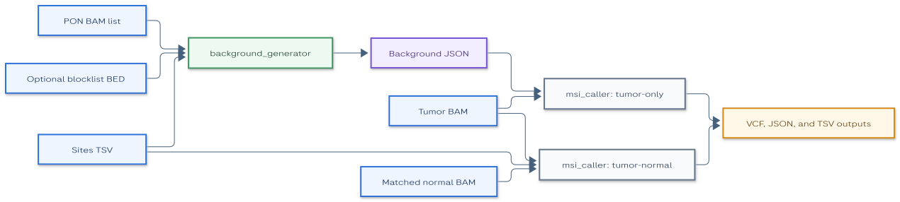
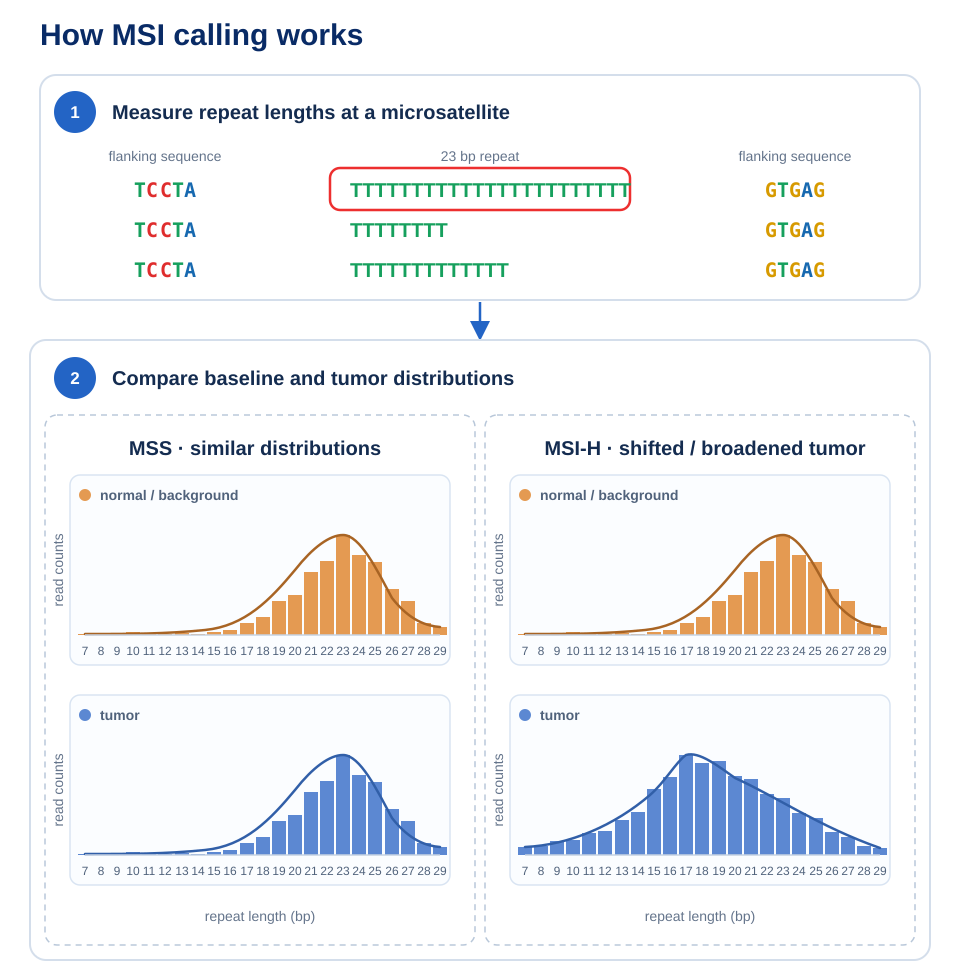

# MSI Caller

## Guide contents

- [Overview](#overview): module purpose, analysis modes, example applications, and system requirements.
- [Usage](docs/usage.md): command entry points and links to the full command guides.
  - [Tumor-only analysis](docs/usage-tumor-only.md): comparing a tumor BAM with a panel-of-normals background model.
  - [Tumor-normal analysis](docs/usage-tumor-normal.md): comparing matched tumor and normal BAMs.
  - [Generate a background model](docs/usage-background-generator.md): creating a panel-of-normals background model.
- [File formats](docs/file-formats.md): schemas for microsatellite sites, the background model, and caller output files.
- [Metrics](docs/metrics.md): run-level quality-control metrics.
- [Troubleshooting](docs/troubleshooting.md): common issues and resolutions.
- [Appendix](docs/appendix.md): concepts, terminology, and performance notes.
- [Release notes](CHANGELOG.md): notable changes by version.

## Overview

The MSI Caller detects microsatellite instability in data from the Roche SBX sequencing platform.
It compares [repeat-length distributions](docs/appendix.md#concepts-and-terminology) from a tumor BAM with either a [panel-of-normals background model](docs/appendix.md#concepts-and-terminology) or a matched normal BAM.
The supported sample type is SBX-D WGS.

The MSI Caller is an experimental beta feature for research use only.
The bundled resources and default parameter settings have limited analytical testing, and results can be less accurate for untested data.

At a glance: **indexed BAM + microsatellite baseline** → **per-site VCF calls + run-level JSON report + TSV metrics**.

Microsatellites are tracts of repetitive DNA where a short motif, often 1 to 6 base pairs long, is repeated many times.
Replication errors can change the number of repeats, creating alleles with different repeat lengths.
Mismatch-repair deficient tumors have more such variation, while PCR and sequencing errors can produce stutter peaks.

**Step 1: Measuring repeat lengths.** At each [microsatellite](docs/appendix.md#concepts-and-terminology) site, the caller measures the observed repeat length between the flanking sequences shown in the top panel.

**Step 2: Comparing distributions.** The caller summarizes those measurements as a [repeat-length distribution](docs/appendix.md#concepts-and-terminology) and compares the distribution with a background or matched-normal baseline shown in the lower panel.

The module contains two executables:

- [`msi_caller`](docs/usage.md) provides the [`tumor-only`](docs/usage-tumor-only.md) and [`tumor-normal`](docs/usage-tumor-normal.md) subcommands.
- [`background_generator`](docs/usage-background-generator.md) creates the panel-of-normals background model required by `tumor-only` analysis.

The caller classifies each usable microsatellite site as stable or unstable.
It calculates the [MSI score](docs/appendix.md#concepts-and-terminology) as the fraction of usable sites classified as unstable.
Set [`--min-msi-classification-fraction`](docs/usage-tumor-only.md#microsatellite-instability-classification-options) to convert the score into a run-level status.
The recommended value is `0.3`.

| Status | Condition | Interpretation |
|:-------|:----------|:---------------|
| `MSI-H` | MSI score is greater than or equal to `--min-msi-classification-fraction`. | Microsatellite instability-high; the fraction of unstable sites meets the configured threshold. |
| `MSS` | MSI score is below `--min-msi-classification-fraction`. | Microsatellite stable; the fraction of unstable sites is below the configured threshold. |
| `THRESHOLD_UNSPECIFIED` | No aggregate threshold is configured, regardless of the number of usable sites. | The status remains unspecified. The MSI score is reported when coverage is sufficient; otherwise, the score is `INSUFFICIENT_COVERAGE`. |
| `INSUFFICIENT_COVERAGE` | An aggregate threshold is configured and fewer than `--min-sites` sites are usable. | The caller cannot calculate an MSI score or assign `MSI-H` or `MSS`. |

Use another calibrated threshold only when appropriate for the analysis.
See the [concepts and terminology](docs/appendix.md#concepts-and-terminology) appendix and [MSI JSON output](docs/file-formats.md#msi-json-output) for the status fields written to the report.

### Example applications

Expand an example below for the matching command and input baseline.

Tumor-only analysis with a panel-of-normals baseline

- **Data type:** Indexed tumor BAM and background model JSON.
- **Objective:** Compare tumor repeat-length distributions with a precomputed panel-of-normals baseline.
- **Usage:** Go to [Tumor-only analysis](docs/usage-tumor-only.md).
- **Command:** `msi_caller tumor-only`

Tumor-normal analysis with a matched baseline

- **Data type:** Indexed tumor and matched normal BAMs, plus a microsatellite sites TSV file.
- **Objective:** Compare tumor repeat-length distributions directly with a matched normal baseline.
- **Usage:** Go to [Tumor-normal analysis](docs/usage-tumor-normal.md).
- **Command:** `msi_caller tumor-normal`

Panel-of-normals background generation

- **Data type:** A list of indexed normal BAMs and a microsatellite sites TSV file.
- **Objective:** Generate a reusable background model for tumor-only analysis.
- **Usage:** Go to [Generate a background model](docs/usage-background-generator.md).
- **Command:** `background_generator`

### System requirements

| | Requirements |
|:--|:-------------|
| CPU | Processing scales with the number of microsatellite sites, BAM read depth, and `--threads` for caller commands. |
| Memory | Memory use depends on the number of sites, the read depth, and the number of panel-of-normals BAMs. A fixed minimum has not been characterized. |
