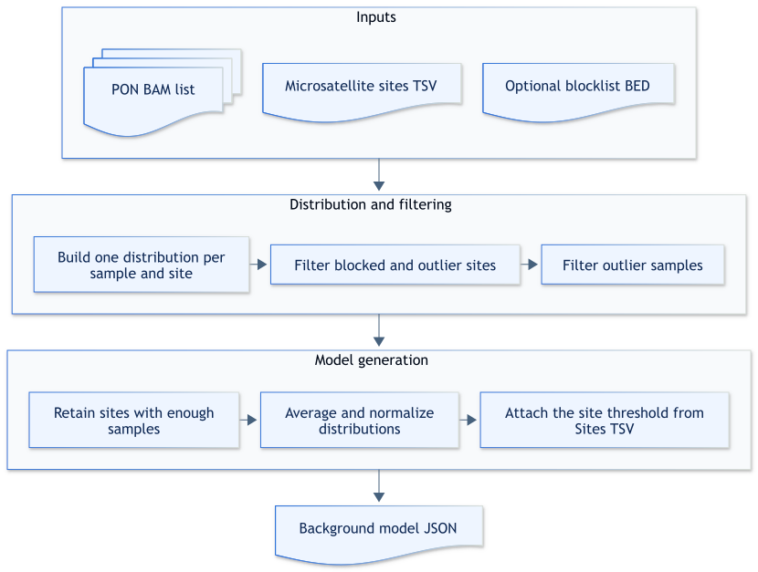

# Generate a background model

## How it works

The `background_generator` executable builds a reusable model from a panel of normal BAMs.
It calculates a repeat-length distribution for each sample and site, filters sites that do not meet the configured quality criteria, and aggregates the remaining distributions.

Use a sites file containing a threshold column matching the selected comparison metric.
The `--microsatellite-sites-thresholds-tsv` option supplies the site definitions and their per-site thresholds.
The generated model is the input baseline for the [`msi_caller tumor-only`](usage-tumor-only.md) subcommand.



Expand the section below for a step-by-step description of background generation.

<details>

<summary>Design details</summary>

1. The command reads the panel-of-normals BAM list and the selected sites file.
2. It extracts reads around each site, applies the configured read filters, and builds one repeat-length distribution per panel sample.
3. It excludes blocked sites, optional nonmonomers, site outliers, and sample outliers.
4. It retains sites with more than `--min-depth` reads in at least `--min-samples-per-site` panel samples.
5. It averages the retained sample distributions and normalizes the resulting background distribution.
6. It associates each background distribution with the configured fixed or per-site threshold.
7. It writes the background model JSON.

</details>

## Example command

The minimal command uses the default read filters, sample-count limit, and comparison metric; threshold values are read
from the matching column in `sites.tsv`:

```shell
background_generator \
  --pon-bam-list pon_bams.txt \
  --microsatellite-sites-thresholds-tsv sites.tsv \
  --output-background-threshold-json background_thresholds.json
```

## Input

| Input | Required | Notes |
|:------|:---------|:------|
| Panel-of-normals BAM list | Yes | Text file with one indexed BAM path per line. Relative paths resolve from the list file directory. |
| Microsatellite sites TSV | Yes | Site definitions with a threshold column matching the selected comparison metric. See [Microsatellite sites TSV](file-formats.md#microsatellite-sites-tsv). |
| Blocklist BED | No | Excludes listed sites or regions from the generated model. |

The container includes the production WGS site list with thresholds at */resources/microsatellite_sites_with_thresholds_167sites_TN_WGS.tsv*.
For other site lists, provide the input file explicitly.

## Output

| Output | Description |
|:-------|:------------|
| Background model JSON | Per-site background repeat-length distributions and thresholds. See [Background model JSON](file-formats.md#background-model-json). |

The command writes the model to the exact path supplied with `--output-background-threshold-json`.
It creates missing parent directories, but it does not replace an existing file.
The model contains only sites that pass site-level filters and retain at least `--min-samples-per-site` usable panel samples.
Each retained site contains its normalized background repeat-length distribution and the threshold associated with the selected comparison metric.

### Output examples

| Scenario | Option | Result |
|:---------|:-------|:-------|
| Current directory | `--output-background-threshold-json background.json` | Writes *background.json* in the current directory. |
| Nested directory | `--output-background-threshold-json results/panel/background.json` | Creates missing *results/panel* directories and writes *background.json* there. |
| Existing path | Any path that already exists | Stops without replacing the existing file. Choose another path or remove the existing file intentionally. |

## Tips for analysis

Use the same read-filter settings when generating the model and running `tumor-only` analysis.
The threshold column name in the sites file must match `--distribution-comparison-metric`.

The sites file can be produced by a compatible microsatellite-scanning tool and then reduced to the required columns.
Filter a sites file to the analyzed panel regions before generating a panel-specific model.

## CLI options

Parameters in **bold** are required.
This command also accepts the common `-h, --help`, `-v, --version`, and `-l, --log-level` options.

### Input options

| Parameter | Description | Value(s) |
|:----------|:------------|:---------|
| **--pon-bam-list** | Text file containing one indexed BAM path per line. | File path |
| **--microsatellite-sites-thresholds-tsv** | Site definitions with a threshold column matching the selected metric. | TSV file path |
| --blocklist-bed | Sites or regions to exclude. | BED file path [default: none] |

### Output options

| Parameter | Description | Value(s) |
|:----------|:------------|:---------|
| **--output-background-threshold-json** | New background model file. The command does not replace an existing path. | JSON file path |

### Read filtering options

| Parameter | Description | Value(s) |
|:----------|:------------|:---------|
| --min-depth | Read depth that a site in a panel sample must exceed. | Nonnegative integer [default: `0`] |
| --min-mapping-quality | Minimum mapping quality for a read. A read must meet or exceed this value. | Integer, 0–255 [default: `0`] |
| --min-base-quality | Minimum base-call quality used when a read lacks a usable `YC` tag. A base must meet or exceed this value. | Integer, 0–255 [default: `0`] |
| --min-base-type | Minimum YC-decoded base category. A base must match or exceed this category. | `discordant`, `simplex`, or `concordant` [default: `discordant`] |
| --min-query-microsatellite-length | Lower exclusive bound for query microsatellite length. The length must exceed this value, which must be less than the maximum. | Integer, 0–255 [default: `0`] |
| --max-query-microsatellite-length | Upper exclusive bound for query microsatellite length. The length must be less than this value, which must be greater than the minimum. | Integer, 0–255 [default: `40`] |
| --trim-soft-clips | Trims soft-clipped sequence before locating repeat flanks. | Flag [default: `false`] |

### Microsatellite instability classification options

| Parameter | Description | Value(s) |
|:----------|:------------|:---------|
| --distribution-comparison-metric | Metric associated with fixed or per-site thresholds. | `t-statistic` or `js-distance` [default: `t-statistic`] |
| --min-samples-per-site | Minimum number of panel samples required to retain a site. The count must meet or exceed this value. | Integer, 0–255 [default: `2`] |
| --filter-nonmonomers | Excludes sites with repeat units longer than one base. | Flag [default: `false`] |
