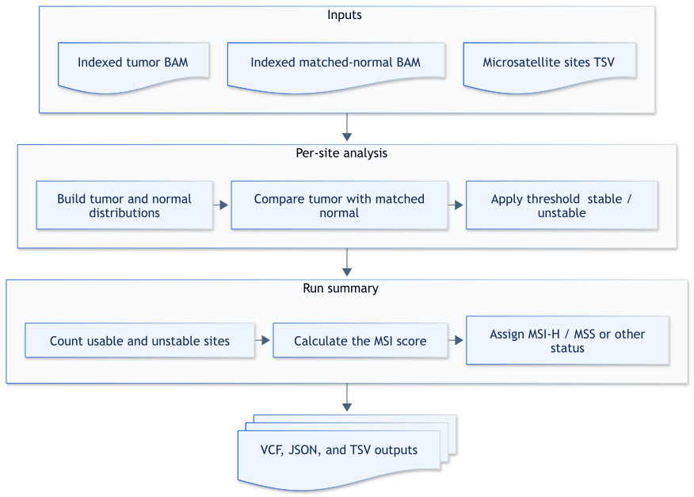

# Tumor-normal analysis

## How it works

The `tumor-normal` command builds repeat-length distributions from matched tumor and normal BAMs at each configured microsatellite site.
It compares the tumor distribution with the normal baseline, classifies each usable site, and calculates aggregate MSI metrics.

By default, the command uses the bundled WGS sites file with per-site thresholds.
To override the default, provide another sites file with a threshold column matching the selected metric.



Expand the section below for a step-by-step description of tumor-normal analysis.

<details>

<summary>Design details</summary>

1. The command reads matched tumor and normal BAMs and the selected sites file.
2. It extracts reads around each site, applies the same read filters to both BAMs, and builds repeat-length distributions.
3. It retains sites with read depth at or above `--min-depth` in both samples.
4. It compares the tumor distribution with the matched-normal distribution by using `t-statistic` or `js-distance`.
5. It classifies each usable site as unstable when the comparison value is at or above its threshold.
6. It calculates the MSI score from the usable sites and assigns an aggregate status when `--min-msi-classification-fraction` is set to the recommended value of `0.3`.
7. It writes the VCF calls, JSON report, and TSV quality-control metrics.

</details>

## Example command

The default sites file is */resources/microsatellite_sites_with_thresholds_167sites_TN_WGS.tsv*.
The `--threads` and `--min-msi-classification-fraction` options are optional, but recommended.
The example uses 8 worker threads and the recommended aggregate threshold of `0.3`.

```shell
msi_caller tumor-normal \
  --tumor-bam tumor.bam \
  --normal-bam normal.bam \
  --min-msi-classification-fraction 0.3 \
  --threads 8
```

## Input

| Input | Required | Notes |
|:------|:---------|:------|
| Tumor BAM | Yes | Coordinate-sorted BAM with an adjacent BAI index. |
| Matched normal BAM | Yes | Coordinate-sorted BAM with an adjacent BAI index. |
| Microsatellite sites TSV | No | Defaults to */resources/microsatellite_sites_with_thresholds_167sites_TN_WGS.tsv*. Override with a sites file containing a threshold column matching the selected metric. See [Microsatellite sites TSV](file-formats.md#microsatellite-sites-tsv). |

## Output

| Output | Description |
|:-------|:------------|
| *msi_results.vcf.gz* and *msi_results.vcf.gz.tbi* | BGZF-compressed, indexed per-site MSI calls with tumor and normal repeat-length distributions. See [MSI VCF](file-formats.md#msi-vcf). |
| *msi_results.json* | Run configuration and aggregate MSI results. See [MSI JSON output](file-formats.md#msi-json-output). |
| *metrics/msi_statistics.tsv* | Compact quality-control metrics for both BAMs. See [TSV metrics](metrics.md#tsv-metrics). |

The command writes outputs under `--output-dir`.
The default output directory is the current directory.
Relative paths specified with `--output-vcf`, `--output-json`, or `--output-tsv` resolve under `--output-dir`.
Absolute paths are used as supplied.
`--output-prefix` adds a shared prefix only to output filenames that retain their default values.
An explicit filename or path supplied with `--output-vcf`, `--output-json`, or `--output-tsv` remains unchanged while default filenames still receive the prefix.
The command stops before writing any results when an output path already exists unless `--overwrite` is set.

### Output naming examples

| Scenario | Options | Resolved output paths |
|:---------|:--------|:----------------------|
| Defaults | None | *./msi_results.vcf.gz*, *./msi_results.vcf.gz.tbi*, *./msi_results.json*, and *./metrics/msi_statistics.tsv* |
| Output directory and prefix | `--output-dir results --output-prefix SAMPLE` | *results/SAMPLE_msi_results.vcf.gz*, *results/SAMPLE_msi_results.vcf.gz.tbi*, *results/SAMPLE_msi_results.json*, and *results/metrics/SAMPLE_msi_statistics.tsv* |
| Explicit VCF filename | `--output-prefix SAMPLE --output-vcf custom.vcf` | *./custom.vcf*, *./SAMPLE_msi_results.json*, and *./metrics/SAMPLE_msi_statistics.tsv* |

## Tips for analysis

The `--min-depth` value applies to both BAMs, and a site is usable only when both samples have sufficient read depth.
The threshold column name in a threshold-bearing sites file must match `--distribution-comparison-metric`.
Set `--min-msi-classification-fraction 0.3` to produce an aggregate `MSI-H` or `MSS` status.

## CLI options

Parameters in **bold** are required.
This command also accepts the common `-h, --help`, `-v, --version`, and `-l, --log-level` options.

### Input options

| Parameter | Description | Value(s) |
|:----------|:------------|:---------|
| **--tumor-bam** | Coordinate-sorted tumor BAM with an adjacent BAI index. | File path |
| **--normal-bam** | Coordinate-sorted matched normal BAM with an adjacent BAI index. | File path |
| --microsatellite-sites-thresholds-tsv | Site definitions with a threshold column matching the selected metric. | TSV file path [default: `/resources/microsatellite_sites_with_thresholds_167sites_TN_WGS.tsv`] |

### Output options

| Parameter | Description | Value(s) |
|:----------|:------------|:---------|
| --output-dir | Directory for output files. | Directory path [default: `.`] |
| --output-prefix | Prefix added to default output filenames and joined with an underscore. | Filename component [default: none] |
| --output-vcf | VCF output path. A `.vcf.gz` filename creates a BGZF-compressed VCF and index. | Filename ending in `.vcf.gz` or `.vcf` [default: `msi_results.vcf.gz`] |
| --output-json | JSON report output path. | Filename ending in `.json` [default: `msi_results.json`] |
| --output-tsv | TSV metrics output path. | Filename ending in `.tsv` [default: `metrics/msi_statistics.tsv`] |
| --overwrite | Replaces existing output files. | Flag [default: `false`] |

### Sample metadata options

| Parameter | Description | Value(s) |
|:----------|:------------|:---------|
| --sample-name | Name written to output metadata. The first `SM` tag in the tumor BAM is used when this option is omitted. | Text [default: `unspecified` when no `SM` tag exists] |

### Read filtering options

| Parameter | Description | Value(s) |
|:----------|:------------|:---------|
| --min-depth | Minimum read depth for each BAM at a site. Each BAM must meet or exceed this value. | Positive integer [default: `15`] |
| --min-mapping-quality | Minimum mapping quality for a read. A read must meet or exceed this value. | Integer, 0–255 [default: `0`] |
| --min-base-quality | Minimum base-call quality used when a read lacks a usable `YC` tag. A base must meet or exceed this value. | Integer, 0–255 [default: `0`] |
| --min-base-type | Minimum YC-decoded base category. A base must match or exceed this category. | `discordant`, `simplex`, or `concordant` [default: `discordant`] |
| --min-query-microsatellite-length | Lower exclusive bound for query microsatellite length. The length must exceed this value, which must be less than the maximum. | Integer, 0–255 [default: `0`] |
| --max-query-microsatellite-length | Upper exclusive bound for query microsatellite length. The length must be less than this value, which must be greater than the minimum. | Integer, 0–255 [default: `40`] |
| --trim-soft-clips | Trims soft-clipped sequence before locating repeat flanks. | Flag [default: `false`] |

### Microsatellite instability classification options

| Parameter | Description | Value(s)                                                                                             |
|:----------|:------------|:-----------------------------------------------------------------------------------------------------|
| --min-sites | Minimum number of usable sites required for an aggregate call. The count must meet or exceed this value. | Positive integer [default: automatically sets to 75% of sites in the selected sites TSV] |
| --min-msi-classification-fraction | MSI score threshold for an `MSI-H` aggregate status. Set `0.3` to use the recommended aggregate threshold. The score must meet or exceed this value. | Number, 0–1 [default: unset]                                                                         |
| --distribution-comparison-metric | Metric used to compare repeat-length distributions and select a threshold column. | `t-statistic` or `js-distance` [default: `t-statistic`]                                              |

### Performance options

| Parameter | Description | Value(s) |
|:----------|:------------|:---------|
| --threads | Number of worker threads used for per-site processing. Use `0` to use the available hardware threads. | Nonnegative integer [default: `1`] |
