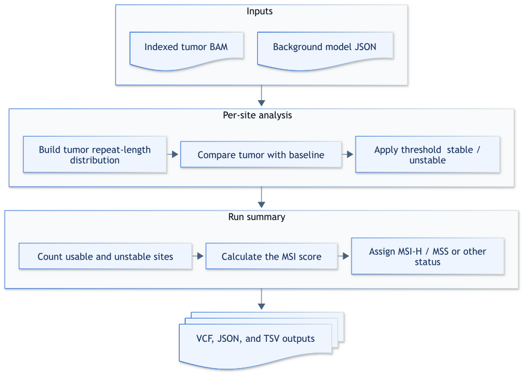

# Tumor-only analysis

## How it works

The `tumor-only` command reads the microsatellite sites, background repeat-length distributions, and per-site thresholds from a background model.
For each site, it builds a tumor repeat-length distribution, compares it with the background, and classifies the site as stable, unstable, or not predicted.
The command then calculates an MSI score and writes per-site calls and run-level metrics.



Expand the section below for a step-by-step description of tumor-only analysis.

<details>

<summary>Design details</summary>

1. The command reads each site, background repeat-length distribution, and site threshold from the background model.
2. It extracts tumor reads around each site and applies the configured read filters.
3. It builds a tumor repeat-length distribution for every site with read depth at or above `--min-depth`.
4. It compares each tumor distribution with the corresponding background distribution by using `t-statistic` or `js-distance`.
5. It classifies each usable site as unstable when the comparison value is at or above its threshold.
6. It calculates the MSI score from the usable sites and assigns an aggregate status when `--min-msi-classification-fraction` is set to the recommended value of `0.3`.
7. It writes the VCF calls, JSON report, and TSV quality-control metrics.

</details>

## Example command

The container includes the WGS background model at */resources/background_thresholds_99sites_ponv1_for_TO_WGS.json*, which is used by default.
The `--threads` and `--min-msi-classification-fraction` options are optional, but recommended.
The example uses 8 worker threads and the recommended aggregate threshold of `0.3`.

```shell
msi_caller tumor-only \
  --tumor-bam tumor.bam \
  --min-msi-classification-fraction 0.3 \
  --threads 8
```

## Input

| Input | Required | Notes |
|:------|:---------|:------|
| Tumor BAM | Yes | Coordinate-sorted BAM with an adjacent BAI index. |
| Background model JSON | No | Panel-of-normals distributions and thresholds from `background_generator`, supplied with `--background-threshold-json`. The default is */resources/background_thresholds_99sites_ponv1_for_TO_WGS.json*. See [Background model JSON](file-formats.md#background-model-json). |

To use a custom panel-of-normals baseline, first run the [`background_generator`](usage-background-generator.md) application with a panel BAM list and a threshold-bearing microsatellite sites TSV file.
Pass its JSON output to `--background-threshold-json`.

## Output

| Output | Description |
|:-------|:------------|
| *msi_results.vcf.gz* and *msi_results.vcf.gz.tbi* | BGZF-compressed, indexed per-site MSI calls and repeat-length distributions. See [MSI VCF](file-formats.md#msi-vcf). |
| *msi_results.json* | Run configuration and aggregate MSI results. See [MSI JSON output](file-formats.md#msi-json-output). |
| *metrics/msi_statistics.tsv* | Compact quality-control metrics. See [TSV metrics](metrics.md#tsv-metrics). |

The command writes outputs under `--output-dir`.
The default output directory is the current directory.
Relative paths specified with `--output-vcf`, `--output-json`, or `--output-tsv` resolve under `--output-dir`.
Absolute paths are used as supplied.
`--output-prefix` adds a shared prefix only to output filenames that retain their default values.
An explicit filename or path supplied with `--output-vcf`, `--output-json`, or `--output-tsv` remains unchanged while default filenames still receive the prefix.
The command stops before writing any results when an output path already exists unless `--overwrite` is set.

### Output naming examples

| Scenario | Options | Resolved output paths |
|:---------|:--------|:----------------------|
| Defaults | None | *./msi_results.vcf.gz*, *./msi_results.vcf.gz.tbi*, *./msi_results.json*, and *./metrics/msi_statistics.tsv* |
| Output directory and prefix | `--output-dir results --output-prefix SAMPLE` | *results/SAMPLE_msi_results.vcf.gz*, *results/SAMPLE_msi_results.vcf.gz.tbi*, *results/SAMPLE_msi_results.json*, and *results/metrics/SAMPLE_msi_statistics.tsv* |
| Explicit VCF filename | `--output-prefix SAMPLE --output-vcf custom.vcf` | *./custom.vcf*, *./SAMPLE_msi_results.json*, and *./metrics/SAMPLE_msi_statistics.tsv* |

## Tips for analysis

Use a background model generated with the same sites, comparison metric, and read-filter settings intended for the caller.
Set `--min-msi-classification-fraction 0.3` to produce an aggregate `MSI-H` or `MSS` status.

## CLI options

Parameters in **bold** are required.
This command also accepts the common `-h, --help`, `-v, --version`, and `-l, --log-level` options.

### Input options

| Parameter | Description | Value(s) |
|:----------|:------------|:---------|
| **--tumor-bam** | Coordinate-sorted tumor BAM with an adjacent BAI index. | File path |
| --background-threshold-json | Background model with site definitions, distributions, and thresholds. | JSON file path [default: `/resources/background_thresholds_99sites_ponv1_for_TO_WGS.json`] |

### Output options

| Parameter | Description | Value(s) |
|:----------|:------------|:---------|
| --output-dir | Directory for output files. | Directory path [default: `.`] |
| --output-prefix | Prefix added to default output filenames and joined with an underscore. | Filename component [default: none] |
| --output-vcf | VCF output path. A `.vcf.gz` filename creates a BGZF-compressed VCF and index. | Filename ending in `.vcf.gz` or `.vcf` [default: `msi_results.vcf.gz`] |
| --output-json | JSON report output path. | Filename ending in `.json` [default: `msi_results.json`] |
| --output-tsv | TSV metrics output path. | Filename ending in `.tsv` [default: `metrics/msi_statistics.tsv`] |
| --overwrite | Replaces existing output files. | Flag [default: `false`] |

### Sample metadata options

| Parameter | Description | Value(s) |
|:----------|:------------|:---------|
| --sample-name | Name written to output metadata. The first `SM` tag in the tumor BAM is used when this option is omitted. | Text [default: `unspecified` when no `SM` tag exists] |

### Read filtering options

| Parameter | Description | Value(s) |
|:----------|:------------|:---------|
| --min-depth | Minimum read depth for a site. A site must meet or exceed this value. | Positive integer [default: `15`] |
| --min-mapping-quality | Minimum mapping quality for a read. A read must meet or exceed this value. | Integer, 0–255 [default: `0`] |
| --min-base-quality | Minimum base-call quality used when a read lacks a usable `YC` tag. A base must meet or exceed this value. | Integer, 0–255 [default: `0`] |
| --min-base-type | Minimum YC-decoded base category. A base must match or exceed this category. | `discordant`, `simplex`, or `concordant` [default: `discordant`] |
| --min-query-microsatellite-length | Lower exclusive bound for query microsatellite length. The length must exceed this value, which must be less than the maximum. | Integer, 0–255 [default: `0`] |
| --max-query-microsatellite-length | Upper exclusive bound for query microsatellite length. The length must be less than this value, which must be greater than the minimum. | Integer, 0–255 [default: `40`] |
| --trim-soft-clips | Trims soft-clipped sequence before locating repeat flanks. | Flag [default: `false`] |

### Microsatellite instability classification options

| Parameter | Description | Value(s)                                                                                          |
|:----------|:------------|:--------------------------------------------------------------------------------------------------|
| --min-sites | Minimum number of usable sites required for an aggregate call. The count must meet or exceed this value. | Positive integer [default: automatically sets to 75% of sites in the background thresholds input] |
| --min-msi-classification-fraction | MSI score threshold for an `MSI-H` aggregate status. Set `0.3` to use the recommended aggregate threshold. The score must meet or exceed this value. | Number, 0–1 [default: unset]                                                                      |
| --distribution-comparison-metric | Metric used to compare repeat-length distributions. | `t-statistic` or `js-distance` [default: `t-statistic`]                                           |

### Performance options

| Parameter | Description | Value(s) |
|:----------|:------------|:---------|
| --threads | Number of worker threads used for per-site processing. Use `0` to use the available hardware threads. | Nonnegative integer [default: `1`] |
