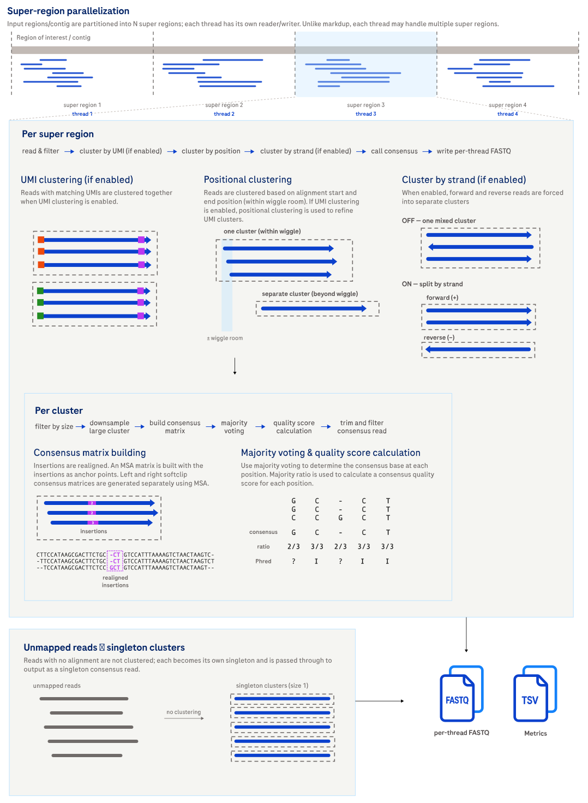

# Consensus

The `consensus` subcommand generates high-quality consensus sequences.

## How it works

Reads are grouped into clusters (by position, and optionally strand and UMI),
then the reads in each cluster are combined through a matrix-based majority vote
that considers base calls and quality scores at every position. The result is a
single error-corrected consensus sequence per cluster, written as FASTQ.



Expand the section below for a step-by-step description of the clustering,
duplex decoding, and consensus-generation algorithm, including the quality score
models.

<details>

<summary>Design details</summary>

Consensus generates high-quality consensus sequences from sequencing reads and uses parallelization for performance.

1. Preparation and parallelization
    - Input BAM/BED is divided into **super regions**.
    - Separate readers/writers are initialized for each super region.
    - Taskflow orchestrates parallel processing of these super regions.
2. Per-super region processing (parallel)
    - Reads within a super region are read and filtered.
    - Reads are categorized as **full** (complete and untruncated on both ends) or **partial** (truncated on one end).
    - **Read clustering**:
        - Full reads are clustered by either **position** or **UMI + position** (if UMIs are present and `--cluster-by-umi` is enabled).
            - In **positional clustering**, reads are primarily grouped by their **genomic start and end positions**. This method incorporates a configurable "wiggle room" (positional tolerance), allowing reads with slightly different but overlapping alignment coordinates to be considered part of the same cluster. This accounts for minor variations in read alignment. Overlapping clusters are recursively merged using a depth-first search to ensure comprehensive grouping within the specified `--wiggle-room` and `--cluster-by-strand` settings.
              - For two full reads, `--wiggle-room W` requires `|start₁ - start₂| + |end₁ - end₂| ≤ W`. Thus, `--wiggle-room 2` is a total distance budget of 2 bp across both coordinates: one coordinate can differ by 2 bp if the other is unchanged, or both can differ by 1 bp.
              - `--wiggle-room-partial P` applies when assigning a partial read to a full-read cluster. A 5′-partial read is matched by its untruncated 3′ end, which must be within `P` bp of the cluster's mean end; its 5′ start is also checked and must not extend more than `P` bp before the cluster's minimum start. A 3′-partial read is handled symmetrically: its untruncated 5′ start is matched to the cluster's mean start, and its 3′ end must not extend more than `P` bp beyond the cluster's maximum end.
            - In **positional and UMI-based clustering**, when UMIs are present, reads are first clustered by their **exact UMI sequences** and then *further refined* by position (as described above). Read Collapser does not correct UMI sequencing errors; perform UMI correction upstream. UMI clustering allows for more precise grouping of reads originating from the same original DNA/RNA molecule.
        - If `--exclude-partial-reads` is not enabled, partial reads are assigned to existing full read clusters based on nearest position and matching available UMI information (when `--cluster-by-umi` is enabled).
        - Any remaining, unassigned partial reads can be clustered together by position if `--make-clusters-of-partial-reads-only` is specified.
    - Reads and any cluster information are written to BAM if `--write-cluster-bam` is specified.
    - Clusters are filtered by size and downsampled based on `--min-cluster-size` and `--max-cluster-size`, respectively.
    - If `--duplex-library-type` is set to `parent-parent` or `parent-daughter`, the duplex reads are decoded into their R1 and R2 components. This information is used to refine the consensus calling logic, especially for quality scoring and handling strand-specific discrepancies.
    - **Consensus generation (per cluster)**:
        - Insertions are detected and aligned using **multiple sequence alignment (MSA)**.
        - A **consensus matrix** is built, aligning all reads in the cluster (including gaps/insertions).
        - **Majority voting** determines the consensus sequence and quality scores based on base support, strand bias, and thresholds. The quality score models are described below.
        - Consensus sequences are trimmed: any bases at the ends of the sequence without at least `--min-trim-read-support` supporting reads (from majority voting) are removed from the sequence.
        - Consensus sequences are filtered: any sequence derived from a same-strand cluster or a mixed-strand cluster that does not have an effective cluster size of at least `--min-same-strand-cluster-size` or `--min-mixed-strand-cluster-size`, respectively, is discarded. The effective cluster size is calculated by the total number of bases in the consensus matrix divided by the number of covered positions.
        - Consensus sequences are written to gzipped **FASTQ** files.
3. Finalization and metrics
    - Global metrics from all tasks are aggregated.
    - Detailed statistics are written to TSV files.


Supplementary and secondary alignments are not clustered regardless of the flags specified in `--exclude-flags`.


There are two base-call quality score models available for consensus generation:

- The default, calibrated model: A calibrated model that is trained on empirical data to better reflect the true empirical error rates. This new model takes in additional context about the consensus base such as cluster size, strand bias, and whether the consensus base has both forward and reverse supports. It produces a wider and more continuous range of quality scores of 5, 10, 20, 22, 30, 40, and 50.
- The naive binomial model: Models the probability of a base being incorrect based on the sequencing error rate. This model produces categorical quality scores of 0 (for bases with low confidence), 18 (simplex bases), 35 (for bases with intermediate confidence), and 40 (bases with high confidence). The naive binomial model can be enabled using `--enable-legacy-qscore-model`.

</details>

## Example command

Consensus with positional and strand clustering for whole-genome duplex cfDNA
analysis:

```bash
# input bam file must be indexed
read_collapser consensus \
  --preset wgs-duplex-cfdna \
  --bam HG001.bam
```

An additional common option:

| Option | Effect |
|:-------|:-------|
| `--cluster-by-umi` | Enables UMI clustering. |

For the full option reference, see [CLI options](#cli-options) below.

## Input

| Input | Required | Notes |
|:------|:---------|:------|
| Position-sorted BAM | Yes | Passed with `--bam`. Must be indexed (a BAI file is required). |
| BAM index (BAI) | Yes | Used to locate reads; required whenever a BED file is provided. |
| BED file | No | Passed with `--bed`. Restricts processing to overlapping regions. Must conform to the [BEDv1 specification](https://samtools.github.io/hts-specs/BEDv1.pdf). |

When a BED file is specified, Read Collapser uses the BAM index file (BAI) to
find and process mapped reads that overlap one or more regions in
the BED file. If the BAI file is not present when a BED file is provided, an
error is thrown.

When `--cluster-by-umi` is enabled, UMIs are parsed from the read name. Read
Collapser `consensus` assumes two UMIs (for the 5' and 3' ends) are present at
the end of the read name, separated by `:` (legacy input delimits by `|`). The
special character `*` is used to indicate a missing UMI. If the chemistry does
not support UMIs, the UMI fields are omitted entirely from the query name. UMIs
can be either alphabetic (the true UMI sequence, e.g., `AGCT`) or numeric (a UMI
ID, e.g. `12`). All alphabetic UMI sequences must be in uppercase.

The input BAM can contain unmapped reads, which are treated as singleton
clusters for consensus. Placed unmapped reads (reads that have the unmapped flag
`0x4` set but also a mapping position) are not supported and are discarded.

### Expected read name format

Read Collapser requires read names to follow a strict structure to parse classification metadata during processing:

`<any-prefix>:<bitflag>|<sid><optional-UMI>`

Format Breakdown:

- `<any-prefix>`: Standard sequencer run metadata or read identifier.
- `<bitflag>`: An 8-bit mask encoded as an integer (e.g., 12) or hex/binary representing full versus partial read classification:
  - `0b00001000` (8): 5' SID complete
  - `0b00000100` (4): 3' SID complete
  - `0b00000010` (2): 5' UMI present
  - `0b00000001` (1): 3' UMI present
- `<sid>`: Sample identifier string following the pipe (`|`).
- `<optional-UMI>`: Molecular barcode sequence appended directly after the SID. The expected format is `:<umi5p>:<umi3p>` (legacy input delimits by `|`). The special character `*` is used to indicate a missing UMI.

A read is full only when both ends are complete. SID bits determine completeness by default; when `--cluster-by-umi` is set the UMI bits are used instead. Reverse strand reads swap the 5' and 3' ends automatically.

## Output

Files are written to the current working directory by default. The output
directory can be specified with `--output-dir`. If output files already exist,
the command fails with an error unless `--overwrite` is specified. Only the
files the current invocation would write are checked, so unrelated files in the
output directory are left alone. Note that per-thread files left over from an
earlier run with a higher `--threads` are not detected; re-run into a clean
output directory if the thread count changes.

| Output | Description |
|:-------|:------------|
| *output.0000.fastq.gz* ... *output.N.fastq.gz* | A number of N FASTQ files where N is the number of threads specified by `--threads`. Each FASTQ file contains a subset of the non-discarded input reads that have been transformed into consensus reads. All FASTQ files follow this four-digit numeric prefix convention (e.g. *0000*), and no more than 10 000 output FASTQ files can be produced. |
| *output.0000.bam* ... *output.N.bam* | A number of N unsorted BAM files where N is the number of threads specified by `--threads`. Each BAM file contains a subset of the non-discarded input reads with clustering information if assigned to a cluster. All BAM files follow this four-digit numeric prefix convention (e.g. *0000*), and no more than 10 000 output BAM files can be produced. This BAM output is only produced if `--write-cluster-bam` is enabled. |
| *metrics/summary_stats.tsv* | Primary metric file containing statistics on clustering and consensus. Metrics irrelevant to the specified CLI command will have a value and percentage of `NA`. |
| *metrics/cluster_size_distribution_summary.tsv* | Summary metrics of the cluster size distributions as indicated by each column header. These metrics are after clustering (and duplex decoding, if applicable) and before cluster size filtering and consensus. |
| *metrics/cluster_size_distributions.tsv* | The cluster size distributions as indicated by each column header. These metrics are after clustering (and duplex decoding, if applicable) and before cluster size filtering and consensus. |

For the full column schemas and metric definitions, see the [Metrics](metrics.md)
page.

If a BED file is provided, the output only contains reads that overlap one or
more regions in the BED file.

If `--write-cluster-bam` is enabled, each read (that was assigned to a cluster)
has cluster tags (`DI`, `DS`) added. See
[Custom BAM tags](file-formats.md#custom-bam-tags) for the tag definitions and
cluster BAM behavior.

For the consensus FASTQ record layout, read name fields, and the distinction
between cluster size and effective cluster size, see
[Consensus FASTQ record format](file-formats.md#consensus-fastq-record-format).

Optionally, duplex consensus auxiliary tags (`ad`, `bd`, `ae`, `be`,
`aD`/`bD`/`cD`, `aM`/`bM`/`cM`, `aE`/`bE`/`cE`) can be added to each consensus
read with `--include-consensus-aux-tags`. See
[Consensus auxiliary tags](file-formats.md#consensus-auxiliary-tags) for the tag
definitions and encoding.

## Tips for analysis

Expand the section below for guidance on preparing `consensus` output for
downstream analysis.

<details>
<summary>Combining output FASTQ files</summary>

For downstream analysis, the output FASTQ files can be combined with `cat` and
piped into the next step, or processed individually.

Example:

```bash
# the resulting FASTQ files can be combined
cat output.*.fastq.gz | [NEXT STEP]
```

</details>

## CLI options

Parameters in **bold** are required. For parameters that control an on/off setting, such as `--cluster-by-strand`, Read Collapser uses a strict flag-only convention. Providing the value `true` or `false` causes an error.

`consensus` also accepts the common `-h, --help`, `-v, --version`, and `-l, --log-level` (`debug`, `info`, `warn`, `error`; default `info`) options.

### Preset options

Presets provide application-specific parameter configurations.

The `--preset` argument selects a configuration. To see application-specific defaults, run the desired preset with `--help`, or see the table below. Any parameters provided that conflict with the preset configurations take precedence over the preset defaults.

**Any parameters explicitly provided on the command line, even those conflicting with the active preset, override the preset configurations.** For example, `--preset wgs-duplex --wiggle-room 5` sets the wiggle room to 5 instead of 0 (the `--preset wgs-duplex` default). There is no command-line syntax to explicitly disable a boolean flag and override a preset that enables it.

If you need to disable a boolean flag that is enabled by a preset, you must not use the preset and manually specify all the desired parameters.

`--preset` values: wgs-duplex, wgs-duplex-cfdna, wgs-simplex, te-duplex, te-simplex, none [default: none].

| Preset | Settings | Rationale |
|:-------|:---------|:----------|
| wgs-duplex | `--cluster-by-strand`, `--wiggle-room=0` | Duplex reads from a molecule are expected in the same orientation and at exact alignment coordinates; strand separation prevents unrelated opposite-strand reads from being clustered. |
| wgs-duplex-cfdna | `--cluster-by-strand`, `--wiggle-room=2`, `--duplex-library-type=parent-parent`, `--min-cluster-size=1`, `--min-trim-read-support=1`, `--max-discordant-duplex-error-percentage=5` | cfDNA duplex molecules use parent-parent decoding. A small coordinate tolerance accommodates observed coordinate drift. `--min-cluster-size=1` retains singleton clusters, and `--min-trim-read-support=1` disables coverage-based trimming at consensus ends. `--max-discordant-duplex-error-percentage=5` discards reads with excessive disagreement between their duplex components. |
| wgs-simplex | `--make-clusters-of-partial-reads-only`, `--wiggle-room=2`, `--wiggle-room-partial=0`, `--min-cluster-size=1`, `--min-trim-read-support=1` | Simplex data can contain partial reads that cannot be assigned to a full-read cluster. Creating partial-only clusters preserves them for consensus, while exact untruncated-end matching avoids joining partial reads with different boundaries. The 2-bp full-read tolerance accommodates observed coordinate drift. `--min-cluster-size=1` retains singleton clusters, and `--min-trim-read-support=1` disables coverage-based trimming at consensus ends. |
| te-duplex | `--cluster-by-umi`, `--wiggle-room=2`, `--wiggle-room-partial=0`, `--duplex-library-type=parent-daughter`, `--min-same-strand-cluster-size=3` | Target-enrichment duplex data use exact UMI matching and parent-daughter decoding. The small positional tolerance accommodates observed coordinate drift, exact untruncated-end matching protects partial-read boundaries, and a same-strand support threshold improves consensus reliability. |
| te-simplex | `--cluster-by-umi`, `--wiggle-room=2`, `--wiggle-room-partial=0` | Target-enrichment simplex data use exact UMI matching with a small full-read positional tolerance; exact untruncated-end matching protects partial-read boundaries. |

### Input options

| Parameter                         | Description                                                                                                                                                                                                                     | Value(s)                                          |
|:----------------------------------|:--------------------------------------------------------------------------------------------------------------------------------------------------------------------------------------------------------------------------------|:--------------------------------------------------|
| **--bam**                   | Aligned and sorted BAM input. Duplex data must have reads with YC tag containing encoded differences between duplex R1 and R2.                                                                                                  | File path to an indexed BAM (`.bai` required)     |
| --bed                       | Path to a BED file specifying target regions for processing.                                                                                                                                                                    | File path to a valid BED (BEDv1); UCSC header/comment lines allowed |
| --padding                         | Number of bases of padding to apply to the regions specified by `--bed`.                                                                                                                                                  | Non-negative integer [default: 200]               |

### Output options

| Parameter            | Description                                                                                                                       | Value(s)                                          |
|:---------------------|:----------------------------------------------------------------------------------------------------------------------------------|:--------------------------------------------------|
| --output-dir         | The output directory for metrics and consensus FASTQ files. Created if needed.                                                    | Directory path [default: `.`]                     |
| --output-prefix      | Prefix prepended to every output filename, joined with an underscore (for example, `SAMPLE` → `SAMPLE_<filename>`). Defaults to no prefix. | String                                            |
| --overwrite          | Overwrite existing output files.                                                                                                  | No value (omit to set false; include to set true) |
| --compression-level  | Compression level (1-9) for output FASTQ files.                                                                                   | Integer from 1 to 9 [default: 1]                  |
| --write-cluster-bam | If enabled, generates intermediate, unsorted BAM file(s) containing reads with clustering information (if assigned to a cluster). | No value (omit to set false; include to set true) |
| --include-consensus-aux-tags | If enabled, adds duplex consensus auxiliary tags to the FASTQ output (`ad`/`bd`/`ae`/`be`, `aD`/`bD`/`cD`, `aM`/`bM`/`cM`, `aE`/`bE`/`cE`). See [Consensus auxiliary tags](file-formats.md#consensus-auxiliary-tags) for more information. | No value (omit to set false; include to set true) |

### Read filtering options

| Parameter                                | Description                                                                                                                                                                                                                                 | Value(s)                                          |
|:-----------------------------------------|:------------------------------------------------------------------------------------------------------------------------------------------------------------------------------------------------------------------------------------------|:--------------------------------------------------|
| --min-mapping-quality                               | Discards reads that have a mapping quality below this threshold.                                                                                                                                                                            | Integer from 0 to 255 [default: 0]                |
| --max-discordant-duplex-error-percentage | Maximum percentage of discordant duplex bases allowed in a duplex read before the read is discarded.                                                                                                                                        | Integer from 1 to 100                             |
| --exclude-flags                          | Exclude BAM records if any bits in their FLAG field match the specified decimal integer. Records are discarded before clustering and are not used for consensus calling. Refer to <https://broadinstitute.github.io/picard/explain-flags.html>. | Integer [default: 2304]                           |
| --exclude-partial-reads                  | Excludes partial reads during the clustering step.                                                                                                                                                                                          | No value (omit to set false; include to set true) |

Notes:

- The default `--exclude-flags` is 2304 (secondary and supplementary).
- Setting `--min-mapping-quality` to 1 or higher will exclude unmapped reads from the output as they always have a mapping quality of 0.
- Secondary and supplementary alignments are not used for consensus generation because they are not unique reads; including them would cause the same original read to contribute multiple times to consensus, potentially biasing the results.

### Cluster options

| Parameter                             | Description                                                                                                                                                                                                | Value(s)                                          |
|:--------------------------------------|:---------------------------------------------------------------------------------------------------------------------------------------------------------------------------------------------------------|:--------------------------------------------------|
| --cluster-by-umi                      | If enabled, clusters will be split by exact UMI (unique molecular index) sequence during the clustering step. | No value (omit to set false; include to set true) |
| --cluster-by-strand                   | If enabled, clusters will be split into two based on strand (forward and reverse) during the clustering step.                                                                                              | No value (omit to set false; include to set true) |
| --make-clusters-of-partial-reads-only | If enabled, creates clusters from remaining unassigned partial reads (i.e., partial-only read clusters).                                                                                                   | No value (omit to set false; include to set true) |
| --wiggle-room                         | The maximum base pair distance to search for full reads to cluster at a given position. `abs(Δstart) + abs(Δend)` must not exceed this value.                                                                                             | Integer from 0 to 255 [default: 0]                |
| --wiggle-room-partial                 | The maximum base pair distance to search for partial reads to cluster at a given position. The untruncated end is matched to the relevant cluster mean; the truncated end is constrained so it cannot extend too far beyond the cluster boundary. | Integer from 0 to 255 [default: 0]                |
| --max-cluster-size                    | The maximum number of reads in a cluster before downsampling.                                                                                                                                              | Integer from 1 to 1 000 000 [default: 50]         |
| --min-cluster-size                    | Discards clusters that do not contain at least this number of reads.                                                                                                                                       | Positive integer [default: 2]                     |

### Consensus options

| Parameter                       | Description                                                                                                                                                                                                                                                                 | Value(s)                                             |
|:--------------------------------|:----------------------------------------------------------------------------------------------------------------------------------------------------------------------------------------------------------------------------------------------------------------------------|:-----------------------------------------------------|
| --min-trim-read-support         | The minimum number of reads required for a specific base position at the ends of the consensus sequence. Any bases at the start or end of the consensus sequence with read support below this threshold will be trimmed. Must be <= `--min-cluster-size`.                                                    | Positive integer [default: 2]                        |
| --min-same-strand-cluster-size  | Consensus sequences generated from same-strand clusters will be discarded if the effective cluster size is below this threshold. The effective cluster size is calculated by the total number of bases in the consensus matrix divided by the number of covered positions. | Positive integer [default: value of `--min-cluster-size`] |
| --min-mixed-strand-cluster-size | Consensus sequences generated from mixed-strand clusters will be discarded if the effective cluster size is below this threshold. The effective cluster size is calculated by the total number of bases in the consensus matrix divided by the number of covered positions. | Positive integer [default: value of `--min-cluster-size`] |
| --min-consensus-fraction           | The minimum fraction of reads that must agree on a base call for it to be considered a strong consensus.                                                                                                                                                                    | Float from 0.0 to 1.0 [default: 0.5]                 |
| --min-consensus-gap-fraction       | The minimum fraction of reads at a given position that must support a gap for a gap to be called in the consensus sequence.                                                                                                                                                 | Float from 0.0 to 1.0 [default: 0.5]                 |
| --skip-softclip-consensus                | Skip soft-clip consensus generation. By default, soft-clipped segments are included in consensus generation.                                                                                                                                                   | No value (omit to set false; include to set true)    |
| --enable-legacy-qscore-model | If enabled, uses the legacy base-call quality score model for consensus calling. The legacy model assigns a quality score of 0 for bases with low confidence, 18 for simplex bases, 35 for bases with intermediate confidence, and 40 for bases with high confidence.                                                                                                    | No value (omit to set false; include to set true)    |
| --duplex-library-type           | Specifies the method for decoding duplex reads into their constituent single-strand reads (R1 and R2). This mode is used to inform downstream consensus calling by treating R1 and R2 as separate entities from a single molecule.                                          | none, parent-parent, parent-daughter [default: none] |
| --min-consensus-read-length     | Discard consensus reads shorter than the specified length. If not specified, no consensus reads are discarded based on length.                                                                                                                                              | Positive integer                                     |

### Performance options

| Parameter     | Description                                                                                                                                      | Value(s)                            |
|:--------------|:-----------------------------------------------------------------------------------------------------------------------------------------------|:------------------------------------|
| --region-size | The region size in base pairs of sub regions (within a super region) for processing and clustering.                                             | Positive integer [default: 10 000]  |
| --batch-size  | Max number of reads to process in a batch. Used in combination with `--region-size` to limit the number of reads being processed simultaneously. | Positive integer [default: 300 000] |
| --threads     | The number of threads to use.                                                                                                                   | Non-negative integer [default: 1]   |
