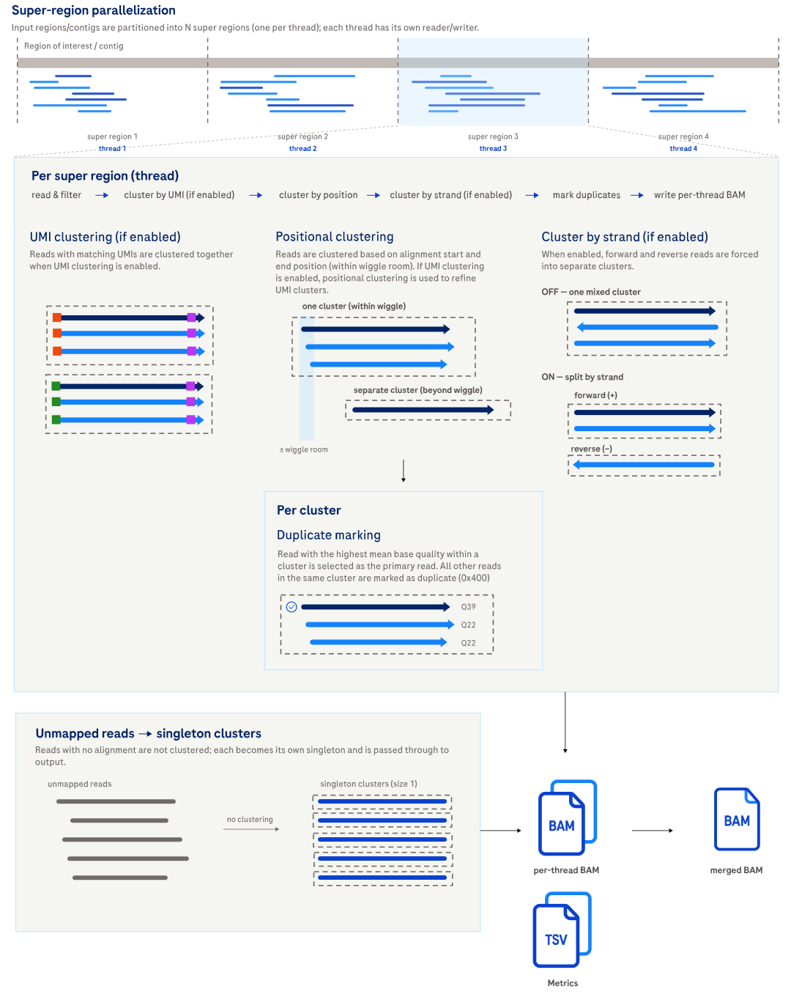

# Mark duplicates

The `markdup` subcommand identifies, marks, and optionally removes duplicate
reads.

## How it works

Reads are grouped into clusters by genomic position (and optionally strand and
UMI), then all reads in a cluster are designated as duplicates except the single
highest-quality representative. Duplicates are flagged in the output BAM's flag
field or removed entirely.



Expand the section below for a step-by-step description of the clustering and
duplicate-marking algorithm.

<details>

<summary>Design details</summary>

Mark duplicates identifies, marks, and optionally removes duplicate reads, leveraging parallelization for performance.

1. Preparation & Parallelization
    - Input BAM/BED is divided into **super regions** (including special region for unmapped reads). The number of super regions is equal to the number of threads specified by `--threads`.
    - Separate readers/writers are initialized for each super region.
    - Taskflow orchestrates parallel processing of these super regions.
2. Per-Super Region Processing (Parallel)
    - Reads within a super region are read and filtered.
    - **Read Clustering**:
        - Reads are categorized as **full** (complete and untruncated on both ends) or **partial** (truncated on one end).
        - Full reads are clustered by either **position** or **UMI + position** (if UMIs are present and `--cluster-by-umi` is enabled).
            - In **Positional Clustering**, reads are primarily grouped by their **genomic start and end positions**. This method incorporates a configurable "wiggle room" (positional tolerance), allowing reads with slightly different but overlapping alignment coordinates to be considered part of the same cluster. This accounts for minor variations in read alignment. Overlapping clusters are recursively merged using a depth-first search to ensure comprehensive grouping within the specified `--wiggle-room` and `--cluster-by-strand` settings.
              - For two full reads, `--wiggle-room W` requires `|start₁ - start₂| + |end₁ - end₂| ≤ W`. Thus, `--wiggle-room 2` is a total distance budget of 2 bp across both coordinates: one coordinate can differ by 2 bp if the other is unchanged, or both can differ by 1 bp.
              - `--wiggle-room-partial P` applies when assigning a partial read to a full-read cluster. A 5′-partial read is matched by its untruncated 3′ end, which must be within `P` bp of the cluster's mean end; its 5′ start is also checked and must not extend more than `P` bp before the cluster's minimum start. A 3′-partial read is handled symmetrically: its untruncated 5′ start is matched to the cluster's mean start, and its 3′ end must not extend more than `P` bp beyond the cluster's maximum end.
            - In **Positional + UMI-based Clustering**, when UMIs are present, reads are first clustered by their **exact UMI sequences** and then *further refined* by position (as described above). Read Collapser does not correct UMI sequencing errors; perform UMI correction upstream. UMI clustering allows for more precise grouping of reads originating from the same original DNA/RNA molecule.
        - If `--exclude-partial-reads` is not enabled, partial reads are assigned to existing full read clusters based on nearest position and matching available UMI information (when `--cluster-by-umi` is enabled).
        - Any remaining, unassigned partial reads can be clustered together by position if `--make-clusters-of-partial-reads-only` is specified.
    - **Duplicate Identification**: Within each cluster, all reads are designated as duplicates *except* for a single representative read. Full-length reads are preferred over partial reads. Among the preferred group, the read with the **highest mean base quality** is selected. In the case of a tie, the first read in the group with the tied mean base quality is chosen.
    - Output Writing: Processed alignments are written to output BAM files. Duplicates are either flagged with the `BAM_FDUP` bit (0x400) or entirely removed if `--remove-duplicates` is enabled. Cluster information (cluster ID and size) is added to the BAM record but can be removed by `--exclude-cluster-tags`.
3. Finalization & Metrics
    - Global metrics from all tasks are aggregated.
    - Detailed statistics are written to TSV files.
    - Output BAM files are merged and indexed if `--merge-output` is specified.


Supplementary alignments are not clustered regardless of the flags specified in `--exclude-flags`. Secondary alignments are also not clustered, with the exception of rescued secondary alignments (see [Rescued secondary alignments handling](#rescued-secondary-alignments-handling)).


</details>

## Example command

Mark duplicates with positional clustering for Germline WGS:

```bash
# input bam file must be indexed
read_collapser markdup \
  --preset wgs-duplex \
  --bam HG001.bam
```

This produces multiple output BAM files, one per thread. These BAM files are
position-sorted and indexed, and they can be used directly in downstream
analysis.

Additional common options:

| Option | Effect |
|:-------|:-------|
| `--cluster-by-umi` | Enables UMI clustering. |
| `--remove-duplicates` | Removes duplicate reads from the output BAM files instead of marking them. |
| `--merge-output` | Merges output BAM files into a single position-sorted BAM file. Suitable for downstream tools that do not support multiple BAM files. |
| `--mark-supplementary-alignments` | Marks supplementary alignments of duplicate reads as duplicates. Requires an additional read/write pass, which increases runtime. |

For the full option reference, see [CLI options](#cli-options) below.

## Input

| Input | Required | Notes |
|:------|:---------|:------|
| Position-sorted BAM | Yes | Passed with `--bam`. Must be indexed (a BAI file is required). |
| BAM index (BAI) | Yes | Used to locate reads; required whenever a BED file is provided. |
| BED file | No | Passed with `--bed`. Restricts processing to overlapping regions. Must conform to the [BEDv1 specification](https://samtools.github.io/hts-specs/BEDv1.pdf). |

When a BED file is specified, Read Collapser uses the BAM index file (BAI) to
find and process mapped reads that overlap one or more regions in
the BED file. If the BAI file is not present when a BED file is provided, an
error is thrown.

When `--cluster-by-umi` is enabled, UMIs are parsed from the read name. Read
Collapser `markdup` assumes two UMIs (for the 5' and 3' ends) are present at the
end of the read name, separated by `:` (legacy input delimits by `|`). The
special character `*` is used to indicate a missing UMI. If the chemistry does
not support UMIs, the UMI fields are omitted entirely from the query name. UMIs
can be either alphabetic (the true UMI sequence, e.g., `AGCT`) or numeric (a UMI
ID, e.g. `12`). All alphabetic UMI sequences must be in uppercase.

The input BAM can contain unmapped reads, which are treated as singleton
clusters and not processed for duplicate marking. The unmapped reads are
retained at the end of the last output BAM file.

Read Collapser clears any pre-existing duplicate flags (0x400) from the input
BAM and sets them based solely on its own clustering logic. This allows it to be
run on BAM files that were already duplicate-marked by another tool. If a read
is marked as duplicate in the input BAM but is not considered a duplicate based
on Read Collapser's clustering logic, the duplicate flag will be cleared in the
output BAM. Conversely, if a read is not marked as duplicate in the input BAM
but is considered a duplicate based on Read Collapser's clustering logic, the
duplicate flag will be set in the output BAM.

By default, Read Collapser also removes any `PG` auxiliary tag from each output
record. This prevents confusion when re-marking duplicates on BAMs produced by
other tools (for example, Picard), where a record can carry a
`PG:Z:MarkDuplicates` tag even though Read Collapser did not mark it as a
duplicate. To retain the original `PG` tags, use `--keep-pg-tag`.

### Expected read name format

Read Collapser requires read names to follow a strict structure to parse classification metadata during processing:

`<any-prefix>:<bitflag>|<sid><optional-UMI>`

Format Breakdown:

- `<any-prefix>`: Standard sequencer run metadata or read identifier.
- `<bitflag>`: An 8-bit mask encoded as an integer (e.g., 12) or hex/binary representing full versus partial read classification:
  - `0b00001000` (8): 5' SID complete
  - `0b00000100` (4): 3' SID complete
  - `0b00000010` (2): 5' UMI present
  - `0b00000001` (1): 3' UMI present
- `<sid>`: Sample identifier string following the pipe (`|`).
- `<optional-UMI>`: Molecular barcode sequence appended directly after the SID. The expected format is `:<umi5p>:<umi3p>` (legacy input delimits by `|`). The special character `*` is used to indicate a missing UMI.

A read is full only when both ends are complete. SID bits determine completeness by default; when `--cluster-by-umi` is set the UMI bits are used instead. Reverse strand reads swap the 5' and 3' ends automatically.

### Rescued secondary alignments handling

In markdup mode, rescued secondary alignments (secondary alignments tagged with
`YF:i:1`) are treated as primary alignments for the purposes of clustering and
duplicate marking. These alignments are produced by
`read_collapser_rescue_secondary` (see
[Usage: rescue secondary alignments](usage-rescue-secondary.md)), which identifies
secondary alignments whose primary alignment is unprojectable to the linear
reference and tags them with `YF:i:1` for downstream use.

Without this handling, rescued secondary alignments would be excluded from
duplicate marking because markdup discards secondary alignments by default
(`--exclude-flags 256`). In markdup mode (enabled by default), these alignments
pass through the discard filter and participate in clustering alongside primary
alignments.

This behavior is specific to markdup mode. In consensus mode, rescued secondary
alignments are still discarded as usual.

The number of rescued secondary alignments is reported in the
`rescued_secondary_alignments` metric in `metrics/summary_stats.tsv`.

## Output

Files are written to the current working directory by default. The output
directory can be specified with `--output-dir`. If output files already exist,
the command fails with an error unless `--overwrite` is specified. Only the
files the current invocation would write are checked, so unrelated files in the
output directory are left alone. Note that per-thread files left over from an
earlier run with a higher `--threads` are not detected; re-run into a clean
output directory if the thread count changes.

| Output | Description |
|:-------|:------------|
| *output.0000.bam* ... *output.N.bam* | A number of N position-sorted BAM files where N is the number of threads specified by `--threads`. Each BAM file contains a subset of the non-discarded input reads with either duplicates marked or removed as specified by `--remove-duplicates`. All BAM files follow this four-digit numeric prefix convention (e.g. *0000*), and no more than 10 000 output BAM files can be produced. |
| *output.0000.bam.bai* ... *output.N.bam.bai* | A number of N BAI files where N is the number of threads specified by `--threads`. Each BAI file is the index of the correspondingly numbered BAM file. |
| *metrics/summary_stats.tsv* | Primary metric file containing statistics on clustering. Metrics irrelevant to the specified CLI command will have a value and percentage of `NA`. |
| *metrics/cluster_size_distribution_summary.tsv* | Summary metrics of the cluster size distributions as indicated by each column header. These metrics are after clustering (and duplex decoding, if applicable). |
| *metrics/cluster_size_distributions.tsv* | The cluster size distributions as indicated by each column header. These metrics are after clustering (and duplex decoding, if applicable). |

For the full column schemas and metric definitions, see the [Metrics](metrics.md)
page.

If a BED file is provided, the output only contains reads that overlap one or
more regions in the BED file.

If `--merge-output` is specified, the output is a single position-sorted
BAM file named *output.bam* with its index *output.bam.bai* instead of
*output.0000.bam, ..., output.N.bam* and their respective BAI files.

Duplicates are either marked or removed from the output by specifying
`--remove-duplicates`. Marking duplicates modifies the alignment record flag
with the `BAM_FDUP` bit (0x400).

By default, each read (that was assigned to a cluster) has cluster tags (`DI`,
`DS`) added. To disable this feature, use `--exclude-cluster-tags`. See
[Custom BAM tags](file-formats.md#custom-bam-tags) for the tag definitions.

## Tips for analysis

Expand the sections below for guidance on preparing `markdup` output for
downstream analysis.

<details>
<summary>Concatenating and indexing output BAM files</summary>

By default, `markdup` produces one BAM file per thread. Unmapped reads can be
found at the end of the last BAM file. If your downstream analysis tool does not
support multiple input BAM files, you can specify `--merge-output` when running
`markdup` to produce a single position-sorted and indexed BAM file as output.
This increases runtime and memory usage.

If you forget to use `--merge-output`, the output BAM files can also be merged
with `samtools cat` and indexed with `samtools index`. The output BAM files must
be provided to `samtools cat` in the correct order, or `samtools index` fails.

Example: Combining and indexing output BAM files

```bash
# the resulting BAM files are sorted and can be combined and indexed
# NOTE: BAM files must be provided in the correct order
samtools cat \
    output.0000.bam \
    output.0001.bam \
    ... \
    output.N.bam \
    -o output.merged.bam
samtools index output.merged.bam
```


This is only necessary if your downstream analysis tool does not support
multiple BAM files and you did not use `--merge-output` when running `markdup`.


</details>

<details>
<summary>Duplicate marking supplementary alignments</summary>

By default, supplementary alignments (with flag 0x800) are excluded from the
duplicate marking logic but are retained in the output BAM(s). As a result, a
supplementary alignment is not marked as a duplicate, even if its
corresponding primary alignment is marked as one.

To mark supplementary alignments of duplicates as duplicates, use the
`--mark-supplementary-alignments` flag:

```bash
read_collapser markdup \
  --preset wgs-duplex \
  --mark-supplementary-alignments \
  --bam HG001.bam
```

When enabled, `markdup` performs a two-pass process: the first pass marks
primary duplicates as usual, and the second pass re-reads the output to
propagate the duplicate flag to supplementary alignments whose primary was
marked as duplicate. Only primary duplicates that have an SA tag (indicating
associated supplementary alignments) are tracked, so the memory overhead is
proportional to the number of such reads. The second pass adds runtime due to
the extra read/write cycle.

</details>

## CLI options

Parameters in **bold** are required. For parameters that control an on/off setting, such as `--cluster-by-strand`, Read Collapser uses a strict flag-only convention. Providing the value `true` or `false` causes an error.

`markdup` also accepts the common `-h, --help`, `-v, --version`, and `-l, --log-level` (`debug`, `info`, `warn`, `error`; default `info`) options.

### Preset options

Presets provide application-specific parameter configurations.

The `--preset` argument selects a configuration. To see application-specific defaults, run the desired preset with `--help`, or see the table below. Any parameters provided that conflict with the preset configurations take precedence over the preset defaults.

**Any parameters explicitly provided on the command line, even those conflicting with the active preset, override the preset configurations.** For example, `--preset wgs-duplex --wiggle-room 5` sets the wiggle room to 5 instead of 0 (the `--preset wgs-duplex` default). There is no command-line syntax to explicitly disable a boolean flag and override a preset that enables it.

If you need to disable a boolean flag that is enabled by a preset, you must not use the preset and manually specify all the desired parameters.

`--preset` values: wgs-duplex, wgs-simplex, rna-bulk, none [default: none].

| Preset | Settings | Rationale |
|:-------|:---------|:----------|
| wgs-duplex | `--cluster-by-strand`, `--wiggle-room=0` | Duplex reads from a molecule are expected in the same orientation and at exact alignment coordinates; strand separation prevents unrelated opposite-strand reads from being clustered. |
| wgs-simplex | `--make-clusters-of-partial-reads-only`, `--wiggle-room=2`, `--wiggle-room-partial=0` | Simplex data can contain partial reads that cannot be assigned to a full-read cluster. Creating partial-only clusters preserves these reads for duplicate marking; exact untruncated-end matching (`--wiggle-room-partial=0`) avoids joining partial reads with different boundaries. The 2-bp full-read tolerance accommodates small observed coordinate drift. |
| rna-bulk | `--cluster-by-strand`, `--wiggle-room=0` | RNA reads are kept strand-specific and require exact alignment coordinates, avoiding clustering reads from distinct transcripts or loci. |

### Input options

| Parameter                         | Description                                                                                                                                                                                                                     | Value(s)                                          |
|:----------------------------------|:--------------------------------------------------------------------------------------------------------------------------------------------------------------------------------------------------------------------------------|:--------------------------------------------------|
| **--bam**                   | Aligned and sorted BAM input. Duplex data must have reads with YC tag containing encoded differences between duplex R1 and R2.                                                                                                  | File path to an indexed BAM (`.bai` required)     |
| --bed                       | Path to a BED file specifying target regions for processing.                                                                                                                                                                    | File path to a valid BED (BEDv1); UCSC header/comment lines allowed |
| --padding                         | Number of bases of padding to apply to the regions specified by `--bed`.                                                                                                                                                  | Non-negative integer [default: 200]               |

### Output options

| Parameter      | Description                                                            | Value(s)                                          |
|:---------------|:----------------------------------------------------------------------|:--------------------------------------------------|
| --output-dir   | The output directory for metrics and mark duplicate BAM files. Created if needed. | Directory path [default: `.`]                     |
| --output-prefix | Prefix prepended to every output filename, joined with an underscore (for example, `SAMPLE` → `SAMPLE_<filename>`). Defaults to no prefix. | String |
| --overwrite    | Overwrite existing output files.                                      | No value (omit to set false; include to set true) |
| --remove-duplicates             | Remove duplicate reads from the output BAM file(s).                                                                                              | No value (omit to set false; include to set true) |
| --exclude-cluster-tags          | If enabled, excludes cluster ID and size information auxiliary tags in the output BAM file(s).                                                   | No value (omit to set false; include to set true) |
| --merge-output                  | If enabled, produces a single position-sorted and indexed BAM file as output.                                                                    | No value (omit to set false; include to set true) |
| --mark-supplementary-alignments | Mark supplementary alignments of duplicate reads as duplicates. Requires an additional read/write pass over the output, which increases runtime. | No value (omit to set false; include to set true) |
| --keep-pg-tag                   | Keep the PG auxiliary tag on output BAM records. By default, PG tags are removed to avoid confusion when re-marking duplicates on BAMs produced by other tools (for example, Picard's `MarkDuplicates`). | No value (omit to set false; include to set true) |

### Read filtering options

| Parameter                                | Description                                                                                                                                                                                                                                 | Value(s)                                          |
|:-----------------------------------------|:------------------------------------------------------------------------------------------------------------------------------------------------------------------------------------------------------------------------------------------|:--------------------------------------------------|
| --min-mapping-quality                               | Discards reads that have a mapping quality below this threshold.                                                                                                                                                                            | Integer from 0 to 255 [default: 0]                |
| --max-discordant-duplex-error-percentage | Maximum percentage of discordant duplex bases allowed in a duplex read before the read is discarded.                                                                                                                                        | Integer from 1 to 100                             |
| --exclude-flags                          | Exclude BAM records if any bits in their FLAG field match the specified decimal integer. Records are discarded before clustering and are not included in the output. Refer to <https://broadinstitute.github.io/picard/explain-flags.html>. | Integer [default: 256]                            |
| --exclude-partial-reads                  | Excludes partial reads during the clustering step.                                                                                                                                                                                          | No value (omit to set false; include to set true) |

Notes:

- The default `--exclude-flags` is 256 (secondary).
- Setting `--min-mapping-quality` to 1 or higher will exclude unmapped reads from the output as they always have a mapping quality of 0.
- Supplementary alignments are passed through to the output BAM unmodified, and non-rescued secondary alignments are excluded by the default `--exclude-flags=256`; rescued secondary alignments are still clustered and written to the markdup BAM (see [Rescued secondary alignments handling](#rescued-secondary-alignments-handling)). To include unclustered and unmodified secondary alignments in the output BAM, set `--exclude-flags` to 0 or a value that does not include the secondary alignment bit (0x100).

### Cluster options

| Parameter                             | Description                                                                                                                                                                                                | Value(s)                                          |
|:--------------------------------------|:---------------------------------------------------------------------------------------------------------------------------------------------------------------------------------------------------------|:--------------------------------------------------|
| --cluster-by-umi                      | If enabled, clusters will be split by exact UMI (unique molecular index) sequence during the clustering step. | No value (omit to set false; include to set true) |
| --cluster-by-strand                   | If enabled, clusters will be split into two based on strand (forward and reverse) during the clustering step.                                                                                              | No value (omit to set false; include to set true) |
| --make-clusters-of-partial-reads-only | If enabled, creates clusters from remaining unassigned partial reads (i.e., partial-only read clusters).                                                                                                   | No value (omit to set false; include to set true) |
| --wiggle-room                         | The maximum base pair distance to search for full reads to cluster at a given position. `abs(Δstart) + abs(Δend)` must not exceed this value.                                                                                             | Integer from 0 to 255 [default: 0]                |
| --wiggle-room-partial                 | The maximum base pair distance to search for partial reads to cluster at a given position. The untruncated end is matched to the relevant cluster mean; the truncated end is constrained so it cannot extend too far beyond the cluster boundary. | Integer from 0 to 255 [default: 0]                |

### Performance options

| Parameter     | Description                                                                                                                                      | Value(s)                            |
|:--------------|:-----------------------------------------------------------------------------------------------------------------------------------------------|:------------------------------------|
| --region-size | The region size in base pairs of sub regions (within a super region) for processing and clustering.                                             | Positive integer [default: 10 000]  |
| --batch-size  | Max number of reads to process in a batch. Used in combination with `--region-size` to limit the number of reads being processed simultaneously. | Positive integer [default: 300 000] |
| --threads     | The number of threads to use.                                                                                                                   | Non-negative integer [default: 1]   |
