# Rescue secondary alignments

`read_collapser_rescue_secondary` recovers secondary alignments whose primary
alignment is unmapped, so reads are not lost at loci where a pangenome graph
diverges from the linear reference.

## How it works

When reads are aligned to a pangenome graph (e.g. with `vg giraffe`), the
aligner produces alignments in graph space that are then projected back to the
linear reference. A read's best graph alignment can project to a position where
its primary linear alignment is unmapped, while a viable mapped alignment is
recorded as a *secondary*. Left unrescued, those reads can drop out of downstream
duplicate marking and other analyses that operate only on primary alignments.
`read_collapser_rescue_secondary` scans the input once (collated) or twice
(non-collated), and for each read whose primary is unmapped it selects the first
mapped secondary that clears the `--min-alignment-score-ratio` threshold and tags
it with `YF:i:1`. All primary and supplementary records are passed through
unchanged; unrescued secondaries are dropped.



Expand the section below for details on the collated and non-collated input modes
and the rescue eligibility criteria.

<details>

<summary>Design details</summary>

The tool supports two input modes:

- **Collated (`--collated`), single-pass.** Records are grouped by read name, so
  the tool reads one group at a time and needs only a single pass. The primary
  alignment must be the first record in each group — the ordering produced by
  `vg giraffe` (when piped directly). Only the first
  primary encountered per group is considered.
- **Non-collated (default), two-pass.** The input can be in any order. Pass 1
  records the read names whose primary alignment is unmapped (the set is
  pre-reserved for 20 M entries). Pass 2 re-scans the input, passing through
  primaries and supplementaries and evaluating secondaries whose read name is in
  that set. A read name with multiple unmapped primaries raises an error.

In both modes a secondary is rescued only when it carries an `AS` (alignment
score) auxiliary tag and `AS / read_length ≥ --min-alignment-score-ratio`. At
most one secondary is rescued per read — the first eligible match. The rescued
record keeps its `BAM_FSECONDARY` flag and gains a `YF:i:1` tag; the flag is not
cleared, so the `YF` tag is the signal for downstream processes that look for
rescued reads.

</details>

## Example command

```bash
# Collated mode: pipe directly from the aligner
vg giraffe ... | read_collapser_rescue_secondary --collated

# Non-collated mode: from an existing BAM file
read_collapser_rescue_secondary --bam aligned.bam
```

## Input

`read_collapser_rescue_secondary` accepts a BAM file via `--bam`, or reads from stdin when `--bam` is `-` (the default). The input BAM can be in any read order when using non-collated mode, as the tool performs a two-pass scan. When `--collated` is specified, records must be grouped by read name and the primary alignment must be first in each group, enabling single-pass processing suitable for piping directly from an aligner. Do not use `--collated` with a BAM created by `samtools collate` as it does not guarantee primary-first ordering and breaks the assumptions. Use the default non-collated mode for such BAMs. The BAM must not have been previously processed by `read_collapser_rescue_secondary`.

## Output

Files are written to the current working directory by default. The output directory can be specified with `--output-dir`. Existing output files are not overwritten unless `--overwrite` is specified.

| Output | Description |
|:-------|:------------|
| *rescued_secondary.bam* | Output BAM containing all primary and supplementary records, plus any rescued secondary alignments tagged with `YF:i:1`. |
| *metrics/rescue_secondary_metrics.tsv* | Metric file containing counts of records processed. See [Rescue secondary alignments summary statistics](metrics.md#rescue-secondary-alignments-summary-statistics). |

If `--output-prefix` is specified, output files are named *\<prefix\>_rescued_secondary.bam* and *metrics/\<prefix\>_rescue_secondary_metrics.tsv*.

**Output record selection:** The output BAM contains all primary and supplementary alignments from the input. For each read whose primary alignment is unmapped, at most one secondary alignment is rescued (the first mapped secondary meeting the `--min-alignment-score-ratio` threshold) and written with a `YF:i:1` tag. Secondary alignments that are not rescued are omitted from the output.

Rescued secondary alignments are tagged with the following auxiliary tag:

| Tag | Type | Definition |
|:---|:---|:---|
| YF | integer `i` | Set to `1` to indicate the record is a rescued secondary alignment. |

## Tips for analysis

Expand the sections below for guidance on where this command fits in the workflow
and the input assumptions and limitations to keep in mind.

<details>

<summary>Run before markdup on pangenome-aligned data</summary>

Run `read_collapser_rescue_secondary` **before** `read_collapser markdup` on pangenome-aligned BAM data. This ensures that rescued reads participate in duplicate marking and consensus calling, preventing systematic dropout of reads at loci where the pangenome graph diverges from the linear reference.

</details>

<details>

<summary>Assumptions and limitations</summary>

- **One primary alignment per QNAME.** The tool expects exactly one primary
  alignment per read name. Non-collated mode raises an error if a QNAME has
  multiple unmapped primaries. Collated mode only processes the first primary
  encountered per group.
- **Rescued secondaries retain the `BAM_FSECONDARY` flag.** The rescued
  alignment is tagged with `YF:i:1` but its secondary flag is not cleared.
  Downstream tools that filter on BAM flags (including `read_collapser markdup`)
  will still treat it as a secondary alignment. The `YF` tag is intended for
  downstream processes that explicitly look for rescued reads.
- **Collated mode: primary must be the first record per QNAME group.** If the
  primary appears after secondaries in a group, those earlier secondaries will
  not be considered for rescue. This requirement is
  met when piping directly from `vg giraffe`, but it is **not guaranteed** by
  `samtools collate`.
- **AS tag required for rescue eligibility.** Secondaries without an `AS`
  (alignment score) auxiliary tag are never rescued, regardless of mapping
  quality or other indicators.
- **Non-collated mode memory.** Pass 1 stores all unmapped primary QNAMEs in
  memory (pre-reserved for 20 M entries). For WGS datasets this can require
  significant memory. The `--threads` option controls htslib I/O threads but
  does not parallelize the rescue logic itself.
- **Secondary rescue can only be performed once**: Secondary rescue relies on
  the presence of all secondary alignments associated with an unmapped primary,
  but only the rescued secondaries are retained in the output BAM. Attempting
  to run secondary rescue again on a BAM that has already undergone rescue will
  not work as intended.

</details>

## CLI options

Parameters in **bold** are required. For parameters that control an on/off setting, such as `--collated`, Read Collapser uses a strict flag-only convention. Providing the value `true` or `false` causes an error.

This command also accepts the common `-h, --help` option.

### Input options

| Parameter | Description | Value(s) |
|:---|:---|:---|
| --bam | Input BAM path or `-` for stdin. | File path or `-` [default: `-`] |

### Output options

| Parameter | Description | Value(s) |
|:---|:---|:---|
| --output-dir | Directory for output file(s) and metrics. | Directory path [default: `.`] |
| --output-prefix | Prefix prepended to every output filename, joined with an underscore (for example, `SAMPLE` → `SAMPLE_<filename>`). Defaults to no prefix. | String |
| --overwrite | Overwrite existing output files. | No value (omit to set false; include to set true) |

### Rescue options

| Parameter | Description | Value(s) |
|:---|:---|:---|
| --collated | Input is collated (records grouped by read name for single-pass processing). | No value (omit to set false; include to set true) |
| --min-alignment-score-ratio | Minimum alignment score (AS tag) to read length ratio for a secondary alignment to be eligible for rescue. A secondary is rescued when AS / read_length ≥ this value. Values greater than 1.0 are valid when the aligner's scoring scheme produces AS scores exceeding read length. | Non-negative float [default: `0.8`] |

### Performance options

| Parameter | Description | Value(s) |
|:---|:---|:---|
| --threads | The number of threads to use. | Non-negative integer [default: 1] |
