# Small Variant Caller

## Guide contents

- [Overview](#overview): what the tool does, example applications, and system
  requirements.
- [Usage](docs/usage.md): the main command entry points.
  - [Generate candidate calls](docs/generating-candidate-calls.md): creating
    the candidate VCF and realigned BAM with GATK or NVIDIA Parabricks.
  - [Filter variants](docs/usage-filter-variants.md): filtering and
    re-genotyping, inputs, outputs, tips, and CLI options.
  - [Phase variants](docs/usage-phase-variants.md): read-based phasing,
    optional variant merging, inputs, outputs, tips, and CLI options.
  - [Train models](docs/usage-train-model.md): training models, inputs,
    outputs, tips, and CLI options.
  - [Compute BAM features](docs/usage-compute-bam-features.md): BAM feature
    extraction, inputs, outputs, and CLI options.
  - [Compute VCF features](docs/usage-compute-vcf-features.md): VCF feature
    extraction, inputs, outputs, and CLI options.
  - [Generate a panel of normals](docs/usage-generate-pon.md): aggregating
    normal-sample BAM features into a PON VCF.
  - [Convert VCF to BED](docs/usage-vcf-to-bed.md): building a regions BED from a VCF
    and the available CLI options.
  - [Detect sample type](docs/usage-detect-sample-type.md): inferring FFPE vs
    cell-line sample type from a tumor-normal VCF.
  - [Convert features to VCF](docs/usage-features-to-vcf.md): converting a BAM features
    TSV into an indexed single-sample VCF and the available CLI options.
- [File formats](docs/file-formats.md): configuration JSON keys and output VCF
  field definitions, model-feature schemas, and SHAP TSV schemas.
- [Troubleshooting](docs/troubleshooting.md): common issues and resolutions.
- [Appendix](docs/appendix.md): concepts, terminology, pre-trained models, and
  output-field definitions.
- [Release notes](CHANGELOG.md): notable changes by version.

## Overview

The Small Variant Caller (SVC) filters and re-genotypes candidate single
nucleotide variants (SNVs) and short insertions and deletions (indels, up to
50 bp) produced by an upstream caller such as GATK.
It applies pre-trained machine learning (ML) models to separate real variants
from sequencing and alignment artifacts, so downstream analysis works from a
higher-confidence call set.

At a glance: **candidate VCF + aligned BAM + reference genome** → **filtered,
re-genotyped VCF**.

SVC does not discover variants itself.
It consumes the candidate calls of an upstream variant caller, GATK
HaplotypeCaller for germline data and GATK Mutect2 for somatic and
mitochondrial data, together with the aligned reads and the reference genome,
then decides which candidates to keep and, for germline data, what genotype to
assign.
The decision is made by
[LightGBM](https://lightgbm.readthedocs.io/en/latest/index.html)
gradient-boosted decision-tree models trained on labeled truth data.

Filtering uses features computed from both the reads (BAM) and the candidate
calls (VCF).
`compute_bam_features` and `compute_vcf_features` produce those features as
tabular files, `train_model` fits models to them against a truth VCF, and
`filter_variants` applies the trained models to a new sample.
The four workflow commands share a common set of use-case subcommands so the
same feature definitions and model layout are used end to end.
For tumor-only WGS, `compute_bam_features panel-of-normals` and `generate_pon`
build the PON VCF used during feature extraction and filtering.

SVC ships nine commands:

- `filter_variants` — apply models to a call set.
- `phase_variants` — phase nearby variants from aligned reads and optionally
  merge phased variants.
- `train_model` — train new models.
- `compute_bam_features` — extract the ML features used for training from BAM.
- `compute_vcf_features` — extract the ML features used for training from VCF.
- `generate_pon` — aggregate normal-sample BAM features into a PON VCF.
- `vcf_to_bed` — turn variant positions into a BED file.
- `detect_sample_type` — infer FFPE vs cell-line sample type from a
  tumor-normal VCF.
- `features_to_vcf` — turn a BAM features TSV into an indexed single-sample VCF.

For the meaning of SNV, indel, germline variant, genotype, and other domain
terms, see [Concepts and terminology](docs/appendix.md#concepts-and-terminology).

Expand the sections below for help choosing a use case and for how the output
score fields are set:

Choosing a use case

- **germline-wgs** — whole-genome germline calling. See [Library types for
  germline WGS](docs/appendix.md#library-types-for-germline-wgs) for
  the supported SBX-Simplex (SBX-S), SBX-Duplex (SBX-D), and SBX-Fast library
  types and `--library-type` behavior. To use bundled models, also set `--aligner` to
  `bwa` or `giraffe`; the default `custom` aligner requires explicit model
  paths. `--model-type` selects the bundled model family and defaults to
  `large`.
- **germline-mitochondria** — mitochondrial variant filtering from GATK Mutect2
  mitochondria-mode calls. See [Library types for
  germline WGS](docs/appendix.md#library-types-for-germline-wgs) for the supported SBX-Duplex (SBX-D), and SBX-Fast library
  types.
- **tumor-normal-wgs** — somatic calling from a matched tumor and normal pair,
  using the normal to suppress germline and artifact calls.
- **tumor-only-wgs** — somatic whole-genome calling without a matched normal,
  using a Panel of Normals to model recurrent background variants.

How PRED_ML, GQ, and QUAL are set

The output VCF records the model score and, for germline data, the genotype
quality derived from it.
The exact meaning of `PRED_ML`, `GQ`, and `QUAL` depends on the use case.
See
[Understanding PRED_ML, GQ, and QUAL](docs/appendix.md#understanding-pred_ml-gq-and-qual-in-the-output-vcf)
for the per-use-case definitions.

### Example applications

Expand each example below for a representative scenario, its objective, the
command to run, and a link to the matching usage section:

Germline whole-genome

- **Data type:** single-sample germline WGS; GATK HaplotypeCaller calls.
- **Objective:** remove artifacts and re-genotype germline SNVs and indels.
- **Command:** `filter_variants germline-wgs`

See [filter_variants germline-wgs usage](docs/usage-filter-variants.md#germline-wgs).

Germline mitochondria

- **Data type:** mitochondrial reads; GATK Mutect2 mitochondria-mode calls.
- **Objective:** filter candidate mitochondrial variants.
- **Command:** `filter_variants germline-mitochondria`

See [filter_variants germline-mitochondria usage](docs/usage-filter-variants.md#germline-mitochondria).

Tumor-normal whole-genome

- **Data type:** matched tumor and normal WGS; GATK Mutect2 calls.
- **Objective:** call somatic SNVs and indels, using the normal to suppress
  germline and artifact calls.
- **Command:** `filter_variants tumor-normal-wgs`

See [filter_variants tumor-normal-wgs usage](docs/usage-filter-variants.md#tumor-normal-wgs).

Tumor-only whole-genome

- **Data type:** tumor-only WGS; GATK Mutect2 calls.
- **Objective:** call somatic SNVs and indels without a matched normal, using a
  Panel of Normals to suppress recurrent background variants.
- **Command:** `filter_variants tumor-only-wgs`

See [filter_variants tumor-only-wgs usage](docs/usage-filter-variants.md#tumor-only-wgs).

Panel of Normals generation

- **Data type:** aligned normal-sample WGS BAM files.
- **Objective:** aggregate recurrent background variants across normal samples
  into a PON VCF for tumor-only WGS filtering.
- **Command:** `compute_bam_features panel-of-normals`, followed by
  `generate_pon`.

See [Generate a panel of normals](docs/usage-generate-pon.md).

### System requirements

|        | Requirements                                                                                    |
|:--------|:-------------------------------------------------------------------------------------------------|
| CPU    | Utilization scales well up to 32 cores on a modern (4th Gen Intel Xeon or 4th Gen AMD EPYC) CPU |
| Memory | At least 32 GiB with 16 threads, memory usage scales with number of threads specified           |
