# Appendix

## Concepts and terminology

Frequently used terms and acronyms:

| Term              | Definition                                                                                                                                                                                                                                                                                                                                    |
|:-------------------|:-----------------------------------------------------------------------------------------------------------------------------------------------------------------------------------------------------------------------------------------------------------------------------------------------------------------------------------------------|
| SNV               | **S**ingle **N**ucleotide **V**ariant. A single base mismatch against the reference genome at a given chromosomal position.                                                                                                                                                                                                                   |
| Indel             | **In**sertion or **Del**etion. An insertion of one or more nucleotides into the reference genome at a given chromosomal position. A deletion of one or more nucleotides from the reference genome at a given chromosomal position.                                                                                                            |
| Germline Variants | Variants that are present in an individual's genome relative to a reference genome that were inherited from the individual's parents. As the human genome is diploid, having two copies of each autosomal chromosome, germline variants at a given reference position occur either on one chromosomal copy or both.                           |
| BAM               | **B**inary **A**lignment **M**ap. The BAM format is a compressed binary representation of the SAM (Sequence Alignment Map) format used for storing nucleotide sequence alignments to a reference genome. A BAM file sorted by reference genome positions can be indexed to allow random access to alignments at target reference position(s). |
| VCF               | **V**ariant **C**all **F**ormat. The VCF format is a text-based file format used for storing information about genetic variants such as SNVs and indels relative to a reference genome. VCF files can be compressed and indexed to allow for random access based on a given reference position.                                               |
| Genotype          | A classification given to germline variants to denote whether the variant is present in only one of the two chromosomes of the sample's genome (heterozygous) or both of the chromosomes (homozygous), or not present at all.                                                                                                                 |
| Phasing           | Determining the haplotype relationship between variants by using read-level evidence that spans the variant positions.                                                                                                                                                                                                                         |
| Phase block       | A connected set of variants with pairwise phasing evidence that supports a shared phase set.                                                                                                                                                                                                                                                  |
| Phase set         | The set of variants that share a phase-set identifier in the `PS` field.                                                                                                                                                                                                                                                                     |
| Haplotype         | One of the chromosome copies carrying a set of alleles. In `phase_variants`, the two haplotype assignments are represented as `0\|1` and `1\|0` in the `PGT` field.                                                                                                                                                                  |
| Cis               | A relationship in which alternate alleles are observed on the same haplotype.                                                                                                                                                                                                                                                               |
| Trans             | A relationship in which alternate alleles are observed on opposite haplotypes.                                                                                                                                                                                                                                                            |
| MNV               | **M**ulti-**N**ucleotide **V**ariant. A variant containing multiple nucleotide substitutions that can be represented as one record after phasing.                                                                                                                                                                                          |
| Complex variant   | A merged phase-block record that combines multiple variants, including at least one indel.                                                                                                                                                                                                                                                     |
| PGT               | Physical phasing genotype. The phased genotype assignment for the tumor read group, represented as `0\|1` or `1\|0`.                                                                                                                                                                                                                     |
| PID               | Physical phasing identifier. The identifier shared by records in the same phase block.                                                                                                                                                                                                                                                     |
| PS                | Phase-set identifier. `phase_variants` sets this value to the 1-based position of the leftmost variant in the phase block.                                                                                                                                                                                                                   |
| MNVTAG            | INFO field containing the component variants represented by a merged MNV or complex record.                                                                                                                                                                                                                                                |
| PHASED_COMPONENT   | FILTER value marking an original component record when a merged phase-block record is emitted and `--keep-components` is enabled.                                                                                                                                                                                                          |
| ML                | Machine learning                                                                                                                                                                                                                                                                                                                              |
| Model file        | A [LightGBM](https://lightgbm.readthedocs.io/en/latest/index.html) ML model file. SVC utilizes the LightGBM framework to train gradient boosting decision tree ML models for filtering and re-genotyping variants.                                                                                                                            |

### Library types for germline WGS

The `--library-type` option selects the library-specific configuration and
bundled model profile for the `germline-wgs` workflow.
Use an explicit value when the library type is known.
The supported concrete library types are SBX-Simplex (SBX-S), SBX-Duplex
(SBX-D), and SBX-Fast.
The supported `--library-type` values are `sbx-s`, `sbx-d`, and `sbx-fast`.

| Term | Definition |
|:---|:---|
| sbx-s | SBX-Simplex (SBX-S) library profile. |
| sbx-d | SBX-Duplex (SBX-D) library profile. |
| sbx-fast | SBX-Fast library type with a distinct bundled-model identity and the shared duplex feature and configuration profile. |
| auto-detect | BAM-based detection from read-group metadata and read content. This value is available to commands that read BAM input and is not a concrete profile for commands without BAM input. |

The concrete library types map to two configuration profiles in
`/resources/profiles_config.json`.
`sbx-s` uses `germline-wgs-simplex`, while `sbx-d` and `sbx-fast` use
`germline-wgs-duplex`.
Each profile supplies profile-specific CLI option defaults and feature lists,
including the sequencing protocol, base-quality and mapping-quality thresholds,
duplex handling, and homopolymer filtering behavior.

For commands that read BAM input, `auto-detect` resolves the library type from
the input BAMs and requires all BAMs to resolve to the same type.
For commands without BAM input, such as `compute_vcf_features` and
`train_model`, provide one of the three concrete `--library-type` values:
`sbx-s`, `sbx-d`, or `sbx-fast`.

## Understanding PRED_ML, GQ, and QUAL in the output VCF

For the `germline-wgs` use case:

Germline variant filtering utilizes multi-class machine learning models that produce prediction probabilities for four genotype classes:

- `./.`: homozygous reference genotype
- `0/1`: heterozygous reference-variant genotype
- `1/1`: homozygous variant genotype
- `1/2`: heterozygous genotype with two different variant alleles

A variant with the `./.` genotype classification lacks sufficient evidence to support the variant call.
The other three classes are non-reference (i.e. variant) genotypes.
A variant's genotype classification is chosen using the highest prediction probability score.

In haploid regions, the genotypes are reduced to only two classes:

- `.`: reference genotype
- `1`: variant genotype

The following fields in the output VCF are derived from the prediction probabilities of the ML model:

- `PRED_ML` is the prediction probability score ranging between 0 and 1 for the predicted genotype, which is the direct output of the ML model.

- `GQ` is the genotype quality score calculated from `PRED_ML` of the predicted genotype.
  - It is calculated as `-10 * log10(1 - PRED_ML)`, which is the Phred-scaled confidence score for the predicted genotype.
  - A higher `GQ` score indicates a higher confidence in the predicted genotype.

- `QUAL` is the variant quality score calculated from `PRED_ML` of all variant genotypes.
  - It is calculated as `-10 * log10(1 - P(variant))`, where `P(variant)` is the sum of the prediction probabilities of all variant genotypes.
  - Therefore, `QUAL` is essentially the Phred-scaled confidence score for the variant being a true variant regardless of the specific genotype.

The original values for `GQ` and `QUAL` reported by GATK HaplotypeCaller are replaced to reflect the ML-based filtering and re-genotyping performed by `filter_variants`.

When ML-based re-genotyping produces a `1/2` genotype without a valid partner allele, or conflicting genotypes across overlapping records, `filter_variants` uses the allele-frequency-based `afq_gt` feature to rescue the call: a lone `1/2` is re-genotyped to `0/1` or `1/1`, a single `0/1`/`1/1` `afq_gt` call among conflicting records is kept, and exactly two `1/2` `afq_gt` calls are merged into one multi-allelic record. Records that cannot be rescued are marked with the `multiallele_partner`, `multiallele_conflict`, or `multiallele_format` FILTER tag.

### Creating an ROC curve for `germline-wgs`

Since `QUAL` does not discriminate between heterozygous and homozygous genotype errors, plot ROC curves based on either `PRED_ML` or `GQ` instead of `QUAL` for a more accurate evaluation of the model's performance.

To create an ROC curve for `GQ`, first generate the data to plot using RTG vcfeval:

```bash
rtg vcfeval \
    -b TRUTH.vcf.gz \
    -c SVC_FILTER_VARIANTS_OUTPUT.vcf.gz \
    -t REFERENCE.sdf \
    --evaluation-regions REGIONS.bed \
    --decompose \
    --ref-overlap \
    --o OUTPUT_DIR \
    -f GQ
```

The above command will generate the ROC data for SNVs and indels separately:

- `snp_roc.tsv.gz` - ROC data for SNVs
- `non_snp_roc.tsv.gz` - ROC data for indels

Then, the ROC curve can be plotted using columns `false_positives` and `true_positives_call` for the X and Y axes, respectively.

For the `tumor-normal-wgs` use case:

`tumor-normal-wgs` variant filtering utilizes a binary-classification machine learning model that produces the prediction probability for a variant.

The following fields in the output VCF are derived from the prediction probabilities of the ML model:

- `PRED_ML` is the prediction probability score ranging between 0 and 1 for the variant, which is the direct output of the ML model.

- `QUAL` is the variant quality score calculated from `PRED_ML` of the predicted genotype.
  - It is calculated as `-10 * log10(1 - PRED_ML)`, which is the Phred-scaled confidence score for the predicted genotype.
  - A higher `QUAL` score indicates a higher confidence in the variant.

- `GQ` is the genotype quality score.
  - It is identical to `QUAL` for `tumor-normal-wgs` variant filtering because the model is not designed to predict specific genotypes.

The original values for `GQ` and `QUAL` reported by GATK Mutect2 are replaced to reflect the ML-based filtering performed by `filter_variants`.

For the `tumor-only-wgs` use case:

`tumor-only-wgs` uses a binary somatic model. `PRED_ML` is the model
probability for the candidate variant, and `QUAL` is the corresponding Phred
score, calculated as `-10 * log10(1 - PRED_ML)`. Records that reach the
hard-filter or ML-scoring stage receive a fixed `GQ` of 100 because the model
does not predict genotype likelihoods. A record rejected by `min_support`,
`min_af`, or `ML_Score` is still written through that stage: ML-score failures
retain the model-derived `PRED_ML` and `QUAL`, while hard-filter failures retain
the default score values. Earlier failures caused by `non_acgt_ref_alt`,
`max_indel_size`, or `missing_feature` use zero defaults for `GQ` and `QUAL`.

For the `germline-mitochondria` use case, filtering is based on allele
frequency, depth, and feature availability rather than a germline genotype
model. The output genotype is assigned from allele frequency using
`--min-hom-alt-af`; `QUAL`, `GQ`, and `PRED_ML` should not be interpreted as
germline-WGS ML scores.

### Balancing FP/FN trade-off using `QUAL` or `PRED_ML`

Both `QUAL` and `PRED_ML` can be used to balance the trade-off between false positives (FP) and false negatives (FN) by applying a post-filtering threshold:

- Raising the threshold (stricter) reduces false positives but can increase false negatives (higher precision, lower sensitivity).
- Lowering the threshold (more permissive) recovers more true positives but can admit more false positives (higher sensitivity, lower precision).

**Recommended approach for setting the ML threshold:**

1. Generate an ROC curve using a truth-benchmarked dataset and RTG vcfeval (see [Creating an ROC curve for `tumor-normal-wgs`](#creating-an-roc-curve-for-tumor-normal-wgs)).
2. Identify the `PRED_ML` or `QUAL` operating point that achieves the FP rate desired for your application.
3. Pass the corresponding threshold to `--snv-min-ml-score` and `--indel-min-ml-score` (or filter the output VCF post-hoc on the `PRED_ML` field).

The default thresholds (`--snv-min-ml-score 0.03`, `--indel-min-ml-score 0.008`) represent a balanced starting point validated on internal data.
For the `Users are encouraged to tune these thresholds to achieve the FP rate that is appropriate for their use case and application.` use case:

### Creating an ROC curve for `tumor-normal-wgs`

To create an ROC curve for `PRED_ML`, first generate the data to plot using RTG vcfeval:

```bash
rtg vcfeval \
    -b TRUTH.vcf.gz \
    -c SVC_FILTER_VARIANTS_OUTPUT.vcf.gz \
    -t REFERENCE.sdf \
    --evaluation-regions REGIONS.bed \
    --decompose \
    --ref-overlap \
    --squash-ploidy \
    --sample "BASELINE_SAMPLE_NAME,TUMOR_SAMPLE_NAME" \
    --o OUTPUT_DIR \
    -f FORMAT.PRED_ML
```

Here, `PRED_ML` is a per-sample FORMAT field in the SVC output VCF, and the explicit `FORMAT.` prefix is used for clarity when selecting the score field for RTG vcfeval.
`BASELINE_SAMPLE_NAME` is the sample name in the truth VCF, and `TUMOR_SAMPLE_NAME` is the tumor sample name in the SVC output VCF.
These are required to ensure RTG vcfeval reads `PRED_ML` from the tumor sample rather than the normal sample.

The above command will generate the ROC data for SNVs and indels separately:

- `snp_roc.tsv.gz` - ROC data for SNVs
- `non_snp_roc.tsv.gz` - ROC data for indels

Then, the ROC curve can be plotted using columns `false_positives` and `true_positives_call` for the X and Y axes, respectively.

### Example ROC curve

Here is an ROC curve plotted for the `germline-wgs` workflow's `GQ` in SNVs,
using the 2025 SBX-D public release data, 30x-downsampled for HG001.



***

## Pre-trained model files

Pre-trained model files for the `filter_variants` submodule are provided.
In the Docker image, these models are available in the `/resources` folder.
The library type labels in the table are SBX-Simplex (SBX-S), SBX-Duplex
(SBX-D), and SBX-Fast.

| Filename                                                | Sub-command           | Library type | Aligner | Auto-select options (when no explicit model path is provided) | Training Data                                                                   | Training Coverage                                                                                                 |
|:---------------------------------------------------------|:-----------------------|:-----------|:---------|:---------------------------------------------------------------|:---------------------------------------------------------------------------------|:-------------------------------------------------------------------------------------------------------------------|
| model-germline-sbxd-giraffe-small-snv.txt.gz            | germline-wgs | SBX-D     | Giraffe | `--library-type sbx-d --aligner giraffe --model-type small`  | HG002 chr1-3 HC (1 sample)                                                      | 30x dedup                                                                                                         |
| model-germline-sbxd-giraffe-small-indel.txt.gz          | germline-wgs | SBX-D     | Giraffe | `--library-type sbx-d --aligner giraffe --model-type small`  | HG002 chr1-3 HC (1 sample)                                                      | 30x dedup                                                                                                         |
| model-germline-sbxd-bwa-small-snv.txt.gz                | germline-wgs | SBX-D     | BWA     | `--library-type sbx-d --aligner bwa --model-type small`      | HG002 chr1-3 HC (1 sample)                                                      | 30x dedup                                                                                                         |
| model-germline-sbxd-bwa-small-indel.txt.gz              | germline-wgs | SBX-D     | BWA     | `--library-type sbx-d --aligner bwa --model-type small`      | HG002 chr1-3 HC (1 sample)                                                      | 30x dedup                                                                                                         |
| model-germline-sbxfast-giraffe-small-snv.txt.gz         | germline-wgs | SBX-Fast  | Giraffe | `--library-type sbx-fast --aligner giraffe --model-type small` | HG002 chr1-3 HC (1 sample)                                                     | 30x dedup                                                                                                         |
| model-germline-sbxfast-giraffe-small-indel.txt.gz       | germline-wgs | SBX-Fast  | Giraffe | `--library-type sbx-fast --aligner giraffe --model-type small` | HG002 chr1-3 HC (1 sample)                                                     | 30x dedup                                                                                                         |
| model-germline-sbxfast-bwa-small-snv.txt.gz             | germline-wgs | SBX-Fast  | BWA     | `--library-type sbx-fast --aligner bwa --model-type small`   | HG002 chr1-3 HC (1 sample)                                                      | 30x dedup                                                                                                         |
| model-germline-sbxfast-bwa-small-indel.txt.gz           | germline-wgs | SBX-Fast  | BWA     | `--library-type sbx-fast --aligner bwa --model-type small`   | HG002 chr1-3 HC (1 sample)                                                      | 30x dedup                                                                                                         |
| model-germline-sbxs-giraffe-small-snv.txt.gz            | germline-wgs | SBX-S     | Giraffe | `--library-type sbx-s --aligner giraffe --model-type small`  | HG002 chr1-3 HC (1 sample)                                                      | 40x dedup                                                                                                        |
| model-germline-sbxs-giraffe-small-indel.txt.gz          | germline-wgs | SBX-S     | Giraffe | `--library-type sbx-s --aligner giraffe --model-type small`  | HG002 chr1-3 HC (1 sample)                                                      | 40x dedup                                                                                                        |
| model-germline-sbxs-bwa-small-snv.txt.gz                | germline-wgs | SBX-S     | BWA     | `--library-type sbx-s --aligner bwa --model-type small`      | HG002 chr1-3 HC (1 sample)                                                      | 40x dedup                                                                                                        |
| model-germline-sbxs-bwa-small-indel.txt.gz              | germline-wgs | SBX-S     | BWA     | `--library-type sbx-s --aligner bwa --model-type small`      | HG002 chr1-3 HC (1 sample)                                                      | 40x dedup                                                                                                        |
| model-germline-sbxd-giraffe-large-snv.txt.gz            | germline-wgs | SBX-D     | Giraffe | `--library-type sbx-d --aligner giraffe --model-type large`  | HG002-7 chr1-22 HC (6 samples)                                                  | 30x dedup, full run                                                                                               |
| model-germline-sbxd-giraffe-large-indel.txt.gz          | germline-wgs | SBX-D     | Giraffe | `--library-type sbx-d --aligner giraffe --model-type large`  | HG002-7 chr1-22 HC (6 samples)                                                  | 30x dedup, full run                                                                                               |
| model-germline-sbxd-bwa-large-snv.txt.gz                | germline-wgs | SBX-D     | BWA     | `--library-type sbx-d --aligner bwa --model-type large`      | HG002-7 chr1-22 HC (6 samples)                                                  | 30x dedup, full run                                                                                               |
| model-germline-sbxd-bwa-large-indel.txt.gz              | germline-wgs | SBX-D     | BWA     | `--library-type sbx-d --aligner bwa --model-type large`      | HG002-7 chr1-22 HC (6 samples)                                                  | 30x dedup, full run                                                                                               |
| model-germline-sbxfast-giraffe-large-snv.txt.gz         | germline-wgs | SBX-Fast  | Giraffe | `--library-type sbx-fast --aligner giraffe --model-type large` | HG002-7 chr1-22 HC (6 samples)                                                 | 30x dedup, full run                                                                                               |
| model-germline-sbxfast-giraffe-large-indel.txt.gz       | germline-wgs | SBX-Fast  | Giraffe | `--library-type sbx-fast --aligner giraffe --model-type large` | HG002-7 chr1-22 HC (6 samples)                                                 | 30x dedup, full run                                                                                               |
| model-germline-sbxfast-bwa-large-snv.txt.gz             | germline-wgs | SBX-Fast  | BWA     | `--library-type sbx-fast --aligner bwa --model-type large`   | HG002-7 chr1-22 HC (6 samples)                                                  | 30x dedup, full run                                                                                               |
| model-germline-sbxfast-bwa-large-indel.txt.gz           | germline-wgs | SBX-Fast  | BWA     | `--library-type sbx-fast --aligner bwa --model-type large`   | HG002-7 chr1-22 HC (6 samples)                                                  | 30x dedup, full run                                                                                               |
| model-germline-sbxs-giraffe-large-snv.txt.gz            | germline-wgs | SBX-S     | Giraffe | `--library-type sbx-s --aligner giraffe --model-type large`  | HG002-7 chr1-22 HC (6 samples)                                                  | 40x dedup and full coverage                                                                                      |
| model-germline-sbxs-giraffe-large-indel.txt.gz          | germline-wgs | SBX-S     | Giraffe | `--library-type sbx-s --aligner giraffe --model-type large`  | HG002-7 chr1-22 HC (6 samples)                                                  | 40x dedup and full coverage                                                                                      |
| model-germline-sbxs-bwa-large-snv.txt.gz                | germline-wgs | SBX-S     | BWA     | `--library-type sbx-s --aligner bwa --model-type large`      | HG002-7 chr1-22 HC (6 samples)                                                  | 40x dedup and full coverage                                                                                      |
| model-germline-sbxs-bwa-large-indel.txt.gz              | germline-wgs | SBX-S     | BWA     | `--library-type sbx-s --aligner bwa --model-type large`      | HG002-7 chr1-22 HC (6 samples)                                                  | 40x dedup and full coverage                                                                                      |
| model-tumor-normal-wgs-ffpe-bwa.txt.gz                  | tumor-normal-wgs      | SBX-D     | BWA     | `--sample-type ffpe --aligner bwa`                            | Positive: 3 FFPE samples, 2 cell-line samples; Negative: 1 FFPE sample          | full run tumor-normal up to 170x tumor & 127x normal, 100x tumor & 40x normal, 25x tumor & 25x normal downsampled |
| model-tumor-normal-wgs-cell-line-bwa.txt.gz             | tumor-normal-wgs      | SBX-D     | BWA     | `--sample-type cell-line --aligner bwa`                       | 7 tumor cell-line samples at varied coverage levels with chr1 left out | full run tumor-normal up to 170x tumor & 127x normal, 100x tumor & 40x normal, 25x tumor & 25x normal downsampled |
| model-tumor-only-wgs-ffpe-bwa.txt.gz                    | tumor-only-wgs        | SBX-D     | BWA     | `--sample-type ffpe --aligner bwa`                            | See the model metadata for the training samples. | See the model metadata for the training coverage. |
| model-tumor-only-wgs-cell-line-bwa.txt.gz               | tumor-only-wgs        | SBX-D     | BWA     | `--sample-type cell-line --aligner bwa`                       | HCC1395, H2009, and HG008 cell-line samples | HCC1395/H2009 at full (~100x), 100x, and 25x; HG008 at full depth (179x) |

- "HC" refers to the high-confidence regions provided by the [Genome in a Bottle (GIAB) consortium](https://www.nist.gov/programs-projects/genome-bottle).
- "dedup" refers to the deduplicated coverage of the training data.

### germline-wgs pre-trained models

- The `germline-wgs` subcommand automatically selects the model compatible with
  the resolved library type, selected aligner, and requested model type.
- The bundled pre-trained models were trained for their intended aligner.
  - Set `--aligner giraffe` or `--aligner bwa` to select the models for the resolved library type and selected aligner.
  - Use `--model-type small` with either aligner to select the single-sample models instead of the default `large` models.
  - Leave `--aligner` as `custom` and provide `--snv-model` and `--indel-model` explicitly to use custom-trained models. Supplied models must use the feature schema generated for `germline-wgs` runs with the selected library type.
- Large pre-trained models:
  - They have better F1 scores and better support for high depth sequencing data compared to the single-sample pre-trained models, but they require more RAM.
  - They were trained for their intended aligner.
    - Using a pre-trained model on data aligned with a different aligner can result in suboptimal performance.
  - They were trained with 4 downsampled samples and 2 full-run samples with higher coverage.
  - The SBX-D training data have the following properties from XOOS Alignment Metrics:
    - `concordant_duplex_coverage (median)`: 29-83
    - `post_filter_read_length_excluding_soft_clipped_bases (median)`: 202-232
    - `all_errors_with_indel_bases (phred)`: 31.68-32.17
    - `hp_errors.tsv` (`hp_base=any`, `hp_length=10`, `phred`): 18.54-19.54
    - `hp_errors.tsv` (`hp_base=any`, `hp_length=8`, `phred`): 21.95-23.34
  - The SBX-S training data have the following properties from XOOS Alignment Metrics:
    - `coverage (median)`: 40-84
    - `post_filter_read_length_excluding_soft_clipped_bases (median)`: 371-377
    - `all_errors_with_indel_bases (phred)`: 20.15-20.21
  - Using the models on data with significantly different properties than the training data can result in suboptimal performance.

### tumor-normal-wgs pre-trained models

Two pre-trained BWA models are available for the `tumor-normal-wgs` workflow: an **FFPE model** and a **cell line / fresh-frozen model**.
Both were trained on BWA-aligned data.
When `--model` is omitted, SVC selects between these models using automatic sample detection (`--sample-type auto-detect`, the default) or an explicitly provided concrete `--sample-type`.
When `--model` is provided, SVC ignores `--sample-type` and does not run sample-type detection.

**Note:** No pre-trained giraffe models are currently available for tumor-normal-wgs.
`giraffe` is not an accepted `--aligner` value for `tumor-normal-wgs`; the CLI rejects it.
For giraffe-aligned data, train a custom model using `train_model` and provide it via `--aligner custom --model`.

**FFPE model** (`model-tumor-normal-wgs-ffpe-bwa.txt.gz`):

- **Aligner**: BWA.
- **Samples used in training**:
  - *Positive samples*: 3 FFPE tumor samples (real FFPE tissue), plus 2 cell line tumor samples (H2009 and HCC1395).
  - *Negative samples*: 1 FFPE normal sample (normal-normal pair, where one normal is FFPE-processed tissue and the other is blood from the same individual).
- **Coverage**: Multiple coverage levels per sample — full-run tumor-normal up to 170x tumor & 127x normal, 100x tumor & 40x normal downsampled, and 25x tumor & 25x normal downsampled.
  - This ensures the model generalizes across a range of depths.
  - **Performance is not guaranteed for data with coverage significantly outside the range of 25x to 170x tumor and 25x to 127x normal.**
- **Truth set**: High-confidence somatic calls, filtered to remove low-confidence calls (e.g., AF < 5% in the tumor) and variants in homopolymer (HP) and short tandem repeat (STR) regions.
- **Normal-normal pairs**: Training included matched pairs where one normal is FFPE-processed tissue and the other is a blood normal from the same individual.
  - This is critical for teaching the model to distinguish FFPE fixation artifacts from true somatic variants.
- **Recommended use**: FFPE tumor samples sequenced with SBX-D and aligned with the BWA aligner.

**Cell line / fresh-frozen model** (`model-tumor-normal-wgs-cell-line-bwa.txt.gz`):

- **Aligner**: BWA.
- **Samples and Coverages**: 7 tumor cell-line samples over 3 cell lines, chr1 left out:
  - HCC1395: full-run (~100x-100x), 100x-40x and 25x-25x.
  - H2009: full-run (~100x-100x), 100x-40x and 25x-25x.
  - HG008: full-run (179x-127x)
  - **Performance is not guaranteed for data with tumor or normal coverage significantly above or below these values.**
- **Truth set**: High-confidence somatic calls for each cell line, restricted to high-confidence regions.
- **Default ML score thresholds**: The default SNV and indel ML score thresholds were selected to maximize the F1 score, measured on chr1 of the training samples (chr1 is held out of this model's training data) together with the whole-genome high-confidence regions of COLO829 and HCC1954 (COLO829 and HCC1954 were not part of the training data).
- **Recommended use**: Cell line tumor samples sequenced with SBX-D and aligned with the BWA aligner.

### tumor-only-wgs pre-trained models

Two pre-trained BWA models are available for the `tumor-only-wgs` workflow: an **FFPE model** and a **cell-line model**.
Both were trained on BWA-aligned data.
When `--model` is omitted, SVC selects between these models using automatic sample detection (`--sample-type auto-detect`, the default) or an explicitly provided concrete `--sample-type`.
When `--model` is provided, SVC ignores `--sample-type` and does not run sample-type detection.

**Note:** No pre-trained giraffe models are currently available for tumor-only WGS.
`giraffe` is not an accepted `--aligner` value for `tumor-only-wgs`; the CLI rejects it.
For giraffe-aligned data, train a custom model using `train_model` and provide it via `--aligner custom --model`.

| Sample type | Model file | Default SNV threshold | Default indel threshold | Default minimum allele frequency |
|:---|:---|:---|:---|:---|
| FFPE | `model-tumor-only-wgs-ffpe-bwa.txt.gz` | `0.929` | `0.818` | `0.05` |
| Cell line | `model-tumor-only-wgs-cell-line-bwa.txt.gz` | `0.07` | `0.09` | `0.03` |

Explicit `--snv-min-ml-score`, `--indel-min-ml-score`, and `--min-af` values override these model-specific defaults.
