# Filter variants

`filter_variants` applies pre-trained ML models to filter and re-genotype the
candidate calls of an upstream variant caller.
It reads the candidate VCF, the aligned reads (BAM), and the reference genome,
computes the same features used during training, scores each candidate with the
model, and writes a filtered, re-genotyped VCF.

Select a use case with the subcommand: `germline-wgs`,
`germline-mitochondria`, `tumor-normal-wgs`, or `tumor-only-wgs`.

## How it works

- One or more coordinate-sorted and indexed GATK output BAM files are read via [htslib](https://github.com/samtools/htslib) to compute ML features.
- A coordinate-sorted, bgzip-compressed, and indexed GATK output VCF is read via [htslib](https://github.com/samtools/htslib) to compute ML features.
- BAM and VCF features are computed in the same manner as `compute_bam_features` and `compute_vcf_features`.
  - See the [compute_bam_features](usage-compute-bam-features.md) and [compute_vcf_features](usage-compute-vcf-features.md) user guides for command details.
- Each variant allele in the VCF record is matched against the set of computed BAM and VCF features.
- Variants without matching BAM and VCF features are designated as FAIL in the FILTER column.
- The computed features for each variant are converted into a numeric vector and scored by a LightGBM model generated in [train_model](usage-train-model.md).
  - Based on the score, variants are designated PASS or FAIL in the FILTER column.
  - For germline variants, the genotype can also be re-assigned.
- Variant filtering can be parallelized and/or restricted to target regions via the input BED file.
- Parallelization uses [Taskflow](https://github.com/taskflow/taskflow), splitting work into per-region tasks that process only overlapping BAM and VCF records.
- The output is a filtered and re-genotyped VCF file, which is coordinate-sorted, bgzip-compressed, and indexed.

For how the model score is written to the output VCF as `PRED_ML`, `GQ`, and
`QUAL`, see
[Understanding PRED_ML, GQ, and QUAL](appendix.md#understanding-pred_ml-gq-and-qual-in-the-output-vcf).

## Example command

Each use case is selected with a subcommand. The commands below share the common
options documented in [CLI options](#cli-options); only the use case-specific
inputs and defaults differ.

### germline-wgs



```bash
filter_variants germline-wgs \
    --bam-input GATK_OUTPUT.bam \
    --vcf-input GATK_OUTPUT.vcf.gz \
    --genome REFERENCE.fa \
    --aligner giraffe \
    --pop-af-vcf POPAF.vcf.gz \
    --output-dir /PATH/TO/OUTPUT/DIRECTORY \
    --vcf-output FILTER_VARIANTS.vcf.gz \
    --threads 16
```

See [Pre-trained model files](appendix.md#pre-trained-model-files) for model
details.
See [CLI options](#cli-options) for all available parameters.

For this BAM-based command, `--library-type auto-detect` is the default.
The supported library types are SBX-Simplex (SBX-S), SBX-Duplex (SBX-D), and
SBX-Fast.
Use the corresponding `--library-type` values `sbx-s`, `sbx-d`, or `sbx-fast`.
See [Library types for germline WGS](appendix.md#library-types-for-germline-wgs)
for the complete mapping and selection behavior.
Set `--aligner` to `bwa` or `giraffe` to select bundled models for any supported library type.
The `--model-type` option selects the bundled model family.
`large` is the default and provides better F1 performance, but may require more memory and run more slowly than `small`.
`small` requires less memory and may have a faster runtime.

### germline-mitochondria

**NOTE**: The `germline-mitochondria` sub-command for filtering is part of the germline mitochondrial variant calling workflow in [xoosnf](../../docs/xoosnf/README.md), with the specific workflow within the pipeline documented [here](../../docs/xoosnf/mitochondrial-bam-post-processing.md). If using giraffe alignments, they may be optionally post-processed using the [mitochondrial bam post-processing](../../bam_post_process/README.md) module to recover misaligned chrM reads.

The `germline-mitochondria` sub-command filters and re-genotypes the Mutect2
calls using allele-frequency and depth thresholds.
Records below `--min-af` are tagged `low_af`, and records below `--min-dp`
are tagged `low_dp`; passing records are tagged `PASS`.
When `--blocklist-bed` is provided, records whose zero-based start position is
inside a listed half-open BED interval receive the additive `blocklist` FILTER
tag and cannot remain `PASS`.
Genotypes are assigned from allele frequency: a variant at or above
`--min-hom-alt-af` is genotyped as homozygous ALT (`1/1`).

```bash
filter_variants germline-mitochondria \
    --bam-input MUTECT_OUTPUT.bam \
    --vcf-input MUTECT_OUTPUT.vcf.gz \
    --genome REFERENCE.fa \
    --output-dir /PATH/TO/OUTPUT/DIR \
    --vcf-output mitochondria.vcf.gz \
    --threads 10
```

As described in [Laricchia et al., 2022](https://genome.cshlp.org/content/early/2022/01/24/gr276013121), calls within the bundled blocklist BED file can be unreliable.
Consider excluding these calls from subsequent evaluation.

To apply the blocklist to the output VCF, pass the BED file with `--blocklist-bed /resources/hg38_germline_mitochondrial_blocklist.bed`.

### tumor-normal-wgs

The examples below show both BWA auto-selection and explicit-model modes.

#### Default BWA aligner with auto-resolved model

```bash
filter_variants tumor-normal-wgs \
    --bam-input GATK_OUTPUT.bam \
    --vcf-input GATK_OUTPUT.vcf.gz \
    --genome REFERENCE.fa \
    --pop-af-vcf POPAF.vcf.gz \
    --aligner bwa \
    --sample-type auto-detect \
    --tumor-sample-name TUMOR_SAMPLE_NAME \
    --output-dir /PATH/TO/OUTPUT/DIRECTORY \
    --vcf-output FILTER_VARIANTS.vcf.gz \
    --threads 16
```

#### Custom aligner with explicit model

```bash
filter_variants tumor-normal-wgs \
    --bam-input GATK_OUTPUT.bam \
    --vcf-input GATK_OUTPUT.vcf.gz \
    --genome REFERENCE.fa \
    --aligner custom \
    --model /path/to/model.txt.gz \
    --pop-af-vcf POPAF.vcf.gz \
    --tumor-sample-name TUMOR_SAMPLE_NAME \
    --output-dir /PATH/TO/OUTPUT/DIRECTORY \
    --vcf-output FILTER_VARIANTS.vcf.gz \
    --threads 16
```

### tumor-only-wgs

#### Tumor-only BWA aligner with auto-resolved model

```bash
filter_variants tumor-only-wgs \
    --bam-input MUTECT2_BAMOUT.bam \
    --vcf-input MUTECT2_OUTPUT.vcf.gz \
    --genome REFERENCE.fa \
    --pop-af-vcf POPAF.vcf.gz \
    --pon-vcf PON.vcf.gz \
    --aligner bwa \
    --sample-type auto-detect \
    --output-dir /PATH/TO/OUTPUT/DIRECTORY \
    --vcf-output FILTER_VARIANTS.vcf.gz \
    --threads 16
```

## Input

All use cases take an aligned BAM, a candidate VCF, and a reference genome FASTA
(each with its index). A target regions BED (`--target-regions`) is optional for
every use case (typically omitted for WGS). What differs per use case is the
upstream caller, the model input, and whether a population allele frequency VCF
is needed:

| Use case | Upstream caller | Model input | Pop-AF VCF |
|:---|:---|:---|:---|
| germline-wgs | GATK HaplotypeCaller | Bundled models selected by library type and aligner; optionally overridden with `--snv-model` and `--indel-model` | Required |
| germline-mitochondria | GATK Mutect2 (mitochondria mode) | Not used | Not used |
| tumor-normal-wgs | GATK Mutect2 | `--model` (optional with auto-selection) | Required with pre-trained models |
| tumor-only-wgs | GATK Mutect2 | `--model` (optional with auto-selection) | Required with pre-trained models |

To generate the candidate VCF and realigned BAM, see
[Generate candidate calls](generating-candidate-calls.md).

The population allele frequency VCF (for example, the gnomAD
[af-only-gnomad.hg38.vcf.gz](https://console.cloud.google.com/storage/browser/_details/gatk-best-practices/somatic-hg38/af-only-gnomad.hg38.vcf.gz;tab=live_object))
supplies AF values used by the ML models. It is required when using the
pre-trained models but not when custom models were trained without the `popaf`
scoring feature; training with the `popaf` feature improves model accuracy (by
~0.01% in F1 score for germline).
For `tumor-normal-wgs` and `tumor-only-wgs`, when `--model` is omitted, the BWA
model is auto-selected from `--sample-type auto-detect` or an explicitly
provided concrete `--sample-type`.
When `--model` is provided, `--sample-type` is ignored, and no sample-type
detection is run.
When a
target regions BED is provided, only overlapping variants are processed, which
reduces runtime and memory; variants outside the regions are still emitted but
marked `FAIL`.

### tumor-only-wgs model selection

Pre-trained models are provided for BWA-aligned cell-line and FFPE samples.
When `--model` is omitted with `--aligner bwa`, `--sample-type` selects the model and its default SNV, INDEL, and minimum allele frequency thresholds.
The default selection is `--sample-type auto-detect --aligner bwa`.
Auto-detection uses the input VCF phred metric and the same classification
controls as `tumor-normal-wgs`.
Phred values at or below 42.5 select the FFPE model, and higher values select
the cell-line model.

| Sample type | Aligner | Model file |
|:---|:---|:---|
| FFPE | BWA | `/resources/model-tumor-only-wgs-ffpe-bwa.txt.gz` |
| Cell line | BWA | `/resources/model-tumor-only-wgs-cell-line-bwa.txt.gz` |

Explicit `--snv-min-ml-score` and `--indel-min-ml-score` values override these
defaults.
An explicit `--min-af` value overrides the model-specific minimum AF.
Custom models remain available with `--aligner custom --model`.

**Model compatibility:** Models are workflow-specific and not interchangeable. In particular, `tumor-only-wgs` and `tumor-normal-wgs` each require their own corresponding model.

### tumor-normal-wgs model selection

Pre-trained models are provided for the `tumor-normal-wgs` workflow for
BWA-aligned data.
Cell line models were trained only on cell line samples, while FFPE models were
trained on a combination of FFPE and cell-line samples.

| Sample type | Aligner | Model file |
|:---|:---|:---|
| FFPE | BWA | `/resources/model-tumor-normal-wgs-ffpe-bwa.txt.gz` |
| Cell line | BWA | `/resources/model-tumor-normal-wgs-cell-line-bwa.txt.gz` |

For `tumor-normal-wgs`, the `--aligner` option accepts only `bwa` or `custom`.
The `custom` option allows custom-trained models with any aligner, as long as
the model is compatible with the input features computed by SVC.

By default, `--sample-type auto-detect` is used when `--model` is omitted, and
a BWA model is automatically selected from the sample type inferred from the
input VCF.

When `--aligner` is set to `bwa`, the model is automatically selected based on
the inferred sample type or an explicitly provided concrete `--sample-type`
(`ffpe` or `cell-line`).
When `--model` is explicitly provided, `--sample-type` is ignored and no
sample-type detection is run.

The `auto-detect` sample type estimates a VCF phred-like metric from
low-allele-frequency tumor SNVs in the Mutect2 VCF and classifies phred values
at or below 42.5 as FFPE and values above 42.5 as cell-line.
If `--target-regions` is provided, only records overlapping the BED intervals
are evaluated and the BED interval length is used as the denominator length.
Otherwise, the denominator length is the sum of `##contig` lengths in the VCF
header, falling back to 3 Gbp when contig lengths are absent or sum to zero.

`giraffe` is not an accepted `--aligner` value for the `tumor-normal-wgs`
workflow because no pre-trained giraffe models are currently available.
The CLI rejects `--aligner giraffe`.
For giraffe-aligned data, train a custom model using `train_model` and pass it
via `--aligner custom --model`.

If `--model` is explicitly provided alongside `--aligner bwa`, the explicit
`--model` takes precedence.

The pre-trained models were trained on data within specific coverage ranges.
See [Pre-trained model files](appendix.md#pre-trained-model-files) for training
details.
**Performance is not guaranteed for data with tumor or normal coverage
significantly above or below the ranges used during training.**
Sequencing data that falls outside the training coverage range can yield a
higher rate of false positives or false negatives than expected.

## Output

Every use case writes a single filtered, re-genotyped VCF (and its index) to the
output directory:

| Output              | Description                            |
|:--------------------|:---------------------------------------|
| *output.vcf.gz*     | Filtered output variant call VCF file  |
| *output.vcf.gz.tbi* | Filtered output variant call VCF index |
| *metrics/metrics.tsv* | QC metrics summary                    |

The output VCF file must not already exist in the output directory.
If the output file name ends in `.gz`, the output is BGZF-compressed with a tabix index; otherwise it is uncompressed.

Every workflow also writes a tab-separated QC metrics summary to `metrics/metrics.tsv`. Use `--output-metrics` to change the path (relative to `--output-dir`). See [QC metrics output file](file-formats.md#qc-metrics-output-file) in the file formats page.

Use case-specific notes:

- `germline-mitochondria`: records are tagged `PASS`, `low_af`, `low_dp`, or `missing_feature` according to feature availability and the `--min-af` and `--min-dp` thresholds.
  When configured, `blocklist` is added to any record whose start is in `--blocklist-bed`, preserving other failure tags.
  Genotypes are assigned from allele frequency using `--min-hom-alt-af`.
- `tumor-normal-wgs`: the output VCF uses a set of FILTER tags to describe the filtering status of each record. See [FILTER tags in the tumor-normal-wgs output VCF](file-formats.md#filter-tags-in-the-tumor-normal-wgs-output-vcf) in the file formats page.
- `tumor-only-wgs`: the output VCF uses a single-sample somatic model and requires the indexed PON VCF used by its scoring schema. See [tumor-only-wgs output fields and FILTER tags](file-formats.md#tumor-only-wgs) in the file formats page.

For the fields added or modified in the output VCF, see [Added and modified fields in the output VCF](file-formats.md#added-and-modified-fields-in-the-output-vcf) in the file formats page.

## Tips for analysis

Expand the section below for guidance on tuning the analysis for specific
scenarios.

<details>

<summary>Relaxing thresholds for catalog variants</summary>

When a catalog VCF is supplied via `--catalog-vcf`, for example a variants VCF
from The Cancer Genome Atlas (TCGA), candidate variants that match a catalog
record are more likely to be true positives.
A catalog of recurrent TCGA somatic hotspots (GRCh38) is bundled with the tool
at `/resources/tcga_hotspots.vcf.gz` and can be passed directly to
`--catalog-vcf`.
For these variants, the standard thresholds can be relaxed to increase
sensitivity without applying the same permissiveness genome-wide:

- `--catalog-min-tumor-af` — relaxed minimum tumor allele frequency for catalog
  variants, which falls back to `--min-tumor-af`.
- `--catalog-snv-min-ml-score` — relaxed minimum ML score for catalog SNVs,
  which falls back to `--snv-min-ml-score`.
- `--catalog-indel-min-ml-score` — relaxed minimum ML score for catalog indels,
  which falls back to `--indel-min-ml-score`.

Each relaxed threshold applies only to variants flagged `in_catalog`, present in
the catalog VCF, and requires `--catalog-vcf`.
When a relaxed threshold is not specified, the corresponding standard threshold
is used, so behavior is unchanged unless you opt in.
There is no requirement that a relaxed threshold be lower than its standard
counterpart.
Values are only range-checked to `[0, 1]`.

For example, to recover low-AF TCGA hotspots while keeping the genome-wide
threshold strict:

```bash
filter_variants tumor-normal-wgs \
    ... \
    --catalog-vcf /resources/tcga_hotspots.vcf.gz \
    --min-tumor-af 0.05 \
    --catalog-min-tumor-af 0.02 \
    --snv-min-ml-score 0.03 \
    --catalog-snv-min-ml-score 0.01
```

</details>

## CLI options

Required parameters are shown in **bold**.
This command also accepts the common `-h, --help`, `-v, --version`, and
`-l, --log-level` options.
Because SVC supports multiple workflows with different model and threshold
logic, the tables below keep cross-use-case comparisons where they help the
reader choose the right parameters.

### Input options

These input options apply across workflows in addition to the use-case-specific
VCF and BAM inputs listed below.

| Parameter | Description | Value(s) |
|:---|:---|:---|
| **--genome** | Path to a reference genome (indexed) FASTA file. Reference must match the reference used by GATK HaplotypeCaller or Mutect2. | Path to an existing FASTA file (can be gzipped) |
| --config | Path to a configuration JSON file. The use case selected is based on the subcommand used. A file containing the default configurations for each supported use case is provided. See [Custom configurations](file-formats.md#custom-configurations) for details. | Path to an existing JSON file |
| --skip-variants-vcf | VCF file containing variants not counted by `--max-variants-per-read` and `--max-variants-per-read-normalized`. | Path to an existing VCF file |

#### Required inputs per use case

| Parameter | germline-wgs | germline-mitochondria | tumor-normal-wgs | tumor-only-wgs |
|:---|:---|:---|:---|:---|
| **--vcf-input** | GATK HaplotypeCaller VCF | GATK Mutect2 (mitochondria mode) VCF | GATK Mutect2 VCF (tumor + normal) | GATK Mutect2 VCF (tumor only) |
| **--bam-input** | GATK HaplotypeCaller BAM(s) | GATK Mutect2 `--bamout` BAM | GATK Mutect2 BAM(s) (tumor + normal, with read groups) | GATK Mutect2 `--bamout` BAM (tumor only) |

All input VCFs must be coordinate-sorted, bgzip-compressed, and indexed.
All input BAMs must be coordinate-sorted, indexed, and contain sequence and
quality strings.
When multiple BAMs are given, they must be from the same sample, and duplicate
alignments across BAMs are counted once.

### Output options

| Parameter | Description | Value(s) |
|:---|:---|:---|
| --output-dir | Path to the output directory. | Path to a directory [default: `.` (the current working directory)] |
| --vcf-output | VCF output location, relative to output directory. | File name ending in `.vcf` or `.vcf.gz` [default: `output.vcf.gz`] |

#### germline-wgs output options

| Parameter | Description | Value(s) |
|:---|:---|:---|
| --output-snv-shap-value-tsv | Path to the SHAP value output TSV file for SNVs, relative to the output directory. Intended to be applied to target regions due to slow runtime. Needs `--target-regions`. See [SHAP value TSV column definition](file-formats.md#shap-value-tsv-column-definition). | File name ending in `.tsv` |
| --output-indel-shap-value-tsv | Path to the SHAP value output TSV file for indels, relative to the output directory. Intended to be applied to target regions due to slow runtime. Needs `--target-regions`. See [SHAP value TSV column definition](file-formats.md#shap-value-tsv-column-definition). | File name ending in `.tsv` |

#### tumor-normal-wgs and tumor-only-wgs output options

| Parameter | Description | Value(s) |
|:---|:---|:---|
| --output-shap-value-tsv | Path to the SHAP value output TSV file, relative to the output directory. Intended to be applied to target regions due to slow runtime. Needs `--target-regions`. See [SHAP value TSV column definition](file-formats.md#shap-value-tsv-column-definition). | File name ending in `.tsv` |

### Region options

| Parameter | Description | Value(s) |
|:---|:---|:---|
| --target-regions | Restricts filtering to 0-based target regions. Variants outside the regions remain in the output with a `FAIL` FILTER status. | An existing BED file (uncompressed or gzip/BGZF-compressed `.gz`) |
| --blocklist-bed | Specifies 0-based regions to exclude during variant filtering. | An existing BED file (uncompressed or gzip/BGZF-compressed `.gz`) |
| --interest-regions | Defines 0-based regions of interest. You can ignore the warning message `VCF feature 'at_interest' is specified, but there are no Interest regions!` when using the pre-trained models because they were not trained with interest regions. | An existing BED file (uncompressed or gzip/BGZF-compressed `.gz`) |
| --par-bed-x | Defines 0-based chromosome X pseudoautosomal regions. Required only when filtering chromosome X variants. | An existing BED file (uncompressed or gzip/BGZF-compressed `.gz`) |
| --par-bed-y | Defines 0-based chromosome Y pseudoautosomal regions. Required only when filtering chromosome Y variants. | An existing BED file (uncompressed or gzip/BGZF-compressed `.gz`) |

### Sample metadata options

| Parameter | Description | Value(s) |
|:---|:---|:---|
| --sd-chr-name | Name of an autosomal chromosome in the reference genome to use for sex determination. | [default: `chr1`] |

#### tumor-normal-wgs sample metadata options

| Parameter | Description | Value(s) |
|:---|:---|:---|
| **--tumor-sample-name** | Name of the tumor sample's read group. Used to identify which alignments come from the tumor sample. | Sample name as a String |

### Read filtering options

These options are accepted by every use case with identical semantics.
Only the default value differs by use case.
In the default column, library-type selections and use cases are abbreviated.
See [Library types for germline WGS](appendix.md#library-types-for-germline-wgs)
for the SBX-Simplex (SBX-S), SBX-Duplex (SBX-D), and SBX-Fast library-type
values.
**gwd** = `germline-wgs` with an SBX-Duplex (SBX-D) or SBX-Fast library type,
**gws** = `germline-wgs` with an SBX-Simplex (SBX-S) library type, **gm** =
`germline-mitochondria`, **tnw** =
`tumor-normal-wgs`, and **tow** = `tumor-only-wgs`.

| Parameter | Description | Value(s) | Default per use case |
|:---|:---|:---|:---|
| --decode-yc | Decode base types for duplex consensus reads using `YC` tags. Option `none`: do not find and decode YC tags; base types are inferred from base quality. Option `consensus`: decode YC tags to infer base types for consensus reads. Option `split`: decode YC tags to split each consensus read into two constituent reads (R1, R2) before feature extraction. | One of {`none`, `consensus`, `split`} | gwd/gm/tnw/tow: `consensus`<br>gws: `none` |
| --duplex-lowbq | Include or exclude `duplex_lowbq` in `duplex_dp` and `duplex_af` feature calculations. | One of {`include`, `exclude`} | gwd/tnw/tow: `include`<br>gws/gm: `exclude` |
| --min-base-type | Minimum base type in duplex reads for variant support. | One of {`discordant`, `simplex`, `concordant`} | gwd/gws: `simplex`<br>gm/tnw/tow: `concordant` |
| --sequencing-protocol | The sequencing protocol used to generate the input data. Option `simplex`: raw simplex sequencing data. Option `duplex`: duplex data, e.g. SBX-Duplex (SBX-D). Option `duplex-simplex`: hybrid duplex and simplex data, e.g. SBX-Duplex (SBX-D) and SBX-Simplex (SBX-S). Option `umi`: UMI consensus data. | One of {`simplex`, `duplex`, `duplex-simplex`, `umi`} | gws: `simplex`<br>gwd/gm/tnw/tow: `duplex` |
| --min-mapq | Minimum mapping quality. Read alignments supporting the variant with a mapping quality below the minimum are ignored and not counted as variant supporting. | Integer >= 0 | gwd/gws/gm/tnw/tow: `1` |
| --min-bq | Minimum base quality. Read alignments supporting the variant with a base quality below the minimum are ignored and not counted as variant supporting. | Integer >= 0 | gwd/gws/gm: `0`<br>tnw/tow: `23` |
| --min-dist | Minimum distance of variant from fragment end. If the variant is less than this number of bases from the end of a read's alignment, the alignment is not counted as variant supporting. | Integer >= 0 | gwd/gws/tnw/tow: `2`<br>gm: `5` |
| --min-family-size | Minimum cluster size. Set this value to 2 if using Roche SBX-Duplex (SBX-D) sequencing data. | Integer >= 0 | gwd/gws/gm: `1`<br>tnw/tow: `2` |
| --filter-homopolymer | Skip variant adjacent to homopolymer that spans beyond the alignment's end position. | One of {`none`, `alignment-end`} | gwd/gws: `alignment-end`<br>gm/tnw/tow: `none` |
| --min-homopolymer-length | Minimum length of homopolymer in reference. Only has an effect when `--filter-homopolymer alignment-end` is set. Only runs of identical bases greater or equal to this value are considered homopolymers. | Integer >= 0 | gwd/gws: `4`<br>gm: `0`<br>tnw/tow: `7` |
| --max-variants-per-read | Maximum number of variants allowed per read. A value of 0 means no maximum. When greater than 0, read alignments containing more than this many variants are skipped. | Integer >= 0 | gwd/gws/gm/tnw/tow: `0` |
| --max-variants-per-read-normalized | Maximum number of variants allowed per read, normalized by alignment length (match, mismatch, and insertion only). A value of 0 means no maximum. When greater than 0, read alignments exceeding this normalized count are skipped. | Float >= 0 | `0` |

### Model selection options

#### germline-wgs model options

| Parameter | Description | Value(s) |
|:---|:---|:---|
| **--pop-af-vcf** | Path to a VCF containing population allele frequency (i.e. [af-only-gnomad.hg38.vcf.gz](https://console.cloud.google.com/storage/browser/_details/gatk-best-practices/somatic-hg38/af-only-gnomad.hg38.vcf.gz;tab=live_object)) in the *AF* INFO field. These values are used by the ML models to filter variants. Required when using pre-trained germline models. Optional if custom models were trained without the `popaf` scoring feature. | Path to an existing VCF file |
| --aligner | Aligner used for BAM alignment. Set to `bwa` or `giraffe` to auto-select models, or leave as `custom` and provide `--snv-model` and `--indel-model` explicitly. | One of {`custom`, `bwa`, `giraffe`} [default: `custom`] |
| --library-type | Library type for config and model selection. The supported library types are SBX-Simplex (SBX-S), SBX-Duplex (SBX-D), and SBX-Fast; use the corresponding values `sbx-s`, `sbx-d`, or `sbx-fast`. See [Library types for germline WGS](appendix.md#library-types-for-germline-wgs). `auto-detect` inspects BAM metadata and read content; explicit values bypass detection. | One of {`auto-detect`, `sbx-s`, `sbx-d`, `sbx-fast`} [default: `auto-detect`] |
| --model-type | Bundled germline WGS model family used for any model path not supplied manually. `large` provides better F1 performance, but may require more memory and run more slowly than `small`. `small` requires less memory and may have a faster runtime. Manual `--snv-model` and `--indel-model` paths override this selection for the supplied path. | One of {`large`, `small`} [default: `large`] |
| --snv-model | Path to input SNV model file. Support gzip/zstd-compressed file with extension `.gz` or `.zst`. Required when `--aligner` is `custom`. | Path to an existing model file |
| --indel-model | Path to input indel model file. Support gzip/zstd-compressed file with extension `.gz` or `.zst`. Required when `--aligner` is `custom`. | Path to an existing model file |
| --normalize-features | Normalize feature values. Use this parameter only when input models were trained with this parameter in `train_model`. Option `none`: Do not normalize feature values. Option `median-dp`: Normalize read-depth related feature values by the chromosome's median DP value. | One of {`none`, `median-dp`} [default: `median-dp`] |

#### tumor-normal-wgs model options

| Parameter | Description | Value(s) |
|:---|:---|:---|
| **--pop-af-vcf** | Path to a VCF containing population allele frequency (i.e. [af-only-gnomad.hg38.vcf.gz](https://console.cloud.google.com/storage/browser/_details/gatk-best-practices/somatic-hg38/af-only-gnomad.hg38.vcf.gz;tab=live_object)) in the *AF* INFO field. These values are used by the ML model to filter variants. Required when using a pre-trained tumor-normal model. Optional if custom models were trained without the `popaf` scoring feature. | Path to an existing VCF file |
| --aligner | Aligner used for BAM alignment. When `--model` is omitted, the BWA model is auto-selected from the inferred sample type unless another accepted aligner is explicitly provided. Set to `custom` and provide `--model` explicitly for custom-trained models. `giraffe` is not an accepted value for `tumor-normal-wgs`; the CLI rejects it. For giraffe-aligned data, use `custom` with a custom-trained `--model`. | One of {`custom`, `bwa`} [default: `bwa` when `--model` is omitted; `custom` with explicit `--model`] |
| --sample-type | Sample preparation type for model selection. Ignored when `--model` is provided. `auto-detect` infers the concrete sample type from the input VCF during BWA auto-selection. Explicit `ffpe` or `cell-line` bypasses inference. | One of {`auto-detect`, `ffpe`, `cell-line`} [default: `auto-detect`] |
| --sample-type-max-af | Maximum allele frequency for SNV error observations used by sample-type auto-detection. | Fraction [default: `0.10`] |
| --sample-type-max-ffpe-phred | Maximum VCF phred classified as FFPE by sample-type auto-detection. Values above this threshold are classified as cell-line. | Non-negative float [default: `42.5`] |
| --model | Path to input model file. Supports gzip- or zstd-compressed files with extension `.gz` or `.zst`. Optional by default; when omitted, the BWA model is auto-selected from inferred or explicit `--sample-type`. Required when `--aligner` is `custom`; when provided, sample type is ignored and no sample-type detection is run. | Path to an existing model file |
| --normalize-features | Normalize feature values. Use this parameter only when input models were trained with this parameter in `train_model`. Option `none`: Do not normalize feature values. Option `median-dp`: Normalize read-depth related feature values by the chromosome's median DP value. | One of {`none`, `median-dp`} [default: `none`] |

#### tumor-only-wgs model options

| Parameter | Description | Value(s) |
|:---|:---|:---|
| **--pop-af-vcf** | Path to a VCF containing population allele frequency in the *AF* INFO field. These values are used by the ML model. Required when using a pre-trained tumor-only model. | Path to an existing VCF file |
| --aligner | Aligner used for BAM alignment. Set to `bwa` to auto-select the model from the inferred or explicit sample type. Set to `custom` and provide `--model` for a custom-trained model. | One of {`custom`, `bwa`} [default: `bwa` when `--model` is omitted; `custom` with explicit `--model`] |
| --sample-type | Sample preparation type for model selection. `auto-detect` infers the sample type from the input VCF. Explicit `ffpe` or `cell-line` bypasses inference. The option is ignored when `--model` is provided. | One of {`auto-detect`, `ffpe`, `cell-line`} [default: `auto-detect`] |
| --sample-type-max-af | Maximum allele frequency for SNV error observations used by sample-type auto-detection. | Fraction [default: `0.10`] |
| --sample-type-max-ffpe-phred | Maximum VCF phred classified as FFPE by sample-type auto-detection. Values above this threshold are classified as cell-line. | Non-negative float [default: `42.5`] |
| --model | Path to an input model file. Supports gzip- or zstd-compressed files with extension `.gz` or `.zst`. When omitted, the BWA model is auto-selected from the inferred or explicit sample type. | Path to an existing model file |
| --normalize-features | Normalize feature values. Use this parameter only when input models were trained with this parameter in `train_model`. | One of {`none`, `median-dp`} [default: `none`] |

### Filtering threshold options

#### germline-mitochondria filtering options

| Parameter | Description | Value(s) |
|:---|:---|:---|
| --min-af | Minimum allele frequency threshold for a variant to pass. Variants below this threshold are tagged `low_af`. | Float [0.0, 1.0] inclusive [default: `0.015`] |
| --min-dp | Minimum depth threshold for a variant to pass. Variants below this threshold are tagged `low_dp`. | Integer >= 0 [default: `400`] |
| --min-hom-alt-af | Minimum allele frequency at or above which a variant is genotyped as homozygous ALT (`1/1`). Variants below this threshold are genotyped as heterozygous (`0/1`). | Float [0.0, 1.0] inclusive [default: `0.95`] |

#### tumor-normal-wgs filtering options

| Parameter | Description | Value(s) |
|:---|:---|:---|
| --snv-min-ml-score | Minimum ML score threshold for SNVs. Explicit values override model-specific thresholds. | Float [0,1] [configuration default: `0.03`; auto-selected FFPE model: `0.9409799`; auto-selected cell-line model: `0.5257580`] |
| --indel-min-ml-score | Minimum ML score threshold for indels. Explicit values override model-specific thresholds. | Float [0,1] [configuration default: `0.008`; auto-selected FFPE model: `0.4324554`; auto-selected cell-line model: `0.6091591`] |
| --catalog-vcf | Path to an indexed VCF of catalog variants (e.g. TCGA) used to relax thresholds for likely true positives. Required by the `--catalog-*` relaxed thresholds. | Path to an existing indexed VCF file |
| --catalog-snv-min-ml-score | Relaxed minimum ML score threshold applied to SNVs present in the catalog VCF (`--catalog-vcf`). Variants in the catalog (e.g. TCGA) are more likely to be true positives, so a lower threshold increases sensitivity. Requires `--catalog-vcf`. When unset, `--snv-min-ml-score` is used (no relaxation). | Float [0,1] [default: value of `--snv-min-ml-score`] |
| --catalog-indel-min-ml-score | Relaxed minimum ML score threshold applied to indels present in the catalog VCF (`--catalog-vcf`). Requires `--catalog-vcf`. When unset, `--indel-min-ml-score` is used (no relaxation). | Float [0,1] [default: value of `--indel-min-ml-score`] |
| --min-tumor-support | Minimum support threshold for variants in the tumor sample. | Integer >= 0 [default: `1`] |
| --max-normal-support | Maximum support threshold for variants in the normal sample. | Integer >= 0 [default: `2`] |
| --min-tumor-af | Minimum allele frequency threshold for variants in the tumor sample. | Float [0,1] [default: `0.05`] |
| --catalog-min-tumor-af | Relaxed minimum tumor allele frequency threshold applied to variants present in the catalog VCF (`--catalog-vcf`). Requires `--catalog-vcf`. When unset, `--min-tumor-af` is used (no relaxation). | Float [0,1] [default: value of `--min-tumor-af`] |
| --min-dp-ratio | Minimum ratio (inclusive) of DP to chromosome's median DP for variants in the tumor sample. Ratios below this value are filtered with the `min_dp_ratio` filter. Set to `0` to disable. | Float >= 0 [default: `0.15`] |
| --max-indel-size | Maximum indel size in base pairs (inclusive). Indels larger than this value are filtered out with the `max_indel_size` FILTER reason. Only applies to insertions and deletions; SNVs are not affected. | Integer > 0 [default: `30`] |

#### tumor-only-wgs filtering options

| Parameter | Description | Value(s) |
|:---|:---|:---|
| --snv-min-ml-score | Minimum ML score threshold for SNVs. | Float [0,1] [FFPE BWA default: `0.929`; cell-line BWA default: `0.07`] |
| --indel-min-ml-score | Minimum ML score threshold for indels. | Float [0,1] [FFPE BWA default: `0.818`; cell-line BWA default: `0.09`] |
| --min-support | Minimum alternative allele support threshold for variants. | Integer >= 0 [default: `1`] |
| --min-af | Minimum allele frequency threshold for variants. | Float [0,1] [FFPE BWA default: `0.05`; cell-line BWA default: `0.03`] |
| --max-indel-size | Maximum indel size in base pairs (inclusive). | Integer > 0 [default: `30`] |

### Performance options

| Parameter | Description | Value(s) |
|:---|:---|:---|
| --threads | Number of threads to use (`0` = available hardware threads). | Integer >= 0 [default: `1`] |
| --max-bam-region-size-per-thread | Maximum BAM region size per thread during feature extraction (inclusive). | Integer > 0 [default: `16384`] |
| --max-vcf-region-size-per-thread | Maximum VCF region size per thread during feature extraction (inclusive). | Integer > 0 [default: `64000`] |

### Developer options

| Parameter | Description | Value(s) |
|:---|:---|:---|
| --warn-as-error | Treat warning messages as errors. | [default: `false`] |
