# STR Caller

## Guide contents

- [Overview](#overview): what the module does, when to use it, example
  applications, and system requirements.
- [Usage](docs/usage.md): the main command entry point.
  - [STR caller](docs/usage-str-caller.md): running the caller, inputs, outputs,
    tips, and CLI options.
- [File formats](docs/file-formats.md): custom input/output and metadata formats.
- [Metrics](docs/metrics.md): metric file schemas and definitions.
- [Troubleshooting](docs/troubleshooting.md): common issues and resolutions.
- [Appendix](docs/appendix.md): concepts and terminology, and performance and
  cost notes.
- [Release notes](CHANGELOG.md): notable changes by version.

## Overview

The STR Caller genotypes and detects repeat expansions in short tandem repeats
(STRs) from Roche SBX sequencing data, for research use. A short tandem repeat
is a sequence of 2–6 base pairs repeated in tandem; the number of repeats can
vary between individuals.
Certain conditions, such as Huntington’s disease ([The Huntington’s Disease Collaborative Research Group, 1993](https://doi.org/10.1016/0092-8674%2893%2990585-E)), fragile X syndrome ([Fu et al., 1991](https://pubmed.ncbi.nlm.nih.gov/1760838/)), Friedreich's ataxia ([Campuzano et al., 1996](https://pubmed.ncbi.nlm.nih.gov/8596916/)), and myotonic dystrophy ([Brook et al., 1992](https://doi.org/10.1016/0092-8674%2892%2990154-5)), are directly linked to abnormal repeat expansions. <!-- prohibited-terms:ignore -->

At a glance: **BAM** + **reference FASTA** → **VCF**, **JSON**, and **metrics**
(plus an optional realigned **BAM**).

The caller recruits reads overlapping the repeat
region, realigns them to a local model of the repeat structure, classifies each
read as spanning, flanking, or in-repeat, and computes the maximum-likelihood
genotype and confidence interval for the repeat copy number.

The caller is designed for duplex (SBX-D / SBX-FAST) input and uses SBX-specific
lossless encoding to recover R1 and R2 reads for additional support. See
[Concepts and terminology](docs/appendix.md#concepts-and-terminology) for the
domain terms used throughout this guide.

### Shipped catalog loci

The packaged *hg38.full_repeat_catalog.json* catalog contains specifications for repeat sites in ABCD3, AR, ARX_1, ARX_2, C9ORF72, CACNA1A, CBL, COMP, DMD, DMPK, FMR1, FXN, FOXL2, GIPC1, GLS, HOXA13_1, HOXA13_2, HOXA13_3, HOXD13, NIPA1, PABPN1, RILPL1, RUNX2, SOX3, TBX1, THAP11, ZIC2, ZIC3, AFF2, ATN1, ATXN1, ATXN2, ATXN3, DIP2B, NUTM2B-AS1, PHOX2B, PPP2R2B, PRDM12, ZFHX3, CSTB, EIF4A3, PRNP, VWA1, ATXN7, ATXN8OS, CNBP, and HTT.
The caller uses this catalog automatically.
The development team curates and versions the catalog with the STR Caller release.
See [STR catalog](docs/file-formats.md#str-catalog) for how locus definitions are structured.

### Evaluated loci

The following loci have been tested using samples with pathogenic expansions: ATN1, ATXN1, ATXN3, DMPK, FMR1, FXN, AR, PHOX2B, C9ORF72, and HTT.
For expansions exceeding the read length, the terms "called" and "not called" indicate whether the estimated repeat count falls outside the normal range for the STR locus of interest. For such expansions, if exact length is required, orthogonal testing may be required.

### Example applications

Expand each example below for a representative scenario, its objective, the command to run, and a link to the matching usage section:

Genotyping a panel of known STR loci

- **Data type:** A sample BAM and a reference FASTA; the packaged catalog is used by default.
- **Objective:** Report repeat copy number and genotype at each cataloged locus.
- **Usage:** To run this application, go to [Example command](docs/usage-str-caller.md#example-command).
- **Command:** `str_caller --bam sample.bam --reference reference.fa --output-dir results --threads 8`

Inspecting realignments for cataloged loci

- **Data type:** A sample BAM and a reference FASTA.
- **Objective:** Produce a realigned BAM of recruited reads for review in a genome browser.
- **Usage:** To enable the realigned BAM, go to [Output](docs/usage-str-caller.md#output).
- **Command:** `str_caller --bam sample.bam --reference reference.fa --output-dir results --output-bam realigned.bam`

### System requirements

| | Requirements |
|:--|:--------------|
| CPU | Modern processor with at least 6 cores. Runtime scales roughly linearly with thread count; set with `--threads`. |
| Memory | At least 16 GiB. Scales with the number of catalog loci and read depth. |
