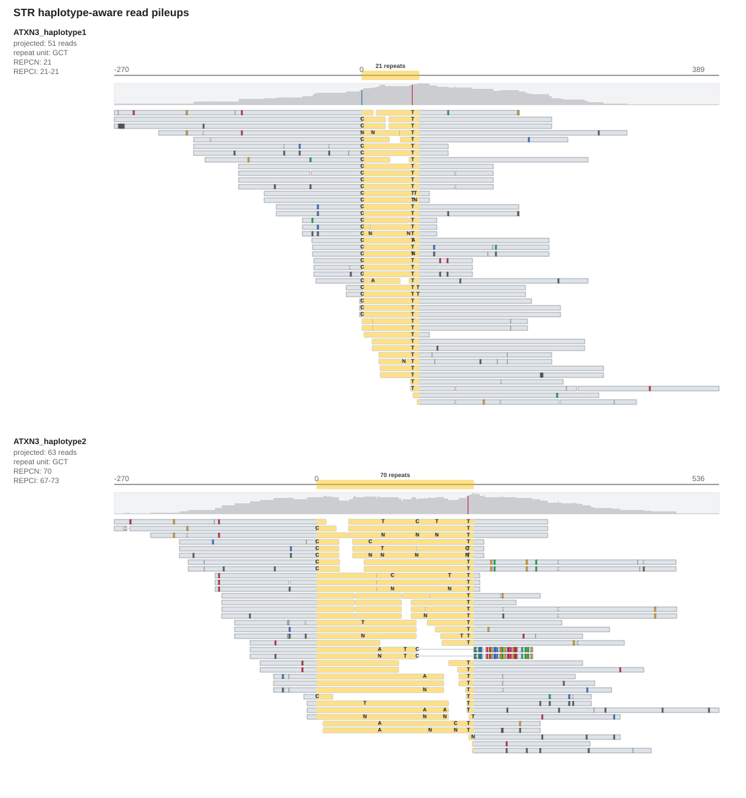
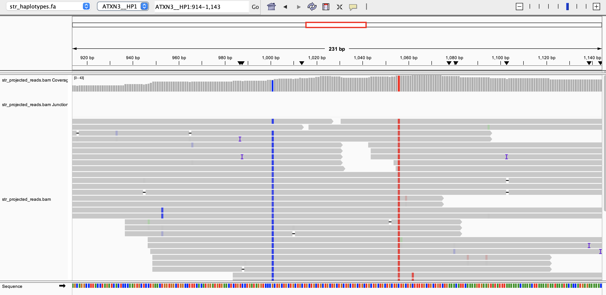

# File formats

This page describes the tool-specific input/output formats of the STR Caller.
Running the caller, its inputs and outputs, and CLI options are on the [STR caller](usage-str-caller.md) page; run-level metric schemas are on the [Metrics](metrics.md) page.

## STR catalog

The STR Caller uses a versioned JSON catalog to define the repeat loci analyzed by each release.
The packaged *hg38.full_repeat_catalog.json* catalog contains the supported hg38 loci listed in [Shipped catalog loci](../README.md#shipped-catalog-loci).
The development team creates each definition by recording the locus identifier, repeat structure, hg38 reference coordinates, variant identifiers and types, and any off-target regions needed for repeat recruitment.
The definitions are reviewed against the reference build before they are included in a release, and the catalog is versioned with the STR Caller release.
The caller uses the packaged catalog automatically.

A catalog file is a JSON array whose entries specify the individual loci the caller analyzes.

Each entry has the following fields:

| Field | Meaning                                                                                                                |
|:------|:-----------------------------------------------------------------------------------------------------------------------|
| LocusId | Unique identifier for the locus.                                                                                       |
| LocusStructure | Regular-expression-like description of the locus structure, using repeat units in parentheses (for example, `(CAG)*`). |
| ReferenceRegion | Reference region(s) of the repeat, as a string or array of `chrom:start-end` (0-based, half-open).                     |
| VariantId | Optional identifier(s) for the variant(s) at the locus; one per repeat in `LocusStructure`.                            |
| VariantType | Type(s) of each variant: `Repeat`, `RareRepeat`, `RepeatFXN`, or `RareRepeatFXN`.                                      |
| OfftargetRegions | Optional off-target regions used for `RareRepeat` recruitment; a value of `"*"` also includes unmapped reads.          |

Example:

```json
[
  {
    "LocusId": "HTT",
    "LocusStructure": "(CAG)*",
    "ReferenceRegion": "chr4:3074876-3074933",
    "VariantId": "HTT",
    "VariantType": "Repeat"
  }
]
```

For multi-repeat loci, `VariantId` and `VariantType` are arrays whose order matches the repeats in `LocusStructure`.
When a locus contains a single variant, there is no difference between the variant and the locus containing it, so the field names refer to the variant itself.

### Using regular expressions to define locus structure

`LocusStructure` describes the repeat structure with a regular-expression-like syntax.

| Variant | Regular expression |
|:--------|:-------------------|
| Short tandem repeat that can occur 0 or more times | `(CCG)*` |
| Short tandem repeat that can occur 1 or more times | `(CCG)+` |

For example, a CAG repeat that can occur 1 or more times, flanked by `CTGT` and then a CCG repeat that can occur 0 or more times, is written as `(CAG)+CTGT(CCG)*`.

## STR VCF output

Applies to: `str_caller`.

The caller writes one VCF record per repeat. The file follows the VCF specification; the custom header lines, symbolic alleles, and fields below are specific to this module.

### Header lines

The header records the resolved input resources used for the run, including resources that were defaulted or auto-resolved rather than passed explicitly.

| Header | Meaning |
|:-------|:--------|
| ##ReferenceFile | Path to the reference FASTA used for the analysis. |
| ##StrCatalog | Path to the STR repeat catalog used for the analysis. |

### ALT alleles

Genotypes are reported with symbolic alleles of the form `<STRn>`, where `n` is the number of repeat units of the repeat unit given by the `RU` INFO field.
For example, `<STR5>` with `RU=GCC` denotes the repeat sequence `GCCGCCGCCGCCGCC`.
The `REF` allele is the reference base immediately before the repeat region (the last base of the left flank).

### INFO fields

| Field | Meaning |
|:------|:--------|
| END | End position of the reference repeat region (e.g., `63912726`). |
| REF | Number of repeat units in the reference (e.g., `4`). |
| RL | Repeat length in reference (bp) (e.g., `12`). |
| RU | Repeat unit sequence (e.g., `GCC`). |
| VARID | Variant identifier (e.g., `ATXN7_GCC`). |
| REPID | Locus identifier (e.g., `ATXN7`). |

### FORMAT fields

| Field | Meaning |
|:------|:--------|
| GT | Genotype (e.g., `0/1`). |
| SO | Support origin of each allele (`SPANNING`, `INREPEAT`, `FLANKING`) (e.g., `SPANNING/SPANNING`). |
| REPCN | Estimated repeat copy number for each allele (e.g., `4/5`). |
| REPCI | Confidence interval for the estimated repeat copy number for each allele (e.g., `4-4/5-5`). |
| ADSP | Number of supporting spanning reads for each allele (e.g., `11/14`). |
| ADFL | Number of supporting flanking reads for each allele (e.g., `4/4`). |
| ADIR | Number of supporting in-repeat reads for each allele (e.g., `0/0`). |
| LC | Total number of reads used for genotyping (locus coverage) (e.g., `29`). |
| LocusSequenceVariant | Present only with `--call-str-region-variants`. Indicates whether at least one SNV was called for the catalog locus: `LocusSequenceVariant` indicates a call, and `.` indicates none. See the companion [STR-region variant VCF output](#str-region-variant-vcf-output) for the individual calls. |

Example record:

```text
chr3    63912714    ATXN7   A   <STR5>  .   PASS    END=63912726;REF=4;RL=12;RU=GCC;VARID=ATXN7_GCC;REPID=ATXN7    GT:SO:REPCN:REPCI:ADSP:ADFL:ADIR:LC    0/1:SPANNING/SPANNING:4/5:4-4/5-5:11/14:4/4:0/0:29
```

This record contains one reference allele (`A`), which in this case is defined as the reference base prior to the start of the repeat region (the last base of the left flanking region).
There is also one allele with 5 repeat units of GCC denoted by `<STR5>`.
The repeat unit is GCC (the `RU` INFO field), so the sequence of the repeat allele is `GCCGCCGCCGCCGCC`.
The repeat spans 4 repeat units in the reference (the `REF` INFO field).
The length of the short allele was estimated from spanning reads (`SPANNING`).
There are 11 spanning and 4 flanking reads consistent with the repeat allele of size 5 (the 4 flanking reads overlap at most 5 repeat units) and there are 0 in-repeat reads consistent with the repeat allele of size 5.
For the reference repeat of 4 there are 11 spanning, 4 flanking, and 0 in-repeat reads consistent with it.

When `--call-str-region-variants` is enabled, `LocusSequenceVariant` is added to the FORMAT column and the sample column of the repeat VCF.
It is a locus-level presence indicator rather than a description of the individual variant.

## Pileup visualization SVG output

Applies to: `str_caller --add-pileup-visualization`.

The caller writes one `<output-dir>/pileups/<locus>.svg` file for every selected locus with visualization data.
Each file shows locally realigned reads projected onto the haplotype contigs constructed from the called STR genotype.
Use `--pileup-visualization-loci` to limit the SVG files to specific catalog loci.



This ATXN3 example contains separate panels for two constructed haplotypes.
Each panel identifies the haplotype, the number of projected reads, the repeat unit, the reported repeat copy number (`REPCN`), and its confidence interval (`REPCI`).
The yellow band marks the repeat interval, the gray histogram shows read coverage across the displayed contig, and the horizontal bars show the projected reads.
Base letters mark mismatching bases observed within repeat regions; non-repeat mismatches are shown as colored read segments.
`N` is an ambiguous or unknown base in a projected read and is shown in gray.

## IGV visualization files

Applies to: `str_caller --add-outputs-for-igv`.

The caller writes a projected haplotype reference and projected-read alignment files under `<output-dir>/pileups/`.
Use these files together to inspect the locally realigned reads in IGV:

1. Load *str_haplotypes.fa* as the genome, with *str_haplotypes.fa.fai* in the same directory.
2. Load *str_projected_reads.bam*, with *str_projected_reads.bam.bai* in the same directory.
3. Select a haplotype contig for the locus of interest in IGV.

The projected-read BAM is aligned to the generated haplotype contigs, not directly to the original reference genome.
Load the generated FASTA before loading the BAM so that IGV uses the matching contigs.
Use `--add-pileup-visualization` as well to produce static SVG pileups for the same analysis.



This example shows projected-read coverage and alignments for the `ATXN3__HP1` haplotype contig in IGV.

## STR-region variant VCF output

Applies to: `str_caller --call-str-region-variants`.

The experimental small-variant output is written as `<output-dir>/str-region-variants.vcf.gz`, with a tabix index at
`<output-dir>/str-region-variants.vcf.gz.tbi`.
It contains SNVs and indels called from projected haplotype pileups inside and around STR loci.
Flank records use the genome reference base, while repeat records use the allele-specific haplotype-contig base.

### STR-region INFO fields

| Field | Meaning |
|:------|:--------|
| REPID | Locus identifier from the STR catalog. |
| STR_REGION | Region of the STR locus containing the variant: `FLANK` or `REPEAT`. |
| VKIND | Variant kind: `SNV`, `INS`, or `DEL`. |
| RUOFF | For `REPEAT` variants, the 0-based offset from the repeat start in the allele-specific haplotype contig. This field is absent for `FLANK` variants. |

### STR-region FORMAT fields

| Field | Meaning |
|:------|:--------|
| GT | Diploid genotype for the called small variant. |
| AF | Maximum confidence-weighted alternate-allele fraction across the haplotypes. |
| DP | Maximum confidence-weighted read depth across the haplotypes. |

## STR JSON output

Applies to: `str_caller`.

The JSON output records information about the sample parameters (`SampleParameters` field) and analysis results summarized by locus (`LocusResults` field).
The locus results contain these fields:

| Field | Meaning |
|:------|:--------|
| Variants | Genotypes and other information describing each variant analyzed at the locus. |
| AlleleCount | The expected number of alleles. |
| Depth | Estimated read coverage. |
| LocusId | Locus identifier. |
| ReadLength | Mean read length. |

Example JSON record:

```json
{
  "LocusResults": {
    "STR": {
      "LocusId": "STR",
      "Variants": {
        "STR_chr1:2005-2008": {
          "AlleleCount": 2,
          "CountsOfFlankingReads": "(1, 1), (2, 2), (3, 2), (6, 1), (8, 2), (9, 1), (10, 2)",
          "CountsOfInrepeatReads": "()",
          "CountsOfSpanningReads": "(2, 22), (10, 21)",
          "Depth": 54,
          "Genotype": "2/10",
          "GenotypeConfidenceInterval": "2-2/10-10",
          "ReadLength": 149,
          "ReferenceRegion": "chr1:2005-2008",
          "RepeatUnit": "CAG",
          "VariantId": "STR_chr1:2005-2008",
          "VariantType": "repeat"
        }
      }
    }
  },
  "SampleParameters": {
    "SampleId": "sample_variants",
    "Sex": "female"
  }
}
```

Back to [Output](usage-str-caller.md#output).
