# Tumor Fraction Estimator

## Guide contents

- [Overview](#overview): module purpose, subcommands, and system requirements.
- [Usage](docs/usage.md): subcommand entry points and links to the full command guides.
  - [Estimate tumor fraction](docs/usage-tumor-fraction.md): estimating tumor fraction from somatic variant sites, inputs, outputs, and tips.
  - [Estimate contamination](docs/usage-contamination.md): estimating cross-sample contamination from population SNP sites, inputs, outputs, and tips.
- [File formats](docs/file-formats.md): schemas for the results, counts, and read-feature output files.
- [Troubleshooting](docs/troubleshooting.md): common issues and resolutions.
- [Appendix](docs/appendix.md): noise probe generation, filter definitions, concepts, and terminology.
- [Release notes](CHANGELOG.md): notable changes by version.

## Overview

The Tumor Fraction Estimator (TFE) quantifies the fraction of tumor-derived DNA in a sequencing sample.
It operates on aligned reads and a set of known variant sites, counting reference and alternate allele observations at each site, applying read-level and variant-level filters, and deriving a tumor fraction estimate from the aggregate variant allele frequencies.

At a glance: **BAM + variant VCF + reference** -> **tumor fraction (or contamination fraction) estimate, per-variant counts, and summary metrics**.

TFE provides two subcommands.
Both share the same analytical engine and differ only in the input variant set, default filter thresholds, and output labels.

- `tumor-fraction` estimates tumor fraction from somatic variant sites in cell-free DNA (cfDNA) sequencing data.
- `contamination` estimates cross-sample contamination using population SNP sites.
  A bundled population SNP VCF (1000 Genomes, GRCh38, biallelic SNVs with AF 0.45 to 0.55) is used by default.
  Base observations are selected by the YC-tag base category, with concordant bases used by default.

### Noise estimation

Add `--enable-noise-estimation` to either subcommand to measure the baseline sequencing error rate at runtime.
When enabled, TFE generates control positions ("noise probe sites") near each query variant and reports a separate noise fraction alongside the tumor fraction.
See [Noise probe generation](docs/appendix.md#noise-probe-generation) for details.

### Example applications

Expand an example below to see the typical use case, the matching command guide, and a representative command.

Tumor fraction from a cfDNA sample with a matched somatic VCF

- **Data type:** cfDNA BAM plus a somatic SNV VCF with tumor and normal samples.
- **Objective:** Estimate the fraction of circulating tumor DNA from the somatic variant sites.
- **Usage page:** [`tumor-fraction` example command](docs/usage-tumor-fraction.md#example-command).
- **Command:** `tumor_fraction_estimator tumor-fraction`

Cross-sample contamination screening

- **Data type:** Any aligned BAM, with or without a matched VCF.
- **Objective:** Estimate cross-sample contamination from population SNP sites using the bundled 1000 Genomes VCF.
- **Usage page:** [`contamination` example command](docs/usage-contamination.md#example-command).
- **Command:** `tumor_fraction_estimator contamination`

### System requirements

| | Requirements |
|:--|:--------------|
| CPU | Utilization scales well up to 8 cores on a modern fourth-generation Intel Xeon or fourth-generation AMD EPYC CPU. |
| Memory | At least 16 GiB with 8 threads. Memory usage scales with the number of query variants and coverage depth. |
