# Appendix

## Concepts and terminology

| Term | Definition |
|:------|:------------|
| Tumor fraction | The proportion of circulating tumor DNA (ctDNA) in a cfDNA sample, estimated as `2 * mean_vaf`. |
| Contamination fraction | The proportion of cross-sample contamination, estimated identically to tumor fraction but from population SNP sites. |
| Noise probe site | A reference-matching genomic position near a query variant, used to estimate the baseline sequencing noise rate. Probes share the same reference allele and trinucleotide context as the query variant. |
| Variant allele frequency (VAF) | The fraction of reads supporting the alternate allele at a given variant site: `alt_count / depth`. |
| Systematic noise | Recurrent technical artifacts at specific genomic positions, provided as a TSV file and excluded from analysis. |
| Pileup | The set of aligned reads overlapping a specific genomic position, used to count allele observations. |

## Noise probe generation

Noise probe generation runs only when `--enable-noise-estimation` is set.
For each passing query variant, nearby reference-matching positions are sampled as noise probe sites to estimate the baseline sequencing error rate.

- Up to 200 000 noise probe sites are generated, distributed proportionally across passing variants.
- Probes are placed at least 200 bp away from the query variant.
- Probes must share the same reference allele and trinucleotide context as the query variant.

The noise probe sites are processed through the same pileup and filtering steps as the query variants, and a separate noise fraction is reported in the [results file](file-formats.md#results-file).

## Filters

The filter pipeline applies filters at several stages, from whole-variant checks before pileup through per-read and per-site checks during and after pileup.

### Variant-level filters

The following filters are applied to each query VCF record before pileup.
A variant that fails any filter is excluded from the tumor fraction calculation but is still reported in the [counts file](file-formats.md#counts-file) with its filter status.

| Filter status | Condition |
|:---------------|:-----------|
| Pass | Variant passed all filters. |
| NonSNP | Variant is not a single-nucleotide polymorphism. |
| HighNormalAD | Normal sample alt allele depth exceeds `--max-normal-ad`. |
| LowTumorAF | Tumor allele frequency from the input VCF is below `--min-tumor-af`. |
| ExcludedRegion | Variant falls outside the included regions. |
| SystematicNoise | Variant matches an entry in the systematic noise file. |
| NoiseProbeOverlappingQueryVariant | Noise probe site overlaps with a query variant (noise probes only). |

### Read-level filters

Before any read-level filtering, secondary, supplementary, duplicate, unmapped, and QC-failed alignments (SAM flags `SECONDARY`, `SUPPLEMENTARY`, `DUP`, `UNMAP`, `QCFAIL`) are skipped during pileup and do not contribute to depth or allele counting.
This behavior is not configurable.

The following filters are applied to each remaining alignment overlapping a variant site during pileup.
Reads that fail any filter are excluded from allele counting but their filter category is tracked in the counts file.

| Filter status | Condition |
|:---------------|:-----------|
| MeanBaseQual | Mean base quality of the read is below `--min-mean-base-quality`. |
| MappingQual | Mapping quality is below `--min-mapping-quality`. |
| MismatchCount | Number of mismatches in the read exceeds `--max-mismatch` (or `--max-high-base-quality-mismatch`). |
| SoftclipLength | Softclip length exceeds `--max-softclip-length`. |

### Base-level filters

These filters evaluate the read at a specific query position.
A read can pass read-level filters but still be excluded at a particular site based on local sequence context.

| Filter status | Condition |
|:---------------|:-----------|
| BaseQual | Base quality at the query position is below `--min-base-quality`, or the base type is below `--min-base-type` in contamination mode. All bases in a read without a YC tag are treated as simplex. |
| Homopolymer | Query position is within `--homopolymer-search-radius` bases of a low-quality homopolymer base. |
| ReadEnd | Query position falls within `--ignore-start` or `--ignore-end` bases of the read. |
| IndelProximity | Query position is within `--min-distance-to-indel` of an indel, or the base is a deletion. |

### Pileup filters

The following filters are applied after pileup and allele counting at each site.
A site that fails any filter is excluded from the tumor fraction calculation but is still reported in the counts file with its filter status.

| Filter status | Condition |
|:---------------|:-----------|
| LowCoverage | Depth at the variant site is below `--min-coverage`. |
| HighCoverage | Depth at the variant site exceeds `--max-coverage`. |
| HighObservedAltVAF | Observed VAF of the query alt allele exceeds `--max-observed-vaf`. |
| HighObservedNonQueryAltVAF | Observed VAF of non-query alternate alleles exceeds `--max-observed-vaf`. |
| HighAltCoverage | Read count supporting the ALT allele exceeds `--max-alt-coverage`. |

### Low-quality alt filters

These filters remove low-quality reads supporting the ALT allele at a site without filtering the entire site.
The site remains Pass and continues to contribute reference depth to the estimation.
The removed alt read counts are reported in the `filtered_low_quality_alts_*` metrics and `low_quality_alt_*` counts columns.

| Filter status | Condition |
|:---------------|:-----------|
| HighLowQualityAltPercentage | Fraction of low base-quality alt reads at the site exceeds `--max-low-quality-alt-fraction`. |
| HighFilteredAltPercentage | Alt reads removed by observation filters are greater than or equal to 30% of the site's post-filter depth. |
