# Estimate contamination

## How it works

The `contamination` subcommand estimates cross-sample contamination.
It uses the same analytical engine as [`tumor-fraction`](usage-tumor-fraction.md) but with stricter default filters and a bundled population SNP VCF.

This subcommand uses `--min-base-type simplex`, `--min-base-quality 39`, and `--min-mapping-quality 60` by default.



Expand the details below for the full processing sequence.

<details>
<summary>Show the algorithm design.</summary>

The `contamination` and `tumor-fraction` subcommands share the same processing sequence.

1. **VCF parsing**: PASS-filtered SNV records are extracted from the input VCF.
   Normal allelic depth (`AD`) and tumor AF (`AF`) filters are applied when the format fields are present.
2. **Region filtering**: Variants are filtered against the included-regions BED and systematic noise file (if provided).
3. **Noise probe generation** (when `--enable-noise-estimation` is set): For each passing query variant, nearby reference-matching positions are sampled as noise probe sites.
   See [Noise probe generation](appendix.md#noise-probe-generation).
4. **Parallel pileup**: The BAM file is queried at each variant and noise probe position using one worker per thread.
   Each worker creates pileup objects for the genomic positions overlapping the variant, stores depth and alignment pointers, and applies read-level filters to each overlapping alignment.
5. **Allele counting**: For each variant site, reference, alternate, and other-alt allele counts are accumulated from observations that meet the configured base-type threshold and pass all other filters.
6. **Estimation**: Contamination fraction (or tumor fraction) is computed as `2 * mean_vaf` across all passing variant sites.
   When noise estimation is enabled, the noise rate is computed independently from the noise probe sites.
7. **Output**: Results and per-variant counts are written to TSV files with metadata headers.

</details>

## Example command

Using the bundled population SNP VCF (default):

```bash
tumor_fraction_estimator contamination \
  --bam /path/to/input.bam \
  --reference /path/to/reference.fa \
  --included-regions-bed /resources/GRCh38_GIAB_highconf.notinalldifficultregions.noY.bed \
  --output-dir /path/to/output \
  --enable-noise-estimation \
  --threads 8
```

Using a custom population SNP VCF:

```bash
tumor_fraction_estimator contamination \
  --bam /path/to/input.bam \
  --query-vcf /path/to/custom_population_snps.vcf.gz \
  --reference /path/to/reference.fa \
  --included-regions-bed /resources/GRCh38_GIAB_highconf.notinalldifficultregions.noY.bed \
  --output-dir /path/to/output \
  --enable-noise-estimation \
  --threads 8
```

The bundled VCF is located at *resources/ALL.autosomal.shapeit2_integrated_biallelic_snv_v2a_27022019.GRCh38.phased.AF_0.45_0.55.vcf.gz* inside the container image.
It contains biallelic autosomal SNVs from the 1000 Genomes Project (GRCh38) filtered to population allele frequencies between 0.45 and 0.55.

## Input

| Input | Required | Notes |
|:------|:---------|:------|
| BAM file | Yes | Coordinate-sorted and indexed BAM file (`.bam` with `.bai` index) passed with `--bam`. |
| Population SNP VCF | No | Population SNP VCF (`.vcf` or `.vcf.gz`) passed with `--query-vcf`. If not provided, the bundled 1000 Genomes VCF is used. |
| Reference FASTA | Yes | Reference genome FASTA with an associated `.fai` index passed with `--reference`. |
| Included-regions BED | Yes | Regions to include in analysis passed with `--included-regions-bed`. A bundled BED is provided at *resources/GRCh38_GIAB_highconf.notinalldifficultregions.noY.bed* inside the container image. It contains the intersection of GIAB HG001-HG007's high-confidence regions after excluding difficult-to-map regions and the Y chromosome. |
| Systematic noise TSV | No | Pre-computed recurrent technical artifacts passed with `--systematic-noise-tsv`, same as for `tumor-fraction`. See [Systematic noise TSV](file-formats.md#systematic-noise-tsv). |

## Output

Output files are written to the directory specified by `--output-dir` (default: current directory).
If the directory does not exist, it is created.
TFE exits with an error if any output file already exists unless `--overwrite` is set.
When `--output-prefix` is set, all output filenames are prefixed with the given string joined by an underscore.

| Output | Description |
|:-------|:------------|
| *contamination_estimation_results.tsv* | Summary metrics with `contamination_fraction` in place of `tumor_fraction`. See [Results file](file-formats.md#results-file). |
| *metrics/per_site_counts.tsv* | Per-variant allele counts, filter status, and sequence context. See [Counts file](file-formats.md#counts-file). |
| *metrics/read_features.tsv* | Per-read feature table. Written only when `--save-read-features` is set. See [Read features file](file-formats.md#read-features-file). |

The file formats are identical to the tumor fraction output.
The only difference is that the primary metric is labeled `contamination_fraction` in the results file.

## Tips for analysis

Expand the details below for practical analysis recommendations and common pitfalls.

<details>
<summary>Show tips for analysis.</summary>

- The default population SNP VCF path assumes the container image layout. When running outside Docker, provide `--query-vcf` explicitly.
- Use `--min-base-type simplex` for simplex reads or consensus reads without YC tags. Use `--min-base-type concordant` for duplex reads with YC tags. The default is `simplex`.
- The existing `--min-base-quality 39` default remains in effect as an additional numeric quality filter.
- The stricter default `--min-mapping-quality` reduces noise from low-quality alignments. Lower it only when the analysis calls for it.
- Use `--enable-noise-estimation` to obtain a baseline noise fraction for comparison against the estimated contamination fraction.

</details>


The reporting limit for contamination estimation is 0.0001 (0.01%). Contamination fractions below this threshold cannot be reliably measured with enough precision are reported as `<0.0001` instead of a numeric value.


## CLI options

Required parameters are highlighted in **bold**.
This command also accepts the common `-h, --help`, `-v, --version`, and `-l, --log-level` options.

The query VCF filter options (`--tumor-sample-name`, `--normal-sample-name`, `--max-normal-ad`, `--min-tumor-af`) are only available for [`tumor-fraction`](usage-tumor-fraction.md#cli-options) and do not apply to `contamination`.

### Input options

| Parameter | Description | Value(s) |
|:-----------|:-------------|:----------|
| **--bam** | Path to the BAM file. Must be coordinate-sorted and indexed. | File path (must have `.bam` extension) |
| --query-vcf | Path to the population SNP query variant file in VCF format. Optional; defaults to the bundled population SNP VCF. | File path (`.vcf` or `.vcf.gz`) |
| **--reference** | Path to reference genome FASTA file with an associated `.fai` index. | File path |
| --systematic-noise-tsv | Path to systematic noise variants in tab-delimited format (chrom, pos, ref, alt). The `pos` column must use 1-based VCF coordinates. Plain-text, gzip (`.gz`), and bgzip are accepted; if the file is bgzipped and a tabix/CSI index (`.tbi`/`.csi`) is present, only the blocks overlapping candidate positions are read. | File path |

### Output options

| Parameter | Description | Value(s) |
|:-----------|:-------------|:----------|
| --output-dir | Output directory. | Directory path [default: `.`] |
| --output-prefix | Prefix prepended to all output filenames (e.g. a sample ID), joined with an underscore. If unset, default filenames are used. | String |
| --overwrite | Overwrite existing output files. | No value (flag) |

### Region options

| Parameter | Description | Value(s) |
|:-----------|:-------------|:----------|
| **--included-regions-bed** | Path to regions to include in analysis. A bundled BED is provided at *resources/GRCh38_GIAB_highconf.notinalldifficultregions.noY.bed*. | File path (`.bed`) |

### Read filtering options

These filters evaluate whole-read properties.
A read that fails any of these filters is excluded from allele counting at all variant sites it overlaps.

| Parameter | Description | Value(s) |
|:-----------|:-------------|:----------|
| --min-mapping-quality | Minimum mapping quality for a read to be considered. | Integer [default: 60] |
| --min-mean-base-quality | Minimum mean base quality for a read to be considered. | Float [default: 15.0] |
| --max-mismatch | Maximum number of mismatches (NM tag) for a read to be considered. | Integer [default: 5] |
| --max-high-base-quality-mismatch | Maximum number of high base-quality mismatches for a read to be considered. | Integer [default: 0] |
| --max-softclip-length | Maximum softclip length allowed in a read. | Integer [default: 0] |

### Base filtering options

These filters evaluate the read at a specific query position.
A read can pass read filters but still be excluded at a particular site based on local sequence context.

| Parameter | Description | Value(s) |
|:-----------|:-------------|:----------|
| --min-base-quality | Minimum base quality at the query position for a read to support the site. | Integer [default: 39] |
| --min-base-type | Minimum base type for an observation to support the site. Base types are ordered from lowest to highest confidence as `discordant`, `simplex`, and `concordant`. Reads without a YC tag are treated as simplex. | `discordant`, `simplex`, or `concordant` [default: `simplex`] |
| --ignore-start | Number of bases to ignore at the start of a read. Observations within this range are excluded. | Integer [default: 5] |
| --ignore-end | Number of bases to ignore at the end of a read. Observations within this range are excluded. | Integer [default: 5] |
| --min-distance-to-indel | Minimum distance between the query position and an indel in the read alignment. Reads with a closer indel are excluded. Observations within softclipped regions are always excluded. | Integer [default: 0] |
| --homopolymer-search-radius | Number of bases to search around the query position for homopolymer-induced errors. | Integer [default: 5] |

### Pileup filter options

These filters evaluate aggregate counts at a site after all reads have been processed.
A site that fails any of these filters is excluded from the contamination fraction calculation but is still reported in the counts file.

| Parameter | Description | Value(s) |
|:-----------|:-------------|:----------|
| --min-coverage | Minimum read depth at a site. | Integer [default: 10] |
| --max-coverage | Maximum read depth at a site. | Integer [default: 300] |
| --max-alt-coverage | Maximum alt read depth at a site. | Integer [default: 1] |
| --max-observed-vaf | Maximum observed variant allele frequency at a site. Sites exceeding this threshold are excluded. | Float [default: 0.1] |

### Low-quality alt filter options

These filters remove low-quality reads supporting the ALT allele at a site without discarding the entire site, so it still contributes reference depth to the estimation.

| Parameter | Description | Value(s) |
|:-----------|:-------------|:----------|
| --max-low-quality-alt-fraction | Maximum fraction of low base-quality alt reads at a site. | Float [default: 0.6, range: 0.0 to 1.0] |

### Noise estimation options

These options control the generation and analysis of noise probe sites used to estimate the baseline sequencing error rate.

| Parameter | Description | Value(s) |
|:-----------|:-------------|:----------|
| --noise-to-tumor-ratio | Noise-to-tumor ratio for noise estimation. | Integer [default: 1] |
| --max-noise-reads | Maximum noise reads to consider for noise estimation. | Integer [default: 0] |
| --enable-noise-estimation | Enable baseline noise estimation in the sample. | No value (flag) |

### Performance options

| Parameter | Description | Value(s) |
|:-----------|:-------------|:----------|
| --threads | Number of threads. Set to 0 to use all available hardware threads. | Non-negative integer [default: 1] |

### Developer options

| Parameter | Description | Value(s) |
|:-----------|:-------------|:----------|
| --write-read-features | Write per-read feature TSV to the output directory. | No value (flag) |
