# Estimate tumor fraction

## How it works

The `tumor-fraction` subcommand estimates tumor fraction from a BAM file and a somatic variant VCF.
It counts reference and alternate alleles at each PASS-filtered somatic SNV site, applies the read-level, base-level, and pileup filters, and estimates the tumor fraction as `2 * mean_vaf` across all passing sites.

This subcommand uses `--min-base-quality 29` and `--min-mapping-quality 10` by default.



Expand the details below for the full processing sequence.

<details>
<summary>Show the algorithm design.</summary>

The `tumor-fraction` and `contamination` subcommands share the same processing sequence.

1. **VCF parsing**: PASS-filtered SNV records are extracted from the input VCF.
   Normal allelic depth (`AD`) and tumor AF (`AF`) filters are applied when the format fields are present.
2. **Region filtering**: Variants are filtered against the included-regions BED and systematic noise file (if provided).
3. **Noise probe generation** (when `--enable-noise-estimation` is set): For each passing query variant, nearby reference-matching positions are sampled as noise probe sites.
   See [Noise probe generation](appendix.md#noise-probe-generation).
4. **Parallel pileup**: The BAM file is queried at each variant and noise probe position using one worker per thread.
   Each worker creates pileup objects for the genomic positions overlapping the variant, stores depth and alignment pointers, and applies read-level filters to each overlapping alignment.
5. **Allele counting**: For each variant site, reference, alternate, and other-alt allele counts are accumulated from reads that pass all read-level filters.
6. **Estimation**: Tumor fraction (or contamination fraction) is computed as `2 * mean_vaf` across all passing variant sites.
   When noise estimation is enabled, the noise rate is computed independently from the noise probe sites.
7. **Output**: Results and per-variant counts are written to TSV files with metadata headers.

</details>

## Example command

```bash
tumor_fraction_estimator tumor-fraction \
  --bam /path/to/input.bam \
  --query-vcf /path/to/somatic_variants.vcf \
  --tumor-sample-name TUMOR \
  --normal-sample-name NORMAL \
  --reference /path/to/reference.fa \
  --included-regions-bed /resources/GRCh38_GIAB_highconf.notinalldifficultregions.noY.bed \
  --systematic-noise-tsv tumor_fraction_estimator/g1.noN.pon.tsv.gz \
  --output-dir /path/to/output \
  --enable-noise-estimation \
  --threads 8
```

Add `--enable-noise-estimation` to also generate noise probe sites and report a baseline noise fraction alongside the tumor fraction.

## Input

| Input | Required | Notes |
|:------|:---------|:------|
| BAM file | Yes | Coordinate-sorted and indexed BAM file (`.bam` with `.bai` index) passed with `--bam`. |
| Somatic VCF | Yes | Somatic variant file (`.vcf` or `.vcf.gz`) passed with `--query-vcf`. Expected to contain PASS-filtered SNVs. |
| Reference FASTA | Yes | Reference genome FASTA with an associated `.fai` index passed with `--reference`. |
| Included-regions BED | Yes | Regions to include in analysis passed with `--included-regions-bed`. A bundled BED is provided at *resources/GRCh38_GIAB_highconf.notinalldifficultregions.noY.bed* inside the container image. It contains the intersection of GIAB HG001-HG007's high-confidence regions after excluding difficult-to-map regions and the Y chromosome. |
| Systematic noise TSV | No | Pre-computed recurrent technical artifacts passed with `--systematic-noise-tsv`. The recommended 5 GB file is provided through the XOOS resource bundle at `tumor_fraction_estimator/g1.noN.pon.tsv.gz`; it is not included in the Docker image. See [Systematic noise TSV](file-formats.md#systematic-noise-tsv). |

Samples are selected by header name via `--tumor-sample-name` (required) and `--normal-sample-name` (optional), so the VCF columns may be in any order.
A named sample missing from the header is a fatal error.
The `AD` and `AF` format fields are used for normal-AD and tumor-AF filtering when present.

## Output

Output files are written to the directory specified by `--output-dir` (default: current directory).
If the directory does not exist, it is created.
TFE exits with an error if any output file already exists unless `--overwrite` is set.
When `--output-prefix` is set, all output filenames are prefixed with the given string joined by an underscore.

| Output | Description |
|:-------|:------------|
| *tumor_fraction_estimation_results.tsv* | Summary metrics including tumor fraction, mean VAF, and variant filter counts. See [Results file](file-formats.md#results-file). |
| *metrics/per_site_counts.tsv* | Per-variant allele counts, filter status, and sequence context. See [Counts file](file-formats.md#counts-file). |
| *metrics/read_features.tsv* | Per-read feature table. Written only when `--write-read-features` is set. See [Read features file](file-formats.md#read-features-file). |

Both TSV files include a metadata header with the command-line invocation.

## Tips for analysis

Expand the details below for practical analysis recommendations and common pitfalls.

<details>
<summary>Show tips for analysis.</summary>

- Confirm the BAM, VCF, and reference all use the same reference genome and coordinate system.
- Provide `--normal-sample-name` when a matched normal is available so germline sites can be removed by the normal-AD filter.
- Use `--enable-noise-estimation` to obtain a baseline noise fraction for comparison against the estimated tumor fraction.
- The systematic noise TSV excludes known recurrent artifacts. Supply one when working with a panel that has a characterized noise profile.

</details>

## CLI options

Required parameters are highlighted in **bold**.
This command also accepts the common `-h, --help`, `-v, --version`, and `-l, --log-level` options.

### Input options

| Parameter | Description | Value(s) |
|:-----------|:-------------|:----------|
| **--bam** | Path to the BAM file. Must be coordinate-sorted and indexed. | File path (must have `.bam` extension) |
| **--query-vcf** | Path to the somatic query variant file in VCF format. | File path (`.vcf` or `.vcf.gz`) |
| **--reference** | Path to reference genome FASTA file with an associated `.fai` index. | File path |
| --systematic-noise-tsv | Path to systematic noise variants in tab-delimited format (chrom, pos, ref, alt). The `pos` column must use 1-based VCF coordinates. Plain-text, gzip (`.gz`), and bgzip are accepted; if the file is bgzipped and a tabix/CSI index (`.tbi`/`.csi`) is present, only the blocks overlapping candidate positions are read. | File path |

### Output options

| Parameter | Description | Value(s) |
|:-----------|:-------------|:----------|
| --output-dir | Output directory. | Directory path [default: `.`] |
| --output-prefix | Prefix prepended to all output filenames (e.g. a sample ID), joined with an underscore. If unset, default filenames are used. | String |
| --overwrite | Overwrite existing output files. | No value (flag) |

### Region options

| Parameter | Description | Value(s) |
|:-----------|:-------------|:----------|
| **--included-regions-bed** | Path to regions to include in analysis. A bundled BED is provided at *resources/GRCh38_GIAB_highconf.notinalldifficultregions.noY.bed*. | File path (`.bed`) |

### Query VCF filter options

These filters are applied to the input VCF records before pileup.
A variant that fails any of these filters is excluded from the tumor fraction calculation.
The tumor and normal samples are located by their header name via `--tumor-sample-name` and `--normal-sample-name`, so the VCF samples may appear in any order.
The `AD` field is read from the normal sample and the `AF` field is read from the tumor sample.
A named sample that is not present in the VCF header is a fatal error.
Multi-allelic records are split into one bi-allelic record per ALT allele before filtering, so each ALT is evaluated independently with its own per-sample `AD`/`AF` values.
These filters are skipped when the expected fields are not present (`FORMAT/AD` in the normal sample and `FORMAT/AF` in the tumor sample).

| Parameter | Description | Value(s) |
|:-----------|:-------------|:----------|
| --tumor-sample-name | Tumor sample name in the VCF header. Selects the column used for the tumor `AF` filter. | String [required] |
| --normal-sample-name | Normal sample name in the VCF header. Selects the column used for the normal `AD` filter. When omitted, the normal AD filter is skipped. | String [optional] |
| --max-normal-ad | Maximum alt allele depth in the matched normal sample (VCF AD field). Sites exceeding this threshold are classified as germline. | Integer [default: 0] |
| --min-tumor-af | Minimum allele frequency in the tumor sample (AF field) for a site to be considered. | Float [default: 0.1] |

### Read filtering options

These filters evaluate whole-read properties.
A read that fails any of these filters is excluded from allele counting at all variant sites it overlaps.

| Parameter | Description | Value(s) |
|:-----------|:-------------|:----------|
| --min-mapping-quality | Minimum mapping quality for a read to be considered. | Integer [default: 10] |
| --min-mean-base-quality | Minimum mean base quality for a read to be considered. | Float [default: 15.0] |
| --max-mismatch | Maximum number of mismatches (NM tag) for a read to be considered. | Integer [default: 3] |
| --max-high-base-quality-mismatch | Maximum number of high base-quality mismatches for a read to be considered. | Integer [default: 0] |
| --max-softclip-length | Maximum softclip length allowed in a read. | Integer [default: 50] |

### Base filtering options

These filters evaluate the read at a specific query position.
A read can pass read filters but still be excluded at a particular site based on local sequence context.

| Parameter | Description | Value(s) |
|:-----------|:-------------|:----------|
| --min-base-quality | Minimum base quality at the query position for a read to support the site. | Integer [default: 29] |
| --ignore-start | Number of bases to ignore at the start of a read. Observations within this range are excluded. | Integer [default: 5] |
| --ignore-end | Number of bases to ignore at the end of a read. Observations within this range are excluded. | Integer [default: 5] |
| --min-distance-to-indel | Minimum distance between the query position and an indel in the read alignment. Reads with a closer indel are excluded. Observations within softclipped regions are always excluded. | Integer [default: 0] |
| --homopolymer-search-radius | Number of bases to search around the query position for homopolymer-induced errors. | Integer [default: 5] |

### Pileup filter options

These filters evaluate aggregate counts at a site after all reads have been processed.
A site that fails any of these filters is excluded from the tumor fraction calculation but is still reported in the counts file.

| Parameter | Description | Value(s) |
|:-----------|:-------------|:----------|
| --min-coverage | Minimum read depth at a site. | Integer [default: 30] |
| --max-coverage | Maximum read depth at a site. | Integer [default: 300] |
| --max-alt-coverage | Maximum alt read depth at a site. | Integer [default: 1] |
| --max-observed-vaf | Maximum observed variant allele frequency at a site. Sites exceeding this threshold are excluded. | Float [default: 0.1] |

### Low-quality alt filter options

These filters remove low-quality reads supporting the ALT allele at a site without discarding the entire site, so it still contributes reference depth to the estimation.

| Parameter | Description | Value(s) |
|:-----------|:-------------|:----------|
| --max-low-quality-alt-fraction | Maximum fraction of low base-quality alt reads at a site. | Float [default: 0.6, range: 0.0 to 1.0] |

### Noise estimation options

These options control the generation and analysis of noise probe sites used to estimate the baseline sequencing error rate.

| Parameter | Description | Value(s) |
|:-----------|:-------------|:----------|
| --noise-to-tumor-ratio | Noise-to-tumor ratio for noise estimation. | Integer [default: 1] |
| --max-noise-reads | Maximum noise reads to consider for noise estimation. | Integer [default: 0] |
| --enable-noise-estimation | Enable baseline noise estimation in the sample. | No value (flag) |

### Performance options

| Parameter | Description | Value(s) |
|:-----------|:-------------|:----------|
| --threads | Number of threads. Set to 0 to use all available hardware threads. | Non-negative integer [default: 1] |

### Developer options

| Parameter | Description | Value(s) |
|:-----------|:-------------|:----------|
| --write-read-features | Write per-read feature TSV to the output directory. | No value (flag) |
